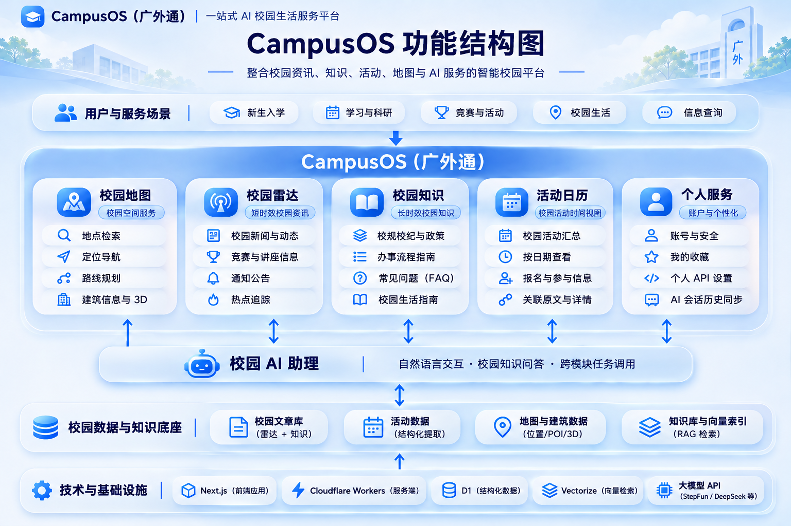
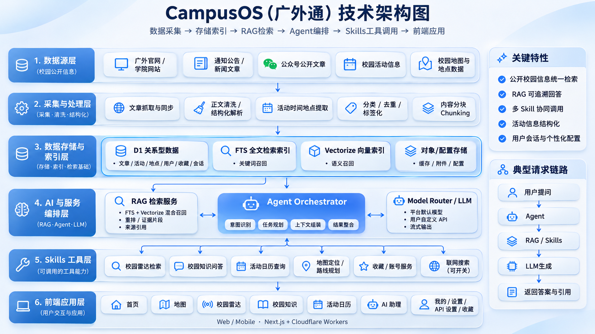
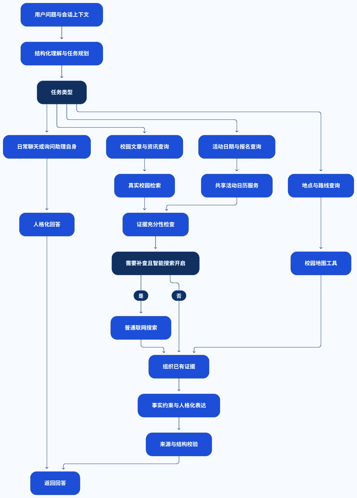

# 广外通 CampusOS

**一站式 AI 校园生活服务平台** —— 把分散在官网、公众号、通知公告和教务系统里的校园信息，收进一个能问、能查、能导航、能办事的入口。

> 广东外语外贸大学第二届 AI 应用创新大赛参赛作品 · 团队「v我50」
> 线上地址：`gdufs.ccwu.cc` ｜ 预发布环境：`campusos-preview.zhujunkui1.workers.dev`



---

## 一、选题背景与需求分析

### 1.1 真实痛点

高校信息不是"没有"，而是"找不到、对不上、信不过"。在广外的日常场景里，这表现为四个具体问题：

| 痛点 | 具体表现 | 后果 |
| --- | --- | --- |
| **信息孤岛** | 政策在官网、通知在OA、活动在公众号、办事指南散落在各学院页面 | 同一个问题要翻 3–5 个站点，还不知道哪个是最新版 |
| **检索失效** | 站内搜索只做标题匹配，自然语言问"校园网怎么开通"返回无关文章 | 学生转而依赖学长口口相传，信息随毕业流失 |
| **时效错位** | 活动、讲座、报名截止时间过期后仍被转发 | 白跑一趟；"报"字标记被误读为"还能报名" |
| **空间断层** | 地图与内容系统互不相通，看到活动不知道在哪栋楼、怎么走 | 新生和访客的导航成本最高 |

通用大模型能缓解"表达"问题，但解决不了"证据"问题：它不知道广外的《学生手册》第几条、不知道图书馆借阅规则、更不知道南苑 7 栋到图书馆要穿过地下隧道。**让 AI 说校园里的真话，必须有一套可追溯的校园数据底座。**

### 1.2 需求定义

由此确定四条产品需求，也构成了本项目的技术约束：

1. **统一入口**：地图、资讯、知识、活动、个人服务在一个 Shell 内切换，跨页面不丢失上下文。
2. **答案可追溯**：每一句涉及规定的回答都必须带原文出处，可点击回到来源；没有证据就说没有。
3. **数据可运营**：来源登记 → 采集 → 审核 → 发布 → 下架，全链路有状态、有审计、可回滚。
4. **权限与成本可控**：公共内容匿名可读，私有数据（收藏、会话、模型密钥）严格隔离；免费额度下可长期运行。

### 1.3 目标用户与场景

- **新生 / 访客**：入学流程、校园地图、宿舍与教学楼导航、办事指南。
- **在校学生**：奖助政策、选课与教务、图书馆、讲座竞赛、活动报名。
- **社团 / 辅导员**：活动发布与日历汇聚，跨栏目检索。
- **学校管理者**：内容中台（Console），来源与发布状态治理。

---

## 二、技术架构设计



### 2.1 六层架构

```
数据源层 → 采集处理层 → 存储索引层 → AI 与服务编排层 → Skills 工具层 → 前端应用层
```

| 层 | 组成 | 关键设计 |
| --- | --- | --- |
| **1. 数据源** | 广外官网 / 学院网站、通知公告、公众号公开文章、校园活动信息、校园地图与地点数据 | 只采集公开信息；来源先登记许可与用途，再入库 |
| **2. 采集与处理** | 文章抓取与同步、正文清洗与结构化解析、活动时间地点提取、分类去重标签化、内容分块 | 抓取与解析分离；正文与元数据分离；未知就标 `unknown`，不猜 |
| **3. 存储与索引** | D1 关系型数据、FTS5 全文索引、Vectorize 向量索引（预留）、对象/配置存储 | **D1 是唯一事实源**；FTS5 做关键词召回；向量检索单独评估、按需启用 |
| **4. AI 编排** | RAG 检索服务、Agent Orchestrator、Model Router / LLM | 意图识别 → 任务规划 → 上下文组装 → 结果整合；多模型优先级链与额度回退 |
| **5. Skills** | 校园雷达检索、校园知识问答、活动日历查询、地图定位/路线规划、收藏/账号服务、联网搜索（可开关） | 每个 Skill 有严格 Schema、权限、副作用、超时与预算；写操作需服务端确认 |
| **6. 前端应用** | 首页、地图、校园雷达、校园知识、活动日历、AI 助理、我的/设置/收藏 | Next.js + Cloudflare Workers，Web / Mobile 响应式 |

### 2.2 技术选型

| 领域 | 选型 | 理由 |
| --- | --- | --- |
| 前端 / 服务端 | Next.js 16 + React 19 + TypeScript 5.9 | 单一代码库同时产出页面与 API，Server Component 降低首屏成本 |
| 运行时 | Cloudflare Workers（OpenNext 适配） | 边缘部署、按需伸缩，免费额度可支撑校园级流量 |
| 数据库 | Cloudflare D1（SQLite）+ 61 份迁移 | 结构化数据与全文索引同库，事务内可做原子额度与权限校验 |
| 全文检索 | SQLite FTS5（`knowledge_chunks` 虚拟表） | 中文关键词 + 分类 + 分段召回，零额外费用，排序可解释 |
| 语义检索 | Vectorize（接口已留，未启用） | 避免在未评估成本前引入不可回退的第二套索引 |
| 地图 | MapLibre GL + 本地 OSM + 自研步行路网 + 3D 建筑 | 底图自托管，不依赖商业地图配额；隧道/连廊等真实连通关系可建模 |
| 模型 | StepFun → DeepSeek 优先级链；支持用户自带 API | 故障与额度耗尽可自动降级；个人 Key 只存服务端 |
| 流式交互 | SSE + 动作回执（Action Receipt） | 前端先收到"意图"，服务端校验后才确认"已执行" |

### 2.3 三条贯穿全局的设计原则

1. **D1 单一事实源**：来源、文章版本、审核状态、片段、引用、索引状态全部在 D1；任何缓存、向量库、外部知识库都只是派生。公开检索每次都要复验"来源许可 + 当前发布态 + 版本 + 生命周期"，下架即失效。
2. **证据先于生成**：模型拿到的是带 `documentId / chunk / 偏移 / 原文 URL` 的证据包，不是"请回答校园问题"的空提示。没有证据时返回真实空结果。
3. **失败不伪装成功**：模型不可用 → 地图与内容页独立可用；检索超时 → 明确说明；动作未回执 → 不说"已完成"。

---

## 三、功能模块说明


### 3.1 五大业务模块

| 模块 | 已实现能力 | 数据来源 |
| --- | --- | --- |
| **校园地图** `/map` | 地点检索、定位导航、步行路线规划、2D/2.5D/3D 视图、建筑信息与模型、附近设施 | 自托管 OSM 校园数据 + 自研路网（含地下隧道）+ MapLibre + Three.js |
| **校园雷达** `/radar` | 校园新闻与动态、竞赛与讲座、通知公告、热点追踪、分类筛选 | 官网 / 学院站 / 公众号公开文章，经审核发布 |
| **校园知识** `/knowledge` | 校规校纪与政策、办事流程指南、FAQ、校园生活指南 | 已发布的制度与指南正文，按知识类别组织 |
| **活动日历** `/calendar` | 活动汇总、按日期查看、报名与参与信息、关联原文详情 | 从文章中结构化抽取的活动时间/地点/报名状态 |
| **个人服务** `/account` | 账号与安全、我的收藏、个人 API 设置、AI 会话历史同步 | D1 用户域，严格 owner 隔离 |

### 3.2 校园 AI 助理（全局）

一个入口贯通五个模块：自然语言提问 → 判定任务类型 → 调用对应 Skill → 带来源作答；地图类问题直接产出可执行的 MapAction。

**已注册的 8 个真实 Skill：**

| 域 | Skill | 作用 |
| --- | --- | --- |
| 知识域 | `search_campus_knowledge` | 查政策、办事流程、借阅、奖助、就业指南，返回证据与来源 |
| 知识域 | `search_external_campus_info` | 内部证据不足时补充联网搜索（可开关，先内后外） |
| 事件域 | `search_campus_events` | 查讲座、竞赛、招聘、科研申报、奖助机会，按活动/报名时间过滤 |
| 空间域 | `search_places` | 校园地点检索，返回真实 `placeId`，模糊时给候选 |
| 空间域 | `get_place_details` | 地点详情、区域、来源与核验状态 |
| 空间域 | `find_nearby_places` | 以建筑/选中地点/授权定位为起点的附近设施 |
| 空间域 | `plan_route` | 基于真实 OSM 路网计算步行路线（跨区走隧道） |
| 空间域 | `control_map` | 生成受校验的地图操作意图：聚焦、详情、显示/清除路线、切换视图 |

> 组合调用已通过真实验收：一条"图书馆新书展在哪、怎么走"的提问会依次触发 `search_campus_events → search_places → plan_route → control_map`，浏览器端 3.6 秒内完成地图落地。

### 3.3 内容中台（Console）

面向运营者的后台：来源登记与许可、抓取任务与租约、文章版本与审核、发布/下架、分类与标签、采集预算与审计。它是"AI 敢说真话"的前提——**没有经过审核与发布的内容，不会进入检索**。

---

## 四、智能体对话逻辑



一次提问的完整链路：

1. **结构化理解与任务规划**：识别意图（闲聊 / 政策查询 / 活动查询 / 地点路线），产出结构化查询与所需证据类型。
2. **分域路由**：按任务类型进入日常问答、校园文章与资讯、活动与报名、地点与路线四条支路；知识域与事件域可**并行预取**。
3. **真实校园检索**：D1 + FTS5 召回候选片段，复验来源许可、发布状态与版本。
4. **证据充分性检查**：不足且"智能搜索"开启时，补一次受控联网搜索；关闭或官方问题则不外扩。
5. **组织证据**：编号、去重、按相关性排序，保留原文链接与发布时间。
6. **事实约束与人格化表达**：只依据证据作答，不确定处显式说明；保持"广外通"的助手人格。
7. **来源与结构校验**：答复必须带引用；地图动作必须来自真实 `placeId` / `routeId`，前端确认后才执行。

配套的工程约束：单轮工具调用上限 4 次、会话历史服务端检索、SSE 可取消、动作回执幂等、每用户额度在 D1 内原子扣减。

---

## 五、复杂技术架构加分说明

评分标准中"多智能体协同 / 多 Skill 集成 / 知识库 RAG"三项各 4 分。本项目的对应实现如下：

| 加分项 | 实现方式 | 代码位置 |
| --- | --- | --- |
| **多智能体协同架构** | 1 个总控 Agent + 4 个专业域（知识 / 空间 / 事件 / 个人）。每个域有独立的 Skill 白名单、权限与预算，总控负责意图识别、任务规划、跨域编排与结果整合；支持多域并行预取 | `src/lib/server/agent/orchestrator.ts`、`domains.ts`、`skill-registry.ts`、`tool-executor.ts` |
| **多 Skill 集成与组合调用** | 8 个已注册 Skill，覆盖检索、事件、地点、路线、地图控制；单轮可组合执行并受 Schema / 超时 / 副作用校验 | `src/lib/server/maps/skills.ts`、`retrieval/skills.ts`、`external-search/skill.ts` |
| **知识库 / RAG 接入** | 自研 `KnowledgeRetriever` 契约 + `D1KeywordRetriever` 实现；FTS5 关键词 + 分类 + 分段召回；片段绑定文档 ID / 快照版本 / 内容修订 / 证据偏移；引用可回溯到原文 | `src/lib/server/retrieval/retriever.ts`、`indexer.ts`、`migrations/0049_shared_article_retrieval.sql` |

**架构的诚实说明**：四个域是"逻辑子智能体"——各自拥有独立的工具集、权限和运行预算，由总控统一编排，共享同一模型运行时，而不是四个独立部署的微服务。这样既保留了多智能体"分工 + 编排"的核心收益，又避免了校园场景下不必要的运维与成本开销。需要横向扩展时，任一域都可以独立拆出。

---

## 六、预期应用效果

### 6.1 已实现的基线（可核验）

| 指标 | 实测值 | 来源 |
| --- | --- | --- |
| 公开文章 | 1,780 篇（知识 29 / 雷达 944 / 校园资讯 807） | S3-D 验收快照，2026-10-26 |
| 证据片段 | 3,776 个，全部 `ready` | 同上 |
| 检索接口 CPU | 7–222 ms（5 个真实样本） | Cloudflare Invocation Trace |
| 完整对话 CPU | 53–115 ms；端到端 5.4–13.3 s | 同上 |
| 跨模块工具链 | 4 个真实工具串行，3.6 s 内完成地图落地 | D4 验收记录 |
| 自动化测试 | 137 个测试文件 / 454 项；440 通过，14 项为已知历史失败 | `unit-summary.json` |

### 6.2 场景化收益

- **新生入学**：从"问 5 个学长、翻 8 个网页"变成"问一句话，拿到带出处的答案 + 一条步行路线"。
- **办事查询**：政策类问题直接给到原文片段与链接，减少因过期信息导致的重复跑腿。
- **活动参与**：日历按真实活动时间聚合，报名状态区分 `open / unknown / 额满`，不再把旧通知当新机会。
- **校园导航**：教学区—生活区—图书馆—宿舍的真实路网，含地下隧道，2D/3D 可切换。
- **运营治理**：内容中台让"哪条信息能公开"变成可审计的状态机，而不是某个人的记忆。

### 6.3 可复制性

系统把"校园"抽象为**来源 + 文档 + 片段 + 地点 + 活动**五类实体，业务逻辑与学校无关。换一所高校，只需替换来源清单、地图数据与院系词表，Agent、检索与前端可复用。这也是本项目从"一个作品"走向"一套方案"的关键。

---

## 七、创新点说明

1. **证据优先的可追溯问答**
   不是"让模型回答校园问题"，而是"让模型在证据上作答"。每个片段绑定文档版本与偏移，回答必须带引用；无证据时返回真实空结果。这一条把大模型的幻觉风险变成了可检测的工程问题。

2. **知识 / 空间 / 事件三域联动**
   大多数校园 AI 只做问答。本项目让"活动 → 地点 → 路线 → 地图动作"成为一条链路：问一句活动，就能定位到建筑并规划步行路线，这是"内容系统"与"空间系统"的真正打通。

3. **发布态检索（Publication-aware Retrieval）**
   检索不是查一张静态索引表，而是在每次请求时复验来源许可、当前发布态、内容版本与生命周期。文章下架、来源撤回、版本替换会即时生效，避免"AI 引用了一篇已经撤稿的通知"。

4. **自研校园地图底座**
   自托管 OSM 数据 + 自研步行路网 + 地下隧道建模 + 3D 建筑，不依赖商业地图配额；坐标系统一 WGS84，在线服务结果按 GCJ-02 对齐，不做近似偏移。

5. **可解释的成本控制**
   多模型优先级链（StepFun → DeepSeek）+ 逐层额度回退 + 用户自带 API + 单轮工具/查询上限，让系统在免费额度内可长期运行，而不是"演示一次就烧完"。

6. **可运营的内容中台**
   把"AI 能说什么"前置为"运营者发布了什么"：来源登记、审核、发布、下架全链路有状态、有审计、可回滚。

---

## 八、当前状态（如实说明）

| 能力 | 状态 |
| --- | --- |
| 校园地图（OSM + 路网 + 3D + 5 Skill） | ✅ 已上线并验收 |
| 校园知识 / 雷达 / 活动日历 | ✅ 已上线，1,780 篇公开文章可检索 |
| 校园 AI 助理（RAG + 多 Skill 编排） | ✅ 已上线，真实模型链路 |
| 账号 / 收藏 / 会话历史 / 个人模型设置 | ✅ 已上线（邮箱注册登录） |
| 内容中台 Console | ✅ 已上线 |
| 联网搜索（可选） | ✅ 已实现，按策略开关 |
| 向量语义检索 | ⏸ 接口已留，未启用（成本未评估） |
| 「深度思考」Dify 增强模式 | ⏸ 代码完成，因 Worker→Dify API 链路未验收而关闭 |

> 我们坚持一个原则：**没跑通的不写进"已实现"**。上表中标 ⏸ 的能力，代码与测试都在，但在真实链路验收前不会对用户展示。

---

## 九、本地运行

需要 Node.js 22.12+（本次验证使用 24.19.0）与 npm；数据库约束验证另需 Python 3。

```powershell
npm ci
Copy-Item .env.example .env.local
npm run db:migrate:local
npm run dev
```

访问 `http://127.0.0.1:3000/map`。凭据只放在本地环境或 Cloudflare Secret，不写入源码与文档。

### 验证

```powershell
npm run typecheck
npm run lint
npm run test
npm run db:verify
npm run build
npm run build:worker
npm run preview:worker
```

浏览器 E2E 使用 Playwright Chromium：先 `npx playwright install chromium`，再 `npm run test:e2e`。

---

## 十、目录结构

```
src/app/                 页面与 API 路由（(campus) 为业务页，api 为服务端接口）
src/components/          响应式 Shell、导航、公共空状态
src/features/            地图 / 助理 / 日历 / 内容 / 账号 / 后台的独立 UI 边界
src/domain/              契约层：MapAdapter、MapAction、Skill、Agent、会话、检索
src/lib/server/agent/    总控编排、四域定义、Skill 注册表、工具执行器、运行限额
src/lib/server/retrieval/ 自研检索：契约、D1 实现、索引器、分块与向量接口
src/lib/server/assistant/ 会话、意图、证据、引用、SSE、额度与回执
src/lib/server/maps/     校园地图服务与 5 个空间 Skill
migrations/              61 份 D1 迁移（结构 + 约束 + 索引）
tests/                   单元 / 集成 / E2E
docs/                    进度、决策、数据来源、阻塞、验收报告
```

---

## 十一、文档索引

- [架构演进与边界](docs/ARCHITECTURE.md)
- [开发进度](docs/PROGRESS.md) ｜ [关键技术决策](docs/DECISIONS.md) ｜ [数据来源](docs/DATA_SOURCES.md) ｜ [已知阻塞](docs/BLOCKERS.md)
- [S3-D 检索实施与验收](docs/verification/s3-d/README.md)
- [S2-D Agent 验收](docs/S2_D_AGENT_ACCEPTANCE.md) ｜ [S2-E 云端预览](docs/S2_E_CLOUDFLARE_PREVIEW_ACCEPTANCE.md)
- [部署与回滚](docs/DEPLOYMENT.md)
- 需求基线：`CampusOS_Codex_完整设计文档_v2/`

---

<sub>本项目仅采集与展示校园公开信息；个人数据（收藏、会话、模型密钥）严格按 owner 隔离，不进入公共知识域。</sub>
