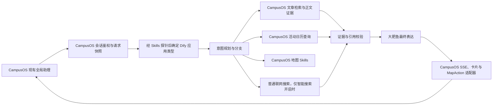

# CampusOS Dify 校园助理实施方案

**状态：2026-11-06 D-144 授权的最近100篇 D1 完整公开全文快照已导入校内 Dify 经济倒排索引；100篇/100个唯一 ID/版本，修正版显示可用。精确标题召回目标文章和正确 URL，但目标仅排 Top 3 第三，另两条不相关；排序仍弱。D-140 规范端点 `gdufs.ccwu.cc` 的 Preview Token 已轮换：本机有效 Bearer 空 POST 返回200，知识检索查询返回4条但Top 3标题无关。校内 Dify 出站仍未用有效 Bearer 验收，外部 API 尚未保存。Chatflow 预览模型返回 404 `Model not found`，未发布。知识快照为手动副本，不自动同步 D1。**

## 结论与当前工作区

建议用 **Dify Chatflow 承担对话编排**，由 CampusOS 继续提供真实校园检索、活动、地图、身份和历史服务。先做独立测试应用，复现已有真实任务并通过回归后，再接入 CampusOS 原有全局助理面板。

我现在区分了两个 Dify 环境，不能把它们的应用、Skill 和额度状态混为一谈：

| 环境 | 本次只读观察 |
|---|---|
| cloud.dify.ai | Workspace 是 Sandbox；工作室0个应用、知识库0个；Dify内置AI消息额度显示200/200已用完。 |
| 校内 dify.gdufs.edu.cn | 工作室0个应用、知识库0个；有独立 Skills 页，Workspace Skills 当前为空；模型供应商页显示 OpenAI-API-compatible 0.0.68，5个启用模型：DeepSeek-V4-Flash-0731、GLM-5.2、Qwen3.8-27B、bge-reranker-v2-m3、bge-m3。 |

这两个环境的模型凭据和额度互不等同。校内站页面没有显示API Key明文；本轮没有读取密钥或调用模型。Chatflow适合逐轮多轮对话，支持会话变量、记忆和流式输出；当前工作室也显示了此应用类型。

项目文档 D-045 记录了此前废弃 Dify 的决定。负责人本轮重新提出 Dify 建设，因此本文是新提案；正式实施时应新增决策记录并保留 D-045 历史，不应静默改写它。

## 架构



Dify 负责理解和编排；CampusOS 现有 D1、检索器、活动服务、地图 Skills、S4 账号及 AI 会话表继续作为业务事实和权限的来源。工具桥只调用现有服务，不在 Dify 里新建一个副本文章库，也不把 `/api/agent/chat` 包成一个总工具。

当前实现的主要入口为 [chat.ts](<D:/tlydcg/Codex_work/广外AI应用大赛/src/lib/server/assistant/chat.ts:169>)、[内容检索 Skills](<D:/tlydcg/Codex_work/广外AI应用大赛/src/lib/server/retrieval/skills.ts:44>)、[活动日历查询](<D:/tlydcg/Codex_work/广外AI应用大赛/src/lib/server/calendar/query.ts:102>) 和 [地图工具 HTTP 接口](<D:/tlydcg/Codex_work/广外AI应用大赛/src/lib/server/maps/http.ts:42>)。内容检索当前有 `search_campus_knowledge`、`search_campus_events`；地图有 `search_places`、`get_place_details`、`find_nearby_places`、`plan_route`、`control_map`；普通网页搜索为 `search_external_campus_info`。Dify 工具名可沿用这些名称，便于查看运行轨迹。

## Dify 应用选择

主线先采用一个独立 Chatflow 测试应用，例如「广外通·大肥鱼校园助理（测试）」。Dify 官方资料将 Chatflow 定义为逐轮触发的流程应用，支持会话变量、LLM 记忆和流式输出；工具可作为独立 Tool 节点或 Agent 节点中的工具。[Chatflow 应用类型](https://docs.dify.ai/en/learn/key-concepts)、[Dify 工具类型](https://docs.dify.ai/en/cloud/use-dify/workspace/tools)

**根据校内站的实际页面，后续能力验证应优先在 dify.gdufs.edu.cn 进行；cloud.dify.ai 的 Sandbox 只作文档和界面对照。** 校内站已有 Skills 入口和上述5个启用模型，因此值得先验证；但模型条目显示“启用”不等于凭据、额度、模型调用和校园外连通性已验收。校内站目前只能在校园网络访问这一限制，可能使 Cloudflare Workers 无法调用其 API。必须先由校方确认是否有受支持的服务端 API 访问路径，并从实际部署网络验证可达性；若不可达，校内 Dify 只能用于校园内 Skill/流程原型，CampusOS 云端运行仍保留现有自研 Agent 与模型路由，不通过隧道或非官方方式绕过网络边界。

校内 Dify 新增的 Skills 页改变了方案：先验证 Workspace Skill 能否被 Chatflow 或其 Agent 节点真实发现和调用。校内页面显示 Workspace Skills 可用 Skill Builder 生成可 review 的草稿，也可导入符合 agentskills.io 格式、包含 SKILL.md 的 ZIP；官方格式以渐进披露组织技能说明。[Agent Skills 格式](https://agentskills.io/home)

若 Workspace Skill 能进入 Chatflow 的技能/工具调用上下文，就按本方案的领域划分导入 Skill 包，并限定其工具白名单。若它只能由校内 Agents BETA 使用，则用同一个只读测试 Skill 在独立草稿中评估 BETA，同时保留 Chatflow 主线；仅在 BETA 的错误、记忆、身份、工具权限和 SSE 行为均通过回归后，再决定是否改选。当前页面标注 BETA，尚无兼容性实测，不能将其写成已选型。

校内 Marketplace 搜索显示了 Agent Skill Plugin、Skill_Agent、SkillWard、Tool-Capture Agent 等第三方条目。这些插件未审查源码、权限和数据处理方式，也未安装；第一版不将它们作为依赖。

工具接入优先使用 CampusOS 受控 MCP HTTP 工具服务；若探针不通过，再用 Dify HTTP Request 节点调用固定 OpenAPI。Dify当前支持HTTP传输的MCP，并能按模板将触发 Service API 请求头透传至MCP服务器；P0必须验证校内版本的实际行为。[工具接入及动态 Header](https://docs.dify.ai/en/cloud/use-dify/workspace/tools)。Code节点仅做少量字段整理，校园查询和地图路线继续由现有TypeScript服务执行；Dify Code运行于沙箱，不能替代D1查询。[Code节点能力](https://docs.dify.ai/en/cloud/use-dify/nodes/code)

## 校内 Workspace Skills 设计

Workspace Skills 用来打包程序性说明，不是新的数据库、检索索引或万能提示词。导入 SKILL.md 本身不会让网站用户可调用它，也不会自动连接 CampusOS；真实数据与地图操作必须仍通过已授权工具服务。

建议准备5个小型 Skill 包，先导入一个 campus-radar 做能力探针，再按相同格式扩展：

| Skill | 触发任务 | 关键边界 |
|---|---|---|
| campus-query-planning | 提取任务、主题、实体、OR/AND、时间和追问 | 输出逐字可回溯的原句规划，不回答事实，不创造别名。 |
| campus-radar | 查询已发布资讯与最近发布内容 | “最近”按发布时间及真实游标排序。 |
| campus-knowledge | 查询政策、办事和人物公开正文 | 区分全文、摘录和元数据；没有正文不总结。 |
| campus-calendar | 查询活动日期、讲座、比赛与报名状态 | 区分举办时间、报名时间及文章发布日期。 |
| campus-map | 搜地点、详情、附近设施、路线及 MapAction | 使用真实placeId/routeId；回执前不声称地图已执行。 |

大肥鱼人格继续作为最终回答契约。智能搜索是权限策略，不做成能由模型自行打开的 Skill；由 Chatflow 分支和 CampusOS 工具桥共同强制执行。

**Skill P0 探针**：向校内 Skills 页导入单个 campus-radar ZIP；验证发现/激活、完整 SKILL.md加载、Chatflow/Agent节点绑定、工具白名单和错误传递。只查公开文章，不上传文章语料包。通过后再扩展其余 Skills；未通过就记录兼容边界，不靠安装未经审查的Marketplace插件冒充原生兼容。

## Chatflow 节点

Start 提供用户本轮问题及服务端提供的上下文快照。不要让浏览器直接填写 `user_id`、conversation owner 或模型路由。

Planner 用一个结构化 LLM 节点抽取任务，不回答校园事实。推荐输出：

```json
{
  "intent": "campus_search",
  "subject": "校园赛事",
  "entities": [],
  "topics_any": ["云计算", "AI", "大数据"],
  "categories_any": ["competition", "lecture"],
  "year": null,
  "time_role": null,
  "time_range": null,
  "sort": "relevance",
  "followup": false,
  "smart_search": false,
  "persona_preference": "current"
}
```

实际问题「搜索和云计算或 AI 或大数据相关的比赛或讲座」中，“或”是主题和类别的任一匹配，不是文章标题，也不能把三个词全部设为硬性 FTS 条件。若加了“最近”，资讯查询才按文章发布时间倒序；“今天／明天／下周”才按活动举办时间；“现在能否报名”才查报名状态。举办日期、报名截止和发布日期必须分开。

最终流程：

| 分支 | Dify 节点和实际服务 |
|---|---|
| 闲聊／询问助理身份 | 规划节点可以同时产出简短 `chat_reply`，直接回答，不查询文章。模型身份取真实运行信息，不固定自称 DeepSeek。 |
| 校园文章／人物／主题 | `search_campus_knowledge` 或受控文章检索；需要时调用正文读取。按结果状态分成可回答、部分证据、无匹配、服务故障，不能把故障说成“没有资料”。 |
| 雷达“最近资讯” | `search_campus_events` 使用发布时间倒序及稳定游标，分类使用用户实际指定条件。 |
| 活动日历 | 通过共享 `readCalendar` 服务查活动实际日期、类别和报名状态，不把文章发布日期当活动日。 |
| 地点／路线 | 依次搜索地点、识别歧义、取地点详情、规划真实路线、准备 `MapAction`。只有收到前端回执后，才说地图已经移动或路线已经显示。 |
| 智能搜索开启 | 校园内部查询先执行；存在信息缺口或用户要求联网时，才调用普通外部搜索一次。优先广外官方来源，保留其真实证据类型和发布时间。 |
| 智能搜索关闭 | 图中分支不注册、工具节点也不连接外部搜索；后端工具桥再次检查本轮服务端开关快照。明确要求全网搜索时提示开启，不请求外部供应商。 |
| 失败／暂停／取消 | 按终态区分检索无匹配、D1不可用、模型额度、网络中断、Dify节点失败和取消。返回已取得的有效校园证据，不用默认空数组掩盖工具错误。 |

意图 Planner 必须覆盖助手自我介绍、多主题 OR、历史追问、新实体覆盖旧主题、精准文章标题、报名状态和地图意图。例如「你是什么智能体」走自我介绍分支；「听说有别的高校来广外调研」要能用“贵州师范学院一行来我校调研”这类真实标题召回，而不是把“广外/调研/外校”每个字词都强制同时出现。

Dify LLM 支持 JSON Schema 结构化输出；但当所选模型不支持原生 Structured Output 时，Dify 会把 Schema 放进 Prompt，输出仍可能不合规并让节点失败。每个Planner与回答节点都要先验证 StepFun、DeepSeek 的实际JSON、工具调用和错误分支，不能将“界面存在Schema开关”当作模型一定遵守的证明。[LLM 结构化输出、Context 与错误处理](https://docs.dify.ai/en/cloud/use-dify/nodes/llm)

## 工具桥与数据契约

建议按现有功能实现只读、固定白名单工具：

| 工具 | 输入要点 | 输出要点 |
|---|---|---|
| `search_campus_knowledge` | 原始主题、主题 OR/AND、具体实体、明确年份和来源范围 | documentId/version、标题、来源、原文 URL、正文证据类型及实际片段 |
| `search_campus_events` | 类别、发布时间或活动日期、报名日期、稳定游标 | eventId、真实举办时间/地点、报名状态、证据与来源 |
| `search_places` | 名称或已确认别名 | 真实 placeId 与歧义状态 |
| `get_place_details` | 已校验 placeId | 已有地点详情；空字段不推测 |
| `find_nearby_places` | 已授权地点或已验证会话上下文 | 真实设施及距离语义 |
| `plan_route` | 真实起终点 ID、walking | 复用校园路网的路线和校验结果 |
| `control_map` | 白名单 `MapAction` | 待执行动作包，不宣称已执行 |
| `search_external_campus_info` | 本轮待补充的公开问题 | 标题、域名、摘要/片段、发布时间、证据类型 |

每个返回对象携带稳定 evidenceId、公开文档/活动/地点 ID、原文 URL、当前版本、正文权限、证据类型和检索状态。**没有可用正文只能确认标题或元数据，不能总结成正文事实。** 普通检索失败与真实无匹配必须分开。Dify 外部知识 API如果接入，必须按官方 `/retrieval` 协议返回 `records`，并满足 `metadata` 非 null 等字段要求；它适合作为可选正文 RAG，不代替标题、时间、报名、地点工具。[外部知识 API](https://docs.dify.ai/en/cloud/use-dify/knowledge/external-knowledge-api)

工具服务必须验证：

- 只读查询走已存在的公开权限和发布状态检查；不直接将未公开 D1 查询接口暴露给 Dify。
- Dify 侧应用 Key 只保存在 CampusOS 服务端；不传入 LLM Prompt、工具参数、浏览器端或日志。
- S4 用户通过现有服务端会话鉴权；Dify `user` 值由服务端生成稳定匿名标识。Dify API 不会认证这个字段本身。[Dify End User Identity](https://docs.dify.ai/en/api-reference/guides/end-user-identity)
- 每轮生成短期会话/运行授权，由工具桥校验目标 conversation owner、会话、搜索开关及工具范围；不得转发浏览器 Cookie，也不得信任 LLM 提供的 userId。
- 为既有请求 ID 和 Dify conversation/task/run ID 建立最小映射及幂等检查。网络重试时先查询运行状态，不能在结果不明时重复提交 Agent 工具。

## Persona、答案和 SSE

沿用 [大肥鱼表达契约](<D:/tlydcg/Codex_work/广外AI应用大赛/docs/CAMPUSOS_PERSONA_CONTRACT.md>)。日常对话短、活泼；校园政策和活动先讲事实；严重安全/医疗等场景收敛。人格只作用于可见自然语言，不能改工具参数、事实、日期、placeId、来源 URL 或引用。

正文必须以 `evidenceId` 对照本轮实际证据生成 `[1]` 等引用；来源卡必须来自正文真实引用的来源。不要依赖 Dify 自动的 Knowledge 引用来覆盖自定义工具结果；后端适配器要将工具 evidenceId 映射成 CampusOS 当前 `AssistantCard` 与折叠来源卡。如果 Planner/模型返回无效 ID、未引文献或未支持的关键日期/人名，禁止把它标记成成功答案。列表类信息优先用已验证结构化字段渲染，减小模型改写日期和报名状态的机会。

Dify Chatflow 应使用 `streaming`。适配器解析 `ping`、`workflow_started`、`message`、`message_end`、`workflow_finished` 和中途 `error`；HTTP 200 不表示流程成功。保存 `task_id` 用于停止，保存 `workflow_run_id` 用于运行恢复，两者不能混用。还需把 Dify 事件转换为 CampusOS 现有 SSE、工具状态、卡片和错误终态；不能把 `agent_thought`、`reasoning_chunk`、裸 JSON 或原工具 XML 送入面板。[SSE 事件与恢复说明](https://docs.dify.ai/en/api-reference/guides/streaming)

## 模型与账号

当前校内模型页显示 OpenAI-API-compatible 0.0.68 下有五个启用模型：DeepSeek-V4-Flash-0731、GLM-5.2、Qwen3.8-27B、bge-reranker-v2-m3 和 bge-m3。当前列表未见 StepFun 模型。CampusOS 现有运行链仍是 StepFun 优先、明确额度耗尽后 DeepSeek 备用；本阶段不改路由、不调用模型，后续要先核对校内端点和额度。


模型优先级要复现现有 `PriorityModelRouter`：阶跃星辰在前，只有明确额度耗尽代码才调用 DeepSeek 一次；401、普通 429、网络错误、Schema 错误不能被伪装成“余额不足”。Dify供应商卡上的 Usage Priority 指供应商自有 API credits 与 BYOK 的顺序，不是跨供应商且仅在额度耗尽时切换。

正式方案建议加一个薄的 OpenAI 兼容模型入口，只复用当前模型路由，不重新包装自研 Orchestrator。先用实际模型探针验证：标准多工具输出、额度耗尽识别、普通限速不回退、中途已输出内容不二次生成、usage 与实际 model snapshot 可读。如果不能可靠区分额度错误，Dify 原生失败分支不能冒充当前路由契约。[模型供应商与 Usage Priority](https://docs.dify.ai/en/cloud/use-dify/workspace/model-providers)

第一阶段不导入个人 API Key，也不重建账号页。接回网站时，已有选择个人 API 的用户仍走当前个人模型路径；只有服务端确认允许时才进入 Dify 平台模型路径，不能静默把个人模型失败改用平台模型。完整Dify会话映射要保留账号跨设备历史，未登录游客历史不自动转移。Dify API会话和其托管Web App会话不共享，不能通过嵌入Dify网页冒充S4跨设备历史。[会话身份](https://docs.dify.ai/en/api-reference/guides/end-user-identity)

## 分阶段实施

| 阶段 | 工作 | 通过条件 |
|---|---|---|
| P0 只读准备 | 优先确认校内 Dify 的 API 可达范围、应用创建权限及隔离方式；获准后以独立测试应用验证 Chatflow、Workspace Skill、Agent BETA、模型调用和结构化输出；cloud.dify.ai Sandbox 仅作对照 | 未读取或暴露 Key；明确校园外服务端能否访问；确认测试应用与共享业务隔离；技能和模型调用均有真实回执 |
| P1 只读工具桥 | 文章、正文、日历、地点/路线只读工具及类型化错误 | 真实请求能区分 full_text/excerpt/metadata/no_match/unavailable；没有私有数据或用户 Cookie |
| P2 Chatflow 骨架 | Planner、分支、Persona和错误路径 | 8条问题进入正确任务分支；输出不含Planner JSON和推理流 |
| P3 智能搜索 | 关闭时外部搜索工具不可用，开启时按证据缺口调用普通搜索 | 关闭实测调用0；小红书专用工具调用0；国内外部来源各有真实回执 |
| P4 身份/SSE | S4映射、重复提交、停止、运行恢复、证据卡和地图回执 | A/B/游客隔离；流中失败不被当成功；一个conversation只能续自己的历史 |
| P5 回归对照 | 真实公开数据的查询集及多轮对话、双模型比较 | 命中、相关性、错误拒答、错答、引用、时延、D1读数均有结果；不得把检索Recall标成回答正确率 |
| P6 决定接入 | 对测试结果与成本/限额作决定，再讨论原面板路由 | 经后续明确授权，先小范围接入；原链路可用Git/版本回退 |

具体测试采用最近五类错误：

1. “你是什么智能体”与“我问你，你是什么”必须识别为问助理，不找校园文章。
2. “小挑比赛是什么时候”核对真实比赛名称、学院与正文日期；不能把相似的其他杯赛文章当答案。
3. “云计算或 AI 或大数据相关的比赛或讲座”执行主题与类别任一匹配，不用全部关键词 AND、也不当作文章标题。
4. “听说有别的高校来广外调研”应尝试召回真实的贵州师范学院来访文章。
5. “只能找到两条吗”承接上题的主题和游标，不产生新地点或新任务。
6. 相同校园查询分别在智能搜索关闭/开启下验证：站内搜索都执行；只有开启且有必要才外查。
7. 逐步延长到至少20轮的5组对话，检查没有已读乱回、主题污染、答案重复、丢失/重复消息。
8. 真实正文、无正文元数据、没有匹配、D1/API故障、Dify失败分别测试；来源和错误分类逐一核对。

验收目标建议：已知真实文章100%命中；非精确主题Recall@5 ≥95%；Top3相关性 ≥90%；测试集无无关引用、无无依据关键日期/身份；关闭智能搜索后外部供应商调用0；小红书专用调用0；Persona显式关闭/恢复跨多轮正确；事实答案的支持率与原版对照不能下降。目标必须由测试决定是否通过，不能用提示词“看起来正常”替代。

## 回退、资源和风险

- 用独立测试应用迭代，不创建并行Dify知识副本，不发布Dify Web App替代CampusOS主界面。
- 每个可审阅版本导出 `.ifpkg` 并在Git记录对应规划、Prompt、工具 schema 和版本说明；导出时不包含Secret明文。Dify的版本恢复及指定历史版本运行存在套餐限制，Sandbox不能依赖付费版本回退功能；线上引擎回退应通过CampusOS后端版本/会话选择完成。[版本控制](https://docs.dify.ai/en/cloud/use-dify/build/version-control)、[应用导出](https://docs.dify.ai/en/cloud/use-dify/workspace/export-import-apps)
- Dify必须跑在现有支持的Cloud/Workers调用链里；不为校园AI购买新套餐、新爬虫服务或额外向量库。当前0条Sandbox credit实际用尽的UI状态已核对，Dify API测试也可能消耗StepFun/DeepSeek自己的余额；按每个节点的真实usage记录调用量，先小流量验收。
- 增量D1迁移仅用于最小会话/运行映射；不得重建conversation数据库或删除游客、账号历史。测试使用独立账号和新对话。
- CampusOS网站与Dify各自可连通不等于校园网链路已解决；校园网问题仍单独按 `docs/CAMPUS_NETWORK_2026_11_04.md` 收错误码和网络回执。

## 只读检查结果

只读查看了两个彼此独立的环境。cloud.dify.ai 是 Sandbox，应用和知识库均为0，内置200条AI额度显示已用完。校内 dify.gdufs.edu.cn 的应用、知识库和 Workspace Skills 均为空；Skills 页提供 Skill Builder 草稿入口与 SKILL.md ZIP 导入入口，Marketplace 可搜索到第三方 Skill/Agent 插件条目，未安装或审查其源码。模型页显示 OpenAI-API-compatible 0.0.68 的5个启用模型。没有读取 API Key、修改配置、创建应用、导入 Skill 或调用模型。校内 Dify 的 API 地址、外网可达性、模型配额和模型原生 Tool Calling/Structured Output 能力仍未验证，列为实施前置条件。Dify官方工具可导入Swagger API/MCP，MCP只支持HTTP传输；模板/Marketplace内容不等于CampusOS已经集成。[Dify工具类型](https://docs.dify.ai/en/cloud/use-dify/workspace/tools)

## 2026-11-05 实施进度：外部知识库接入

校内 Dify 的数据集页为空；创建页提供“连接外部知识库”。因此本轮选择只读外部知识 API，继续以 CampusOS D1 作为唯一文章与权限权威，不向 Dify 批量上传正文、不建立向量副本。

本地新增适配端点 POST /api/dify/external-knowledge/retrieval，使用现有 searchContent 和公开权限检查；固定支持校园知识与活动两个 knowledge_id，每次最多返回4条，正文证据类型、来源与原文链接随记录返回。分数仅用于将 D1 词法排序值单调映射到 Dify 的 0–1 字段，不代表语义相似度或事实置信度。

适配器仅接受 ACCOUNT_ORIGIN 与 ACCOUNT_ALLOWED_ORIGINS 配置的精确 HTTPS 主机，并需 DIFY_EXTERNAL_KB_TOKEN。只读检索路由已部署到共享 campusos-preview Worker，并配置独立 Secret；Dify 尚未成功保存外部 API 或创建知识库。Dify 到 Preview 的连接失败，最初归因于 SSRF/出站策略的推断尚未证实。

后续步骤：先修通 Dify 空 POST 连接探测，再用连接测试验证网络与检索回执；通过后创建两个外部知识库，再搭建 Chatflow/Skills。当前不调用 Embedding/LLM、不导入全文、不切换网站现有 Agent。

## 2026-11-05 连接回执

只读检索适配器已部署到共享 campusos-preview Worker，版本 dd4470d0-137e-4168-99fc-4d80e4e22fda；独立 DIFY_EXTERNAL_KB_TOKEN Secret 已配置。Worker 仍同时服务 gdufs.ccwu.cc，正式域名没有迁移。Dify 外部 API 注册时，workers.dev 与 gdufs.ccwu.cc 两个端点都返回 failed to connect，Worker Tail 没有相应适配器日志。

## 2026-11-05 空 POST 探测兼容修复

Dify 官方说明注册外部知识 API 时会将 `/retrieval` 附加到基础端点并发送连接测试；本地处理器原先要求该 POST 必须包含完整检索 JSON。Dify 保存探测的空请求因此会被处理器作为无效 JSON 拒绝。现在本地分支在 Host/Bearer 鉴权后对空请求返回 `200 {"records":[]}`，正常带检索参数的请求仍走原有 D1 检索和校验。

修复版 `npm run build:worker` 和部署脚本内 Preview 构建、dry-run、类型检查通过；正式 Preview 部署因 Wrangler 授权令牌过期且 Cloudflare 授权服务不可达而中止，线上仍是版本 `dd4470d0-137e-4168-99fc-4d80e4e22fda`。管理员给出的 Squid `200 Connection established` 只证明 CONNECT 隧道建立，不能代表 TLS/HTTP 完成；且此前 Worker Tail 无请求，不能把现存失败唯一归因于空 POST。待重新授权和部署后再保存 Dify API，按 Worker Tail 与 Dify/Squid 同时刻日志定位剩余网络问题。

## 2026-11-05 Dify 原生知识试点与 Chatflow

负责人明确要求建立 Dify 原生知识库并继续搭建 Agent。按 D-143 限定例外，从 CampusOS D1 的公共内容 API 导入 29 篇 `readable=true` 且完整的知识全文，1 篇仅有元数据的文章未导入。Dify 知识库名为「CampusOS 校园知识试点」，ID `6083f0fe-ea98-4048-b74d-88b6e7dce50e`。采用 Economical/倒排索引，不调用 Embedding；知识为截至2026-11-05的手动快照，D1仍是权威源。

通过召回测试观察到，合并文件格式会让来源标题与正文分块分离，导致错召回。已导入3份改进版来源分块文档（每个片段重复标题、来源、日期、原文 URL、D1 ID/版本），并将旧版3份合并文档禁用而未删除。改进后「校园网怎么开通？」首条命中《使用指南 | 校园网上网》并带原文链接；「校园卡补办」结果仍把热水卡补办排第一、校园卡补办指南排第二，经济索引自然问法召回尚不稳定。

已创建 Chatflow「广外通·校园助理（Dify试点）」，ID `39945f9b-9ee0-4c2c-a3a0-fc5298b3f861`，结构为用户输入→知识检索→LLM→直接回复；知识检索结果接入上下文，系统提示包含有限数据范围、事实约束、来源链接和轻量大肥鱼语气，引用归属已开启。应用未发布。一次预览「校园卡如何补办？」由已配置的 `DeepSeek-V4-Flash-0731` 调用，Dify 返回 404 `Model not found`，未生成答案。

未更改 Dify 模型供应商或密钥，未安装 StepFun 插件。当前模型列表与网站原有 StepFun 优先/额度耗尽后 DeepSeek 路由不一致；需管理员核对 OpenAI-compatible provider 的 model ID/endpoint，且后续要提供可用的 StepFun/DeepSeek 路由后才能完成真实 Agent 答案验收。全站 Agent、雷达、活动日历、地图、智能搜索和现有 Dify 外部 API 尚未接入该 Chatflow。


## 2026-11-06 实施进度：CampusOS「深度思考」运行分支

按负责人 D-146 要求，项目现有全局助理已加入服务器端 Dify Chatflow 适配分支。本轮不是从本地 `articles_full` 导入数据，也不会在 wechat-mp-rss 采集后推送文章；每轮仍只由 CampusOS 现有 D1 公开检索取少量证据后交给 Dify。D1 为事实来源，Dify 只负责综合并生成最终答复。偏好及 Dify conversation ID 绑定现有 CampusOS conversation owner，API Key 只由服务端 Secret 读取。地图/导航和外网智能搜索不由此 Dify Chatflow 代替。

已将现有 Chatflow LLM 节点补充简洁的大肥鱼表达、当前 D1 证据边界、[n] 引用和最终答复规则；一条真实 D1 预报名文章摘录在校内 Dify Web 预览中得到正确日期和引用。Chatflow 已按负责人授权发布并创建1个 Dify App API Key；外部知识库 API 表单仍未保存，App API Key 尚未配置为 Cloudflare Secret。此预览是“CampusOS提供证据后Dify可用证据回答”的探针，不证明 Dify 出站直连 D1。

## 2026-11-06 状态更新

Chatflow 已发布，Dify App API Key 已建立；其中一把作为 `DIFY_APP_API_KEY` Cloudflare Secret 保存。代码已部署到共享 `campusos-preview`（版本 `1fb00a34-be32-4f46-9e08-3a14c4ff90c8`；Secret变更版本 `68ec12eb-f731-46c5-b250-b530712c1e4e`），因此同时更新 `gdufs.ccwu.cc`。API的真实调用仍未通过：Cloudflare Worker 收到 Dify `POST /v1/chat-messages` 的HTTP200，但Content-Type不是SSE、无事件/回答；Dify日志页没有对应执行记录。直接网页预览可以消费手动提供的D1证据，但不证明Worker出站已通。Dify外部知识库API也未保存。负责人明确保留现有密钥并停止轮换。


## 2026-11-06 联调最终状态

Dify Chatflow已发布，App API Key 已配置到共享 Worker Secret；本地代码已部署到共享 campusos-preview，最终代码版 b5f6f81d-a4ca-4c0b-88eb-a58ac25740e8，Secret变更版 68ec12eb-f731-46c5-b250-b530712c1e4e。Worker真实请求返回 HTTP200 text/html，不是 Dify Chatflow API 的 SSE/JSON，Dify日志也没有对应运行。独立游客Session回执 deepThinkingAvailable=false，因为 DIFY_CHAT_ENABLED=false；网站不会显示尚不可用的开关。

手动 Dify Web 预览在用户消息里提供公开 D1 文章摘录后，能给出准确预报名日期并引用[1]。因此当前可行架构是CampusOS D1按当前问题检索后，将少量证据传入Dify；不是Dify直接连接D1。外部知识 API 表单未保存，直接出站检索尚未验证。articles_full本地目录没有导入，RSS无同步。负责人要求保留现有密钥并停止轮换。


## 2026-11-06 最终验收结论

Chatflow已发布，App API Key Secret 已配置并保留，Worker共享部署版 b5f6f81d-a4ca-4c0b-88eb-a58ac25740e8。真实 Worker→Dify 请求返回HTTP200 text/html而非SSE/JSON，Dify日志无调用；因此已部署代码但没有可用的线上深度思考答复。DIFY_CHAT_ENABLED=false 已部署，按钮隐藏。需要校内 Dify 管理员提供可从Cloudflare Worker访问的 API 路径，再复验。D1来源仍由CampusOS服务端检索；没有导入articles_full或开启RSS自动同步。
