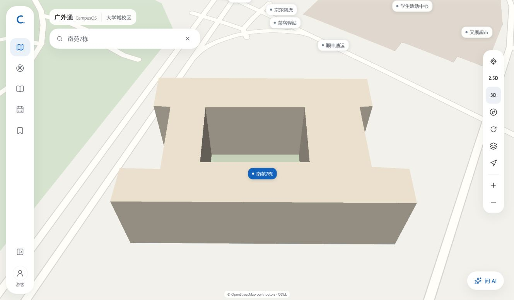
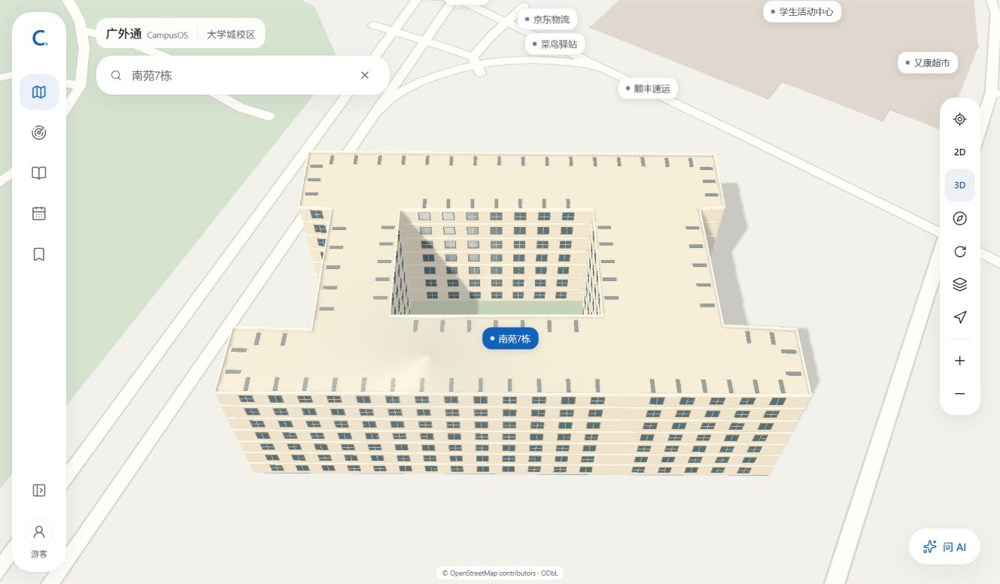

# 南苑7栋 2.5D / 3D 单栋试点验收

2026-10-14。范围：仅南苑7栋，`osm-way-312536955`。本地 Workers 生产预览：[校园地图](http://127.0.0.1:3000/map)。搜索“南苑7栋”，选中后通过侧边2D/2.5D及3D按钮查看；Edge已保留选中本栋的3D预览。

## 1. 依据与近似项

- 外轮廓：原OSM稳定地物，内部WGS84；原地点、底图和导航数据未改动。地图仍为 `s1-2026-10-14.2`，113地点/4521地物，路网547节点/2202边。
- 楼层及高度：负责人明确7层、约21米，记为 `owner_approximation`，没有回填OSM实测height。
- 体量：已提供的南苑卫星图与已确认校区图支持围合中庭、横向翼楼和地物对应。外轮廓投影尺寸约70.57×41.68米；中庭位置/比例、窗格、女儿墙、屋顶条带及颜色为程序化近似，未生成室内/房间/门导航。
- 外观搜索：小红书需登录；公开攻略文字可读，配图CDN未成功显示。未据此宣称看到南苑7栋立面，GLB没有嵌入第三方图片、纹理或网格。来源细项见SRC-044和owner-model-review.json。

## 2. 当前实现

| 模式 | 当前效果                                                                    |
| ---- | --------------------------------------------------------------------------- |
| 2D   | 原固定平面地图                                                              |
| 2.5D | 本栋约21米的原生挤出，保留开放中庭；其他建筑仍为平面                        |
| 3D   | 本栋七层立面、中庭内壁、窗带、分层线、女儿墙和简化屋顶条带；自有GLB按需加载 |

采用MapLibre6.14.0与Three.js0.186.1共享GL、同一地图相机和38°最大倾角。没有独立Orbit相机、持续渲染循环、在线底图或供应商模型缓存。GLB以内容哈希校验，并绑定地图版本、原轮廓SHA和模型版本 `nanyuan7-2026-10-14.1`。

| 资产         | 文件                                                    | 字节   | 三角形 | 模型绘制调用 | 本轮渲染含阴影调用 |
| ------------ | ------------------------------------------------------- | ------ | ------ | ------------ | ------------------ |
| 手机低细节   | `public/models/nanyuan7/nanyuan7-low-7def165d3ed8.glb`  | 71432  | 3804   | 5            | 9                  |
| 桌面完整细节 | `public/models/nanyuan7/nanyuan7-full-3386f67af1bf.glb` | 124024 | 7040   | 7            | 12                 |

绘制统计不包含底图，字节为GLB文件大小，不是整页首次下载。手机视口390×844/DPR3加载低细节，桌面1440×900/DPR1加载完整细节；均为真实Chrome/Edge的视口检查，不能作为手机实机FPS证明。

## 3. 两种效果

以下为当前Edge实际显示截图；公开校园地图，无个人GPS。原始JPEG直接保存，未编辑像素。

### 2.5D



### 3D



两款浏览器的桌面/手机、旋转和模式截图及证据JSON分别位于 `screenshots/s1/nanyuan7-model/chrome-production-final` 与 `edge-production-final`。真实浏览器原生页面缩放/短窗口快速检查保存在 `chrome-native-window` 与 `edge-native-window`。

## 4. 验收结果

- TypeScript、Lint、45单元/8文件、Next/OpenNext生产构建通过。模型单元检查覆盖稳定ID/外轮廓/地图版本、近似高度标记、中庭在原外轮廓内、GLB哈希/自包含/无图片及21米总高。
- 最终Workers3000完整Chrome53通过/5跳过，Edge53通过/5跳过。跳过为两项在线服务、两项需显式开启的原生窗口检查及桌面不适用的手机AI抽屉用例。
- 两款浏览器各另行运行原生窗口快速检查1通过：最大化150%、普通450px高窗口、650px高窗口+150%等配置；内部滚动、路线路径/标签、版权链接、四角覆盖及灰框像素检查通过。本轮没有重跑全部110%—300%矩阵。
- 新增模型用例在桌面/手机均通过：2D/2.5D/3D切换，首次3D才请求GLB，LOD选择，模型实际渲染/射线点击、无遮挡边界、旋转、标签关闭不隐藏模型、503回退/重试。焦点恢复不重新展开搜索，手动点击或ArrowDown仍可打开建议。
- Edge当前用户配置另做实际显示检查：3D正常、无搜索弹层遮挡，2.5D和3D截图已保留。没有请求真实设备位置或上传个人位置。

本轮修复记录：初次类型检查发现PointLike应使用数组参数，已修正；屋顶阴影噪点通过法线偏移修订，移除Three.js已废弃的PCFSoftShadowMap；实际Edge显示发现关闭详情恢复输入焦点会重开搜索，改为明确的指针/键盘操作打开建议。首次并发生产回归共享test-results导致trace文件ENOENT，隔离每款浏览器输出目录后全部通过；首次构建被旧预览锁住产物，停止旧预览后构建通过。没有借上述历史失败声称未完成能力可用。

## 5. 生成、运行与复查

可编辑源：`scripts/build-nanyuan7-model.mjs`、`src/features/campus-map/data/owner-model-review.json`。资产清单为 `nanyuan7-model.json`，来源声明为 `public/models/nanyuan7/SOURCE.md`；许可证位于 `public/vendor/three-0.186.1/LICENSE.txt`。不需要Blender生成本轮程序化模型。

```powershell
# 显式离线生成；正常启动/构建不执行此步骤。
node scripts/build-nanyuan7-model.mjs
npm run build:worker
npx wrangler dev --local --ip 127.0.0.1 --port 3000 --log-level error
```

先停止已有预览再重新构建，避免Windows文件占用；预览与构建不能同时操作同一OpenNext产物。浏览器回归命令在另一终端运行：

```powershell
$env:E2E_BASE_URL='http://127.0.0.1:3000'
$env:PLAYWRIGHT_CHANNEL='chrome'
$env:E2E_CAPTURE_DIR='docs/screenshots/s1/nanyuan7-model/chrome-production-final'
npx playwright test --workers=2 --output=test-results/nanyuan7-chrome --reporter=list
# Edge对应改为msedge、edge-production-final和nanyuan7-edge，输出目录独立。
```

## 6. 后续资料

本轮效果可用于负责人审核这一栋的表达。准确的立面/阳台/门/屋顶设备、实测高度仍需本栋照片及尺寸；手机真实触控、热机FPS/弱网和现场GPS未验收。其余建筑继续保持原范围，不自动套用本栋高度或模板。
