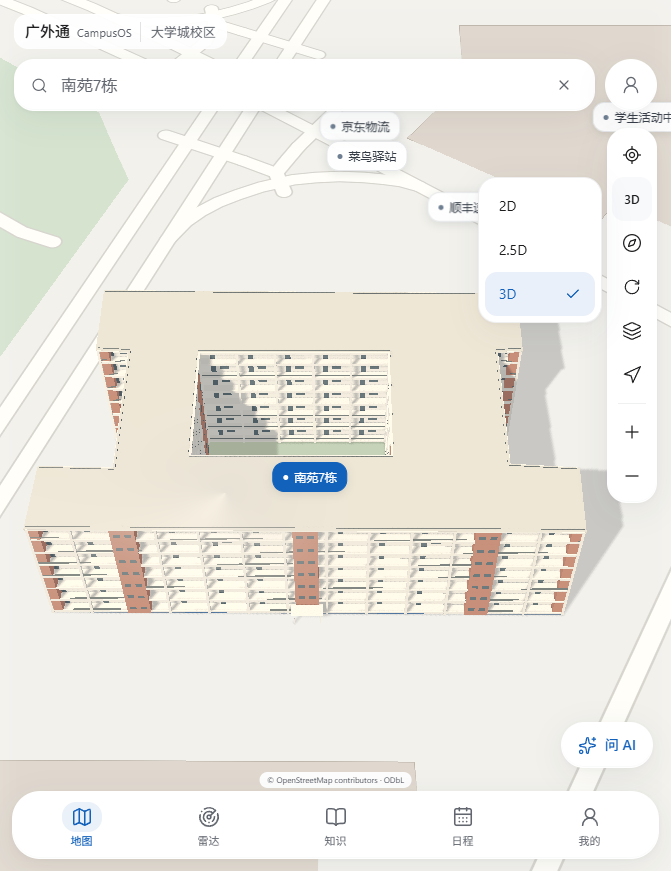

# 南苑7栋第二版3D接图验收

2026-10-15。负责人批准：2.5D保留第一版，3D换成第二版；2D/2.5D/3D合并到一个按钮。本轮只替换南苑7栋，不扩展其他建筑或地图供应商。

后续负责人发现缩放窗口会使3D位移/变形，已修复共享画布视口同步，详细复现及修复后检查见[S1_NANYUAN7_MODEL_RESIZE_ACCEPTANCE.md](S1_NANYUAN7_MODEL_RESIZE_ACCEPTANCE.md)。下文全量回归是接图阶段记录，窗口修复后另行重跑专项，不混用两个阶段证据。

## 当前版本与资源

| 项目     | 当前值                                                           |
| -------- | ---------------------------------------------------------------- |
| 地图     | s1-2026-10-14.2，原底图/113地点/路由不变                         |
| 2.5D     | nanyuan7-2026-10-14.1，原轮廓/中庭/约21米高度                    |
| 3D       | nanyuan7-v2-2026-10-14                                           |
| 文件     | public/models/nanyuan7/nanyuan7-v2-54cc55342ae5.glb              |
| SHA256   | 54cc55342ae54c2f38743341490fe943de8a877f8a968bc7c46d7a6f2c14b79a |
| 模型成本 | 80384字节、4748三角面、7模型绘制、5材质、0纹理                   |
| 运行绘制 | 当前地图Three层13次（含阴影），不含MapLibre底图                  |
| 设备资产 | 桌面/手机共用同一轻量GLB，仍按需加载和校验SHA                    |

当前绑定在src/features/campus-map/data/nanyuan7-model.json。geometry/courtyardGeometry/origin/heightMeters/dimensionsMeters与docs/model-previews/nanyuan7-v1/manifest.json逐值一致；原V1低/完整GLB保留。draft目录中的design/manifest是独立评审快照，当前接图批准独立登记owner-model-review.model3D。GLB复制后SHA与原评审文件一致，未嵌入原照片或精修纹理。

运行层仍共享MapLibre6.14.0与Three.js0.186.1的GL、投影、米制锚点和38°倾角；无额外动画循环。第二版挑檐/阳台的真实显示包络纳入相机拟合，但不修改OSM足迹或地点坐标。菜单沿用原600ms镜头，浏览及专注导航共用一个模式按钮，三项菜单支持直接选择、键盘、Escape、外部点击和已选状态。加载中可切回2D/2.5D；迟到的3D完成回调只缓存模型，不恢复已退出的模式。失败继续用原2.5D体块，菜单显示“3D · 重试”。

## 验证与修订

- 类型检查、Lint、48单元/9文件通过；Next及OpenNext生产构建通过，Workers3000实际提供新版。
- 模型专项原8项及新增闭窗菜单2项在Chrome/Edge的桌面/手机视口均通过：版本与哈希、原挤出保留、懒加载/只请求一次、点击详情、标签只切标签、旋转/范围拟合、503失败回退/重试、加载中退出及菜单键盘/外部关闭。
- 原生窗口快速矩阵两款浏览器各1项通过：150%缩放、450px短窗、650px+150%条件下导航滚动与地物绘制正常。此快速矩阵不等于全部缩放比例穷举，截图/证据见native-chrome和native-msedge子目录。
- 初次全量回归仍引用旧独立按钮，更新所有模式操作为菜单选择；后续快速关闭详情时发现其延迟finalFocus会把焦点强制还给搜索，导致已打开的菜单关闭。最终焦点恢复尊重用户后续操作，新增连续闭窗选择用例。该用例第二次查询同词时未触发输入变更，已修正测试为先清空再输入；没有用等待时间掩盖产品焦点问题。

最终Chrome完整59通过/9跳过。Edge完整58通过/9跳过，1项既有手机AI抽屉拖拽终态检查失败；源码未修改该抽屉，独立重复3次全部通过，首次并发失败如实保留。两款浏览器的模型专项10项、地图/模式/导航/退出流程全部通过。跳过项目分别为显式在线2项、显式原生窗口2项、独立预览4项、桌面不适用手机抽屉1项；原生窗口已另行跑快速矩阵。完整命令与状态也记录在docs/PROGRESS.md。

测试使用实际本地地图与公开校园坐标；供应商接口/拒绝GPS等个别错误流程保持原受控夹具。未请求用户真实GPS，未上传或部署外网。本次修改不证明手机实机触控、热机帧率或现场GPS完成，也不使近似立面成为测绘资料。

## 证据

截图与当前视口/DPR/版本/SHA/成本/包络/600ms证据：docs/screenshots/s1/nanyuan7-v2-integration。



显式发布命令（批准已登记，启动/构建不自动调用）：

```powershell
node scripts/publish-nanyuan7-v2.mjs
```

完整浏览器回归：

```powershell
$env:E2E_BASE_URL='http://127.0.0.1:3000'
$env:PLAYWRIGHT_CHANNEL='chrome' # Edge使用msedge
$env:E2E_CAPTURE_DIR='test-results/nanyuan7-v2-chrome-accepted/captures'
npx playwright test --workers=2 --reporter=list --output=test-results/nanyuan7-v2-chrome-accepted
```

显式原生窗口快速检查：同浏览器环境下设置E2E_WINDOW_LAYOUT=1、E2E_WINDOW_QUICK=1，运行tests/e2e/map-window-layout.spec.ts，project=desktop。来源/许可记录SRC-046，负责人决定D-030，未解除的资料/实机依赖见BLOCKERS。

## 2026-10-23 冷启动预热更新

上文“进入3D时才加载”的行为已由这次性能修复取代：地图基础数据ready后，后台导入3D模块并预取GLB；3D图层复用已取回并通过SHA校验的buffer。用户仍可先在2D/2.5D浏览；失败不阻塞基础地图，2.5D体块保留作为回退。地图路由提前预载本地GeoJSON及MapLibre worker依赖，初始化超时由15秒改为45秒。

本机Chrome/Edge与公网campusos-preview的桌面模型专项均通过。公网测试确认模型文件在3D切换前已下载，并验证切换后模型ready在5秒内；冷缓存地图专项Chrome约1.8分钟、Edge约58秒完成整项流程。该时间包含首次页面和地图资产加载，受网络和设备影响，不代表其他网络环境的冷启动时长。3D点击等待回归断言位于 `tests/e2e/building-model.spec.ts`。
