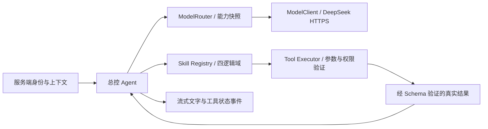

# S2-A｜Agent 核心审计与开发清单

日期：2026-10-15。范围仅 S2-A；建筑批量建模暂停，南苑7栋视觉资产及地图渲染不变。

## 实施前审计

| 现状 | 复用与缺口 |
|---|---|
| Next.js 16 / OpenNext / Workers，Zod 4 | 复用 API 错误封装、运行环境和测试工具；无需新增 AI SDK |
| `src/domain/skills/contracts.ts` | 已有 Skill 类型；尚无注册、执行、权限及输出验证实现 |
| `AssistantPanel` | 全局桌面面板/手机抽屉已存在，输入禁用；S2-C 接入，S2-A 不假装聊天可用 |
| 本地 OSM、`searchCampusPlaces`、`planLocalRoute` | S2-B 直接调用现有数据和算法；不重做搜索/导航，不换底图 |
| MapAction 与现有地图执行器 | 复用动作协议；旧图层枚举与实际图层差异留 S2-B 适配，模型不能生成自由坐标 |
| 本地 D1 | 30 业务表；对话、消息、运行、用户、地点查询均为 0。地点实际服务来自固定 JSON，不从空 D1 伪造结果 |
| 鉴权 | 只有权限原语，未实现有效登录会话；公开技能允许游客，个人技能关闭。客户端 userId 不能形成身份 |
| 凭据 | env 未配置默认模型；负责人指定的忽略文件含 DeepSeek 凭据，官方模型列表认证成功；能力须另外实测 |

检查基线：根与 v2 AGENTS、PROJECT_SPEC、02/03/04/05/08/09/12、PROGRESS、DECISIONS、BLOCKERS。

## S2-A 开发清单

- [x] ModelClient：受控 DeepSeek 端点、工具调用、JSON 输出、流解析、超时与脱敏错误。
- [x] ModelRouter：管理员默认模型、配置绑定的能力实测记录、单次运行快照；Mock 只用于隔离测试。
- [x] Skill Registry：唯一命名、四逻辑业务域、Zod 入出参及 JSON Schema、按权限开放工具。
- [x] Tool Executor：鉴权、权限、确认、超时、取消、输出大小与异常处理；写入未有服务端确认机制前拒绝。
- [x] Orchestrator：固定总控、最多 6 轮/12 次工具、使用预算、模型失败与取消、SSE 事件，不暴露内部推理。
- [x] HTTP 边界：严验证请求；未注册业务技能时聊天返回准确不可用；状态接口不产生付费探测。
- [x] 分离 Mock/真实 API 证据；类型、Lint、单测、Chrome/Edge 地图回归、生产与 Workers 预览。
- [x] 更新进度/决策/依赖；本里程碑 checkpoint 见 Git 历史。

## 差异登记与后续

1. 08/09 的早期高德默认方案由 D-018 固定本地 OSM 决策取代；当前 WGS84 数据/手动版本维护不变。
2. 09/12 的游客 BYOK 管理前置由本次负责人指令延期；保留后续计划，本轮只管理员默认模型。
3. 数据库逻辑设计不等于已接数据；本轮不新增 BYOK 表或账号迁移。会话持久化和地图上下文需 S2-B/C 明确接入。
4. 建模方案的“下一批3栋”建议目前暂停执行；保留已验收成果和压力测试报告。
5. S2-A 的诊断工具只在隔离测试注册，不算首批五项生产 Skill。自然语言地图完整验收属于 S2-B/C/D，不能提前写成通过。

## 配置与测试证据

默认模型文档依据：[官方 Chat Completions](https://api-docs.deepseek.com/api/create-chat-completion/)。JSON Object 输出必须在服务端再校验业务 Schema，不等于供应商严格 JSON Schema 支持。

### 核心结构

### 真实 API 与 Mock 分开记录

| 测试 | 实际结果 | 边界 |
|---|---|---|
| 官方模型列表 | HTTPS认证200，当前可用deepseek-flash/deepseek-v4-pro | 非生成请求，未据此推断工具能力 |
| 第一轮真实生成验证 | 3请求，3029ms，工具→真实Executor→结果回传→流式结束，JSON Object通过 | 诊断工具，无业务Skill/地图动作 |
| 最终真实生成复验 | 3请求，5268ms，每请求≤256输出Token，20秒总上限，无重试；工具、流、JSON业务Schema通过 | 总共两轮6个生成请求；最新脱敏证据model-live.json；费用未查询，不编造金额 |
| Mock单元 | 108通过/13文件；其中新增58项核心/供应商/HTTP边界 | tests/fixtures/MockModelProvider不进生产；不调用真实API |
| 类型 / Lint / DB约束 | typecheck、lint通过；30表约束/外键/内存夹具通过 | 未新增业务种子或迁移 |
| 构建 | Next.js生产 + OpenNext Workers成功 | 本地Wrangler预览，未外网部署 |
| Chrome / Edge | 各29通过/1跳过，桌面1440×900与手机视口390×844 | 跳过桌面不适用的手机抽屉避让；不是手机实机或完整S2验收 |

命令：npm run test / typecheck / lint / db:verify / build:worker；npm run model:verify -- --configure-local；E2E指定E2E_BASE_URL=http://127.0.0.1:3000、PLAYWRIGHT_CHANNEL=chrome或msedge，运行agent-core、shell、building-model、navigation-fixes四个spec。

实际浏览器证据在[verification/s2-a/screenshots](verification/s2-a/screenshots)。模型状态页证明服务端能力准备完成；地图与禁用AI面板截图证明S2-A阶段边界及既有地图保留，不能当作自然语言地图联动成功截图。测试框架输出中NO_COLOR提示为环境提示；OpenNext的Windows兼容警告已记录，实际构建/预览成功。

### 服务端配置

管理员配置MODEL_API_KEY、MODEL_NAME、MODEL_BASE_URL与MODEL_CAPABILITIES_JSON。已安全配置本机.env.local/.dev.vars；两者与anykey.md被Git忽略。验证记录由CLI实测生成，绑定规范端点、模型、凭据指纹、策略，24小时过期；改Key/模型后重新运行model:verify。状态接口不付费探测，不回传密钥/指纹；Router/Client也不会通过对象JSON序列化暴露凭据。

Cloudflare部署须分别设置环境Secret并重新验证，不能把本机配置自动视为线上可用。BYOK、持久密钥加密、短信账号尚未实施。

### 安全限制

- 默认模型无自动供应商/凭据回退；只出站到精确审核的官方端点，拒绝重定向、查询参数、任意内网地址。
- 单Run最多6轮、12次工具、4096输出Token预算；单模型请求≤1024输出Token/15秒，Run总90秒。上下文/工具参数/回复/结果均有限长；HTTP消息8KiB/5秒。
- 每isolate最多2并发，每服务端主体10分钟8次，主体窗口最多1000；这是局部保护，未声称跨Workers实例共享配额。公开付费聊天在共享额度和可信主体接入前关闭。
- 写入/需确认工具拒绝执行；confirmedActionId不能授权。确认台账、业务幂等与账号鉴权未接入前不开放个人写入。
- 工具与系统错误不暴露上游原始正文/Key；供应商reasoning_content被丢弃，只传文字和执行状态。公共地图环境验证不依赖模型配置。

### S2-B 的具体下一步

1. 从现有campus.json注册地点搜索/详情/附近查询；所有ID校验，距离明确为几何距离或真实路网步行距离。
2. plan_route复用planLocalRoute，保存归属于可信会话的路线快照，绑定当前mapVersion与路网版本；跨区下沉隧道/教学实验穿行规则保持。
3. control_map复用现有动作执行器；图层枚举与实际四类标签统一，语义验证ID和快照，不能接自由坐标。
4. 接入匿名会话、所有权DAO和共享限额，再启用Agent请求；跨请求指代只使用已验证的会话实体，不接受客户端历史或userId。
5. S2-C连接原全局面板，消费SSE/卡片/MapAction，并复验避让、导航清理和跨页面保留。S2-D运行真实自然语言四场景与API故障验收。
