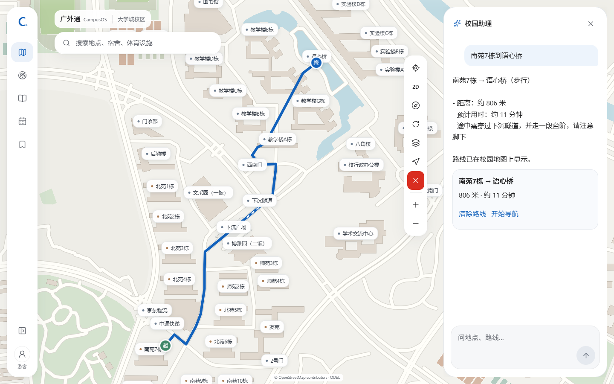
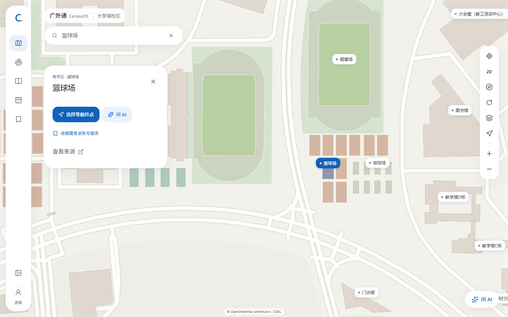
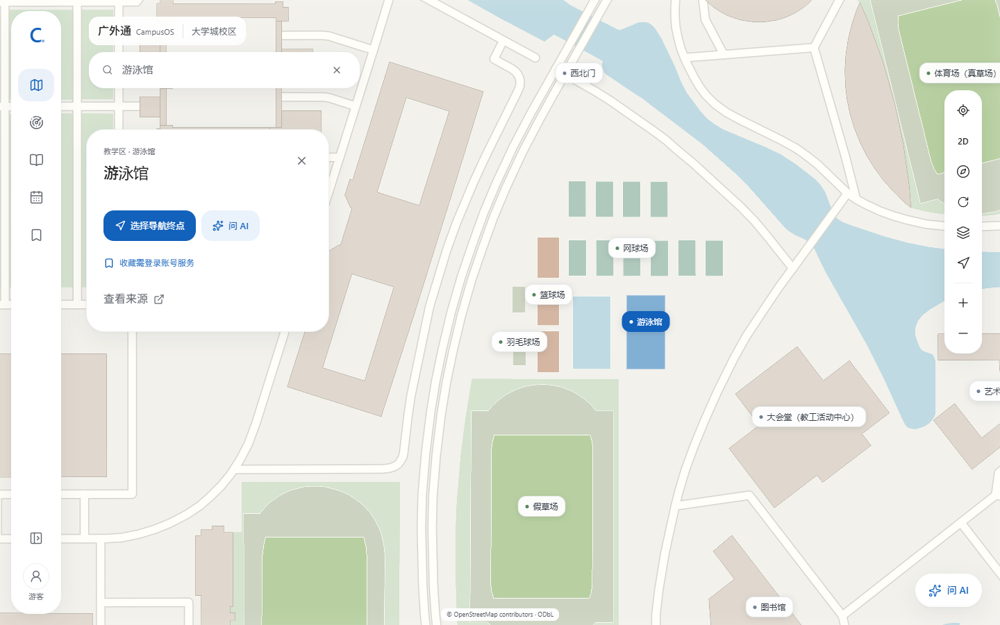

# S2-E 预览反馈修复

日期：2026-10-16；基线 `4e08e4e`。仅更新 `campusos-preview`，无迁移、Secret变更、正式域名操作或新增收费资源。

## 1. AI路线问题

负责人截图已有服务回复，但错误地反复询问起点。原解析只支持带“从”的句式、只匹配完整地点名称；缺少“从”时依赖当前地图选中地点，不同浏览器历史会掩盖问题。不是浏览器全部AI功能无法连接。

原服务端代码抽为共享函数后，回归测试先得到3失败/1通过：`从南苑7栋到语心桥`通过，`南苑7栋到语心桥`、`南苑7到语心桥`漏起点，`我想去北苑5`不触发定位。旧公开版本在全新Edge会话中两种原始问法均复现，记录在 `verification/s2-e-fixes/before/`。

新 `navigationIntent`从真实地点/别名识别两端，支持已存在宿舍数字简称，最长匹配和数字边界避免南苑77栋误识别为7栋。明确建筑起点优先于旧地图状态；“从这里”继续使用经服务端核对的地点。

## 2. 默认起点与定位时间

负责人最新决定取代“省略起点先问”的旧规则：**明确发起导航且只提供可识别目的地时，先请求一次浏览器定位，以授权位置出发。**搜索、普通聊天和模式切换不定位；明确建筑起点不定位。拒绝、不可用或精度不足时允许手动输入，不能把选中建筑当设备当前位置。

`我的位置`及手动起点可续接最近未完成的用户导航需求；目的地重新从真实地点解析。服务端使用本人D1历史，不接收客户端历史或任意目的地ID；已验证路线卡片形成完成边界。无新增表或精确位置持久化。

公网定位另复现“定位已过期”：现场客户端与HTTP Date约2.6秒差（HTTP日期为秒级，有量化及网络误差），旧代码只容许1秒未来定位时间。`/location/challenge`新增`serverTime`，前端按服务端时间、单调计时和定位样本年龄计算`capturedAt`。**服务端所有权、单次消费、30秒过期、1秒未来容差、精度和范围校验均未放宽。**覆盖时钟快/慢1小时、快2.6秒、旧样本、过期和重复凭证；不声称硬件GPS真实性认证。

## 3. 全部批注处理

| 批注 | 处理 | 原标签锚点/来源ID |
|---|---|---|
| 1 | 10个篮球场合为1个 | `osm-way-1389859426`（第35个） |
| 2 | 4个排球场合为1个 | `osm-way-1389859420`（第29个） |
| 3–6 | 隐藏4个待核验标签及普通点击入口 | `1389859422/1389859417/1389859421/1389859419`（均osm-way） |
| 7 | 另一区3个篮球场合为1个 | `osm-way-1389859443`（第49个） |
| 8 | 10个网球场合为1个 | `osm-way-1389859447`（第53个） |
| 9 | 2个羽毛球场合为1个 | `osm-way-1389859440`（第46个） |
| 10 | 全部泳场改名游泳馆，2标签合为1个 | `osm-way-1389859438`（第44个）；旧名仍可检索 |
| 11 | 导航默认请求授权定位 | 拒绝允许手动起点，续接未完成目的地 |
| 12 | 清除路线红底白叉 | `#d92d20` / `#fff`，清理行为不改 |
| 13 | 修复原始路线问法 | 真实plan_route/control_map/地图执行回执 |

`owner-sports-label-review.json`独立版本`sports-labels-2026-10-16.1`，锚点按旧标签顺序/稳定ID核对，沿用原坐标，未从截图片素推算。使用既有`labelPlaceId`统一地图、搜索和附近结果。原113个源ID、坐标、轮廓保留；地图/路网几何版本不变，不重建模型或道路。

## 4. 实测与证据

- 全新Chrome/Edge真实DeepSeek：两种原始问法均调用真实路线及地图Skill，显示南苑7栋→语心桥806米、约11分钟、经下沉隧道；没有定位请求。检查真实线路/起终点和成功回执耗时，不以模型文字作成功证明。
- 首次“我想去北苑5”直接从已授权位置规划；定位拒绝时无工具和地图动作，刷新后“我的位置”从D1恢复目的地并实际显示路线。
- 标签数量/锚点、旧名检索、红白按钮、清理重画、抽屉、三模式与3D分别回归。公开校园模拟坐标及手机视口不等于手机GPS实机。
- 真实模型与Mock故障回归分列。最终统计在本报告末尾和PROGRESS补充。
- 截图/事件：`verification/s2-e-fixes/after/`；中间诊断保留`diagnostic/`：真实定位时钟故障；一次Chrome“旧版本预期”恰在发布完成后运行，因已正确显示路线而失败，不作为修复前证据；标签补充截图曾未关闭详情弹层而超时，改按正常关闭按钮操作，未强制点击。

## 5. 发布和限制

标准`npm run deploy:preview`完成Next/OpenNext构建、环境净化、实际入口dry-run和凭据扫描。原D1、5项Secret、额度和身份检查保持；无迁移、生产/DNS/其他项目操作。原OSM、路网和南苑7栋两版模型/GLB哈希不变，未扩展业务Skill或批量建模。

既有Free CPU稳定容量、真实手机、多地域、24小时模型能力刷新和开发依赖告警仍见BLOCKERS。本轮不声称这些项目已达标。保留批准的1元现有模型余额上限，未充值；账户余额差可能包括同期其他使用，不当项目独立账单。

入口：[公开预览地图](https://campusos-preview.zhujunkui1.workers.dev/map)。刷新一次后输入上述问法即可复验。Android Chrome/iPhone Safari真实GPS、输入法和后台恢复仍需负责人实机验收。

## 本轮最终结果

- 最新Worker版本：`a520feb8-41e6-4adb-8fae-58c6611f77bb`；HTTPS地址不变。
- TypeScript、Lint通过，211项单元/28文件通过。Next/OpenNext生产安全构建、实际入口dry-run与扫描通过；上传14780.42KiB/gzip2403.50KiB，平台部署启动验证106ms（非每次用户冷启动）。
- 常规9spec：Chrome和Edge各61通过、3既有条件跳过，含桌面/手机视口、五Skill、清理、抽屉、取消/断线/迟到动作及3D缩放拖动。两个原生外框测试和一个桌面不适用手机场景保持跳过。
- 最终公开版本专项：Chrome和Edge各10通过（每浏览器桌面5项+手机视口5项）。其中每浏览器8项真实模型用例、2项真实标签检查；16份最终模型记录均含真实plan_route/control_map和地图成功回执耗时。拒绝定位分支单列，刷新恢复使用真实D1。
- 最终事件/PNG：`verification/s2-e-fixes/final/`；中间过程在before/after/diagnostic，常规完整原始日志在忽略的test-results/fixes-*.txt。结构化统计见summary.json。最终版本发布后完成专项检查，不将旧版本结果替代最终专项。
- 1元授权范围累计账户余额变化0.20元，剩余约0.80元；含前序S2-E及可能的同期其他使用，不是本次修复独立账单。未充值、升级或放宽额度。
- 已知实际凭据及最终Worker/客户端资产扫描无命中；原模型/OSM/路网哈希及几何不变。无生产部署/数据库迁移/DNS修改。

### 实际浏览器截图

手机视口截图在同目录的chrome-mobile/msedge-mobile文件；实际手机仍未验收。以上为真实页面截图，无生成图或图像合成。
