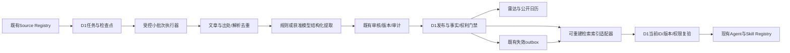
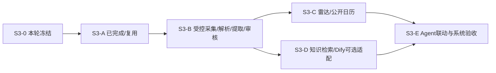

# S3-0｜校园信息引擎审计与架构冻结

日期：2026-10-17（Asia/Shanghai）。代码基线：`7d0f9eb`。冻结版本：`s3-freeze-2026-10-17.1`。

**本轮只交付审计、产品/数据契约与实施门槛。S3-A既有成果保留；被中断的S3-B不继续实施，没有启用来源、采集文章、运行微信PoC、调用模型、执行云端迁移或部署。**

入口文档：[数据模型与协议](S3_0_DATA_MODEL.md)、[固定分类JSON](contracts/s3-taxonomy.v1.json)、[参考产品与Dify研究](research/s3-0/product-and-dify.md)。事实证据：[仓库/Schema](verification/s3-0/repository-audit.json)、[真实Cloudflare只读快照](verification/s3-0/cloud-readonly.json)。下文“冻结/拟新增”是后续开发契约，不代表功能已运行。

## 1. 本轮范围、依据与实际现场

优先级：负责人本轮明确决定 → 最新DECISIONS（含本轮新增D-043）→ 当前实际实现和验收证据 → v2设计中仍有效的要求 → 早期草案/历史段落。事实与规划分开：负责人可以关闭某个开发专项，但没有相应实测时不能补写容量达标或服务接通。

已读取根/v2 AGENTS、索引、04/06/08/09/12相关设计，DECISIONS/PROGRESS/BLOCKERS/DATA_SOURCES，S2-A/B/C/D/E及CPU、浏览器、多会话验收记录；检查源码、配置、0001–0006迁移。开始时Git干净、HEAD为7d0f9eb。此前S3-B子任务仅做只读准备和失败的robots读取尝试，未创建业务代码或数据；中断现场无S3-B采集/PoC进程。参考研究只浏览公开页面，未向参考站提交信息。

### 1.1 当前能力，不按早期章节推断

| 模块           | 真实状态 / 复用位置                                                                                                        | S3边界                                                                                        |
| -------------- | -------------------------------------------------------------------------------------------------------------------------- | --------------------------------------------------------------------------------------------- |
| 地图           | MapLibre/Three.js、固定本地OSM、WGS84、113地点；`src/features/campus-map`                                                  | 只大学城；默认2D、单按钮三模式；原路网/隧道和南苑7栋保持，不转回高德底图                      |
| Agent          | `src/lib/server/agent`的Orchestrator/Registry/Executor；`models`的Router/Client；`assistant`的SSE/取消/共享D1/动作领取回执 | 仍1总控+4逻辑域；不能由网页、模型或新索引扩权                                                 |
| 当前生产Skills | search_places、get_place_details、find_nearby_places、plan_route、control_map                                              | domains.ts中的16项是能力规划，实际仅注册5项；知识/事件Skill以后接同一Registry                 |
| 会话           | `assistant/store.ts`及0004/0005；多会话新建、历史切换、删除、配额与路线绑定                                                | 必须保留；新信息引擎不另建聊天/会话系统，不用删除历史重置额度                                 |
| Console        | `/admin`静态外壳、`console/auth.ts`/`store.ts`/`api.ts`、`src/domain/console/contracts.ts`                                 | S3-A已完成；复用，不重做后台。公网独立HTTPS密钥、D1会话/CSRF/撤销，Access可选但未用于当前认证 |
| 雷达/知识      | `(campus)`路由调用`src/components/module-page.tsx`，显示准确空状态                                                         | 尚无列表/日历/知识检索运行实现，不能把页面存在当信息服务可用                                  |
| 收藏/日程      | 页面和DDL存在，学生账号/SMS/持久个人服务未开放                                                                             | 公共浏览不能依赖登录；个人写入不得伪造成功，也不借运营权限读取学生数据                        |
| Dify           | `src`无Dify实现，当前bindings无Dify/向量/对象存储/队列                                                                     | 只是规划；学校实例端点、授权、Key、模型和费用均未确认，不探测内网                             |
| 采集/索引      | 来源登记、审核、版本/outbox已存在；没有真实Connector/索引消费者                                                            | 本轮只冻结边界，不能把220候选称作220采集器或已采文章                                          |

### 1.2 真实D1与输入资料核对

0001–0006重放到一次性内存SQLite得到**45业务表**、外键0错误，不触及本地服务数据。另对精确的既有`campusos-preview`做只读SQL和配置核对：来源220、启用0、已核验0、公开域文档0、事件0、采集任务0、已发布正文0；D1校园地点投影0。当前地图实际使用固定JSON，D1空地图表不代表地图缺失，也不能假称已有可直接引用的D1地点FK。

原始文件实际存在于`CampusOS_Codex_完整设计文档_v2/`：同名`CampusOS_广外信息源_去重详表_2026-10-17.xlsx`和`.md`。本轮只读重核220主表行、220个Markdown稳定ID、29行冲突事项，文件SHA与S3-A保存值一致。109官网、89公众号、3服务号、16小程序、1企业微信、2内嵌应用；社团组织/证据及冲突表是核验线索，不是额外已认证账号。113警告沿用S3-A干跑记录，不重新导入或覆盖人工状态。

来源载体和机构分别记录：同名不同载体、同名不同认证主体不得自动合并；2026有组织活动不等于2026有公众号推文；官网可访问不等于允许全文转载或自动采集。学校登录系统仅入口，不采集学校密码/Cookie。公共知识可全校，地图匹配仅大学城。

## 2. 冲突清单与裁决

| 编号 | 旧设计/旧状态                                                | 证据与本轮裁决                                                                                                                                                                        |
| ---- | ------------------------------------------------------------ | ------------------------------------------------------------------------------------------------------------------------------------------------------------------------------------- |
| C01  | v2 08/09早期高德底图、仅2D/2.5D                              | D-018以后实际OSM/MapLibre，Provider初始mode=2d，三模式已验收；以后文和实际代码为准                                                                                                    |
| C02  | 0001偏好表默认2.5d、CHECK只含2d/2.5d                         | 此表尚未接地图；不能改当前默认或倒退三模式。未来接账号时兼容迁移，S3-0不改DDL                                                                                                         |
| C03  | 历史S2-A/B段落：聊天关闭、工具为空、路线仅内存               | S2-C–E/0004–0005与当前5项manifest为准；共享会话、删除和回执保持                                                                                                                       |
| C04  | `domains.ts`列16项；静态CAPABILITIES.agent.available=false   | 16项不是16项已运行；实时/api/agent/status只读核实模型就绪和5注册工具。能力标志存在历史滞后，后续修订不得凭常量宣称RAG/账号可用                                                        |
| C05  | 历史文档“无云端Worker/D1/HTTPS”                              | S3-A与本轮只读快照表明隔离预览已部署；production仍占位，gdufs.ccwu.cc不操作                                                                                                           |
| C06  | 规划Dify或误当已接学校Dify                                   | 当前无Dify代码/绑定/鉴权证据；采用窄RAG适配边界，不能替换自研Agent或假接学校服务                                                                                                      |
| C07  | 旧开发计划把知识Console放S6，或认为没有S3-0就没有后台        | S3-A已先完成；现在补S3-0设计冻结，不回滚、不重做S3-A                                                                                                                                  |
| C08  | 04方案B“官方文章可自动索引”被等同自动发布                    | 首批真实数据一律待审；只有已核验来源、合规用途和批准策略下的已批准当前版本才可发布/索引。自动策略未验收前关闭                                                                         |
| C09  | 基础`content_reviews`关联users；当前运营身份在console_admins | 公共内容审核复用console_content_reviews/console_audit_logs；不能为后台审核伪造学生users身份或另起审核权威库                                                                           |
| C10  | `candidate_kind=event/knowledge`、category自由文本、旧status | 不是新的7/6分类或content_type；按第3节和数据模型做兼容扩展，旧字段继续作为过渡，不机械改名覆盖                                                                                        |
| C11  | Console人工编辑会写fetched_at=now；事件validUntil可取startAt | 当前实现是S3-A最小行为，不作为S3信息语义标准；S3-B区分抓取/原发布时间/系统更新时间，S3-C不把开始时间伪造成结束时间                                                                    |
| C12  | “CPU专项已完成”与旧报告“Free稳定容量未达标”                  | 按负责人要求将专项实施视为已完成且不重启专项。b71/S3-A报告仍有Agent48/116ms、单样本54ms及页面8/14ms；未有更新的容量通过证据。本轮只登记历史风险，S3不新增昂贵同步处理，不补写长期达标 |
| C13  | 固定JSON已有真实地点，但D1 campus_places仍空                 | 事件place_id有真实FK约束；未经带版本/许可的有限引用投影前保持null，不能绕FK、猜ID或重做地图                                                                                           |
| C14  | 原数据库“表存在”被认为服务已经可用                           | chunks/facts/events/个人表目前没有相应业务闭环；逐阶段真实验收，不给空表填假内容                                                                                                      |

历史记录保留其日期，不批量改写为当前状态；本基线和D-043是S3后续实施入口。

## 3. 冻结的产品与分类

### 3.1 分类契约

| 视图     | 固定一级分类（顺序也是默认展示顺序）                         |
| -------- | ------------------------------------------------------------ |
| 校园雷达 | 讲座、文体活动、竞赛、升学就业、学术科研、奖助机会、校园公告 |
| 校园知识 | 学业教务、校园生活、办事服务、奖助政策、升学就业、科研创新   |

稳定代码、状态枚举见[分类JSON](contracts/s3-taxonomy.v1.json)。主键为`(taxonomy,code)`，同一版本每个视图至多一个主分类；同一原文可同时派生一条雷达投影和一条知识投影。分类不明确进入审核，不随意塞进校园公告。

`content_type`是活动/通知/政策/指南/新闻/未知；`category`是当前视图的主分类；tags仅辅助主题（上限12），不是学院、机构、校区、来源、官方身份、审核或报名状态的替代字段。来源机构/载体、campus_scope、review_status、lifecycle_status、publication_status分别存储。

event_status对外徽标可包含报名中/已截止/已取消/已结束，内部保留事件阶段与报名状态两个维度，避免把“需报名”当“正在报名”或“本人已报名”。优先显示明确取消/改期/结束；其余由已核验起止时间、截止语义和报名要求推导，不用发布时间推导活动时间。日期型截止不补23:59；当天显示时刻未明，跨过该日期才可说明截止日期已过。

### 3.2 参考机制与CampusOS差异

对[PKU Know](https://pkuknow.cn/)及[日历](https://pkuknow.cn/calendar)只读观察：聚合卡片、来源筛选与搜索、报名要求、摘要/原文、周日历，以及390×844下单双列切换。没有验证其采集、模型、授权或审核内部实现；不复制其代码、视觉资产、品牌、数据或分类体系。详情和限制见研究文档。

CampusOS冻结为：匿名可浏览已公开的雷达/知识和公开活动日历；保留全局AI和现有学生导航。日历可作为`/radar/calendar`子入口，不把公共活动日历伪装成已实现的个人日程。手机默认单列保证时间/地点可读，可提供双列选择并测试窄屏；桌面复用现有布局/组件，不新增永久占地图的内容侧栏。来源补充先进入候选线索审核；不在本轮开放匿名任意URL抓取。

点击地点/路线继续用已验证ID、现有Skills与MapAction回执；文章地点文本不能直接转地图坐标。收藏/添加个人日程须待有效学生登录与写入确认闭环，未具备时显示明确未开放，不虚报保存。

## 4. 统一数据底座与责任边界

D1是来源、原文元数据/合规文本、版本、审核、任务、事件、权限与索引映射的权威；检索索引是可重建派生物。原文/版本、提取事件、知识片段、审核与任务分离，不能塞进一个extracted_fields_json。沿用45表和DAO，具体PK/FK、拟增量字段与兼容要求见[数据模型](S3_0_DATA_MODEL.md)。**本轮无新DDL或迁移。**

大文件/图片/附件只记录合法元数据和源链接；没有批准的对象存储、版权范围和成本前不下载归档或公开镜像。已授权正文才可按权利范围保存/送索引；未知则只保留必要元数据、合规短摘录/自有摘要及原文跳转。公开API使用字段白名单，不能把`console_public_documents`的`d.*`直接序列化给游客。

审核通过、公开发布和索引完成是不同状态。任何检索后端返回的ID/版本/分数都不是权限，必须在D1复验；远端删除失败也立即停止对外引用撤回内容。事件若因来源变化失去关键字段的有效证据，应撤下地图/公开投影，不能只删一个页面卡片。

## 5. Dify与检索方案冻结

| 方案                    | 收益 / 约束                                                                    | S3优先级                                                      |
| ----------------------- | ------------------------------------------------------------------------------ | ------------------------------------------------------------- |
| D1受控关键词/分类检索   | 不新增云资源，能复用审核门禁；中文分词、相关性、扫描行数需真实测试             | P0默认后端，先标题/分类/必要短摘要，分页/索引限制；再评估FTS5 |
| Dify Dataset检索        | 可复用已有知识检索能力；需真实端点/Key/数据范围/模型与费用、索引映射和撤回同步 | P1适配；学校依赖不可用不阻塞D1公共浏览/检索                   |
| Vectorize或其他托管索引 | 向量能力与运维方案可独立评估                                                   | 未授权资源，不创建；需维度/Embedding/费用另批                 |
| R2等对象存储            | 大附件与原件归档                                                               | 未授权，不为S3-0开通或假定免费可用                            |

D1官方支持FTS5，但不能据此宣称中文召回已达标；需单独验证分词/二三字词和标题精确匹配。[D1扩展](https://developers.cloudflare.com/d1/sql-api/sql-statements/)

冻结`KnowledgeRetriever.retrieve(validatedQuery, trustedPublicScope, limit, signal)`：返回本地documentId/version、片段、证据区间、来源URL、原发布时间、backend标记。`D1KeywordRetriever`与`DifyDatasetRetriever`服从同一输出Schema和D1复验。Dify写索引权限和只读检索Key分离，固定服务端端点；不把管理Key、GPS、私人对话、成绩或未经许可全文发给外部系统。

方向必须明确：CampusOS调用Dify的`POST /datasets/{dataset_id}/retrieve`是候选方案；Dify调用CampusOS的external `/retrieval`是相反方向，当前不开放该服务。两者均不替代自研Orchestrator/ModelRouter/Registry/Executor，不新增第二个聊天总控，也不自动触发Dify生成工作流。官方接口与许可研究见[研究第3–5节](research/s3-0/product-and-dify.md)。

Dify接入前缺口：学校授权、可达HTTPS端点（不得绕入内网）、采用版本、限定Dataset、最小作用域Key、Embedding/Rerank模型及预算、容量/隐私/许可与撤回测试。Cloud免费额度和自托管软件均不等于零基础设施/模型成本。Key只进Secret，禁止上传学校个人账号密码或Cookie。

默认D1；Dify未配置时准确标不可用。以后启用Dify遇故障，可按预先批准策略使用无额外模型消费的D1公共检索并标明降级；没有已核验结果就返回不足。不能悄悄切换供应商/平台Key或伪称Dify已答复。当前仅接口设计，无真实Dify集成。

## 6. 执行、免费预算与安全约束

### 6.1 低成本执行方式

普通用户HTTP只负责轻量查询；管理接口创建/读取/暂停任务，不能一口气爬列表、批量正文、LLM与索引。S3-B默认采用管理员启动的受控本地执行器，按D1租约和检查点做小步；Python/Docker微信PoC与官方Connector分开。没有常驻主机时诚实标“手动运行/非全天候采集”，不伪装定时更新。

同一预览Worker未来最多承接已基准验证的有限步骤。Cron和waitUntil不是突破CPU上限的方法；不为后台任务创建新Worker/Queues/DO/R2或付费组件。每步提交前复验来源版本/启用许可、会话/租约/取消；同一结果幂等，失败停顿并可恢复，不能无限重试。

设计起始保护值（非实测吞吐/来源授权）：首轮最多5源，每站1列表+2详情，初期总网络请求≤20/次；每站间隔至少10秒，站点要求更慢则从其要求。增量起步全局≤20请求/日、≤10篇新增/变更/日；重试最多2次、有退避、429/403/登录/验证码/robots禁止时暂停，不绕过。具体阈值需S3-B据真实站点与CPU再定，不能把阈值当采集承诺。

### 6.2 平台限制与证据差异

当日官方Free约束：请求10万/日、HTTP与Cron CPU各10ms、内存128MB、50子请求/次；网络/D1等待不等于CPU，偶发弹性不等于长期保证。[Workers限制](https://developers.cloudflare.com/workers/platform/limits/)

D1免费账户额度为读500万行/日、写10万行/日、总存储5GB；单个Free数据库上限500MB，不能把账户5GB当本库容量。需测实际rows_read/rows_written，索引维护也占写入，扫描不是只看返回行数。[D1价格](https://developers.cloudflare.com/d1/platform/pricing/)、[D1限制](https://developers.cloudflare.com/d1/platform/limits/)

这些是官方规格，不是本账户实时剩余额度，本轮没有进行计费能力开通或压力测试。初期采集预算可另设每日读5000/写1000行软阈值，必须与地图/Agent共享账户余量评估；到阈值安全停，不擅自提额。220源×10篇×多版本全文加索引可能逼近本库容量，不能无界保存原件。

负责人把CPU专项视为完成，本轮遵从且不重新实施；现有S2-E/S3-A证据仍保留超10ms样本。S3只冻结不增重的执行边界；未来新增API必须独立测CPU/Wall、D1与子请求，低频零错误不能代替容量验收。

### 6.3 安全与版权

- 精确域名/栏目allowlist，由已审批sourceId选规则；不接游客任意URL/请求头或任意重定向。校方子域不做宽泛后缀放行，IP/内网/元数据地址/非HTTPS/异常端口拒绝；DNS与实际连接约束须验证，既有compatibility flag不能单独当SSRF证明。
- 原文HTML与模型输出都是不可信数据。去除脚本/隐藏区/事件属性，后台预览沿用纯文本；提取字段有Schema、证据区间与置信度，unknown不补造，网页不能提升工具权限。
- robots、条款、官方主体、采集频率和附件权利分别核对；robots不等于版权授权。没有全文许可不公开镜像/图片，不将未核验公众号全文送外部索引。
- 运营密钥/管理员会话和学生会话分离，所有管理接口继续鉴权/CSRF/原子审计；采集器不能批准自己输出，管理员不能借运营权限读取私人学生数据。
- 公众号工具只做独立本地PoC，每工具/目标账号最多10篇公开样本，许可、当前Issue和实测分母分别报告；被平台阻止即停止。S3-0不执行PoC，也不假称可用。

### 6.4 管理后台身份与最小权限

继续复用`requireConsole`、`consolePermission`与D1命令guard，不新增第二套管理员表。当前公网采用`admin_key`：精确HTTPS Origin、服务端独立高熵访问密钥交换HttpOnly/Secure/SameSite=Strict Cookie，D1会话、CSRF、每次角色/状态/密钥指纹验证和撤销；退出与密钥轮换拒绝旧Cookie。错误配置关闭管理能力，不降级开发认证。邮箱只是操作者标签，不是已验证的学校登录身份；当前配置仅一名管理员，不宣称已有多人独立凭据。

| 可信D1角色               | 管理只读 | 编辑来源/内容 | 审核内容 | 发布/撤回 |
| ------------------------ | -------- | ------------- | -------- | --------- |
| admin                    | 允许     | 允许          | 允许     | 允许      |
| operator                 | 允许     | 允许          | 允许     | 拒绝      |
| reviewer                 | 允许     | 拒绝          | 允许     | 拒绝      |
| 学生/游客/伪造客户端角色 | 拒绝     | 拒绝          | 拒绝     | 拒绝      |

此表来自当前`consolePermission`的read/write/review/publish边界；未来任务控制和索引维护须映射到明确受控命令，新增授权前默认拒绝。采集执行器只持批准任务作用域，不能通过提交结果自设verified/approved/published或变更管理员角色。批次操作保留session/actor、目标ID、版本、幂等键、结果和审计；不记录凭据、私人对话或精确GPS。运营角色无学生私域读取权，公共浏览API与管理API使用不同字段投影和权限。

## 7. S3-A至S3-E实施依赖与停止点

| 阶段 | 具体工作                                                                                                           | 前置与验收/退出门槛                                                                                                                         |
| ---- | ------------------------------------------------------------------------------------------------------------------ | ------------------------------------------------------------------------------------------------------------------------------------------- |
| S3-A | 已有后台、220候选、D1审核/版本/outbox/认证                                                                         | 已完成不重做；兼容差异在后续迁移中逐项补齐，不回滚成果                                                                                      |
| S3-B | 逐站核验5官网候选；3–5个可用Connector目标；受控任务/断点/去重/原发布时间/版本；规则或另获授权模型提取；独立微信PoC | 先robots/条款/版权；真实数据全待审。实际成功数如实报告，受限不足3源不凑数。官网成功、解析成功、审核批准、公开发布四个数字分开；Dify非硬依赖 |
| S3-C | 固定7类雷达、通知/活动区别、搜索/来源/校区过滤、报名状态与公开日历、手机单双列                                     | 只有可公开当前版本；多事件/多来源、取消/改期/过期及时处理；大学城地图投影须过地理FK/版本门槛，不代替个人日程                                |
| S3-D | 固定6类知识、关键词/片段/来源引用、索引适配器与outbox；获授权时单独接Dify                                          | 默认D1真实检索。Dify缺依赖明确标未集成；禁止无证据回答，撤回/私域/版本失配全路径拒绝                                                        |
| S3-E | 原Agent接只读知识/事件Skills，卡片/地图动作与证据；成本、性能、故障与权限回归                                      | 每个新增Skill注册/Schema/输出/权限/超时；地图动作等实际回执。个人收藏/日程依赖S4身份与确认写入，未具备则不开放。正式生产/DNS另批            |

后续每阶段须负责人明确启动；阶段完成即停。当前只提交S3-0文档，不恢复刚中断的S3-B。

## 8. 测试计划与验收门槛（计划，不冒充本轮通过）

| 层面       | 必测与失败标准                                                                                                                                                   |
| ---------- | ---------------------------------------------------------------------------------------------------------------------------------------------------------------- |
| 数据/迁移  | 空库和既有历史升级、原ID/FK/私域/配额保留；不能清空preview；危险重建需先确认                                                                                     |
| Connector  | 真实许可/robots；ETag/Last-Modified与hash增量；同URL重复不新发布；原文变化有版本；多栏目出处保留；失败/超大/编码/分页可见；不按同标题跨年合并                    |
| 任务/恢复  | 两执行器争抢租约只有1成功，过期fence拒绝；重启从checkpoint恢复；暂停/取消无迟到提交；幂等/退避/日上限/无重试风暴                                                 |
| 提取       | 多活动、一活动多来源、日期型截止、取消/改期、未知时间/发布者/地点、错误校区；每字段证据指向准确文章版本，不按fetched_at编发布时间                                |
| 审核/版权  | 采集/解析不等于批准/发布；未批准或无用途许可不得公开/索引；退回/拒绝/过期/撤回/源暂停同步失效；非官方不自动升格                                                  |
| 检索/Dify  | 中文问题、分类精确过滤、引用与学年、旧版本/远端残留拒绝、远端超时/无配置真实降级；真实API与Mock分开，缺预算不跑模型                                              |
| 前端       | Chrome/Edge桌面/手机视口，日历日期和筛选、长标题/未知字段、200%文字、原文链接；匿名浏览不因未登录阻塞；真机单独列验收                                            |
| Agent/地图 | 五地图Skill、多会话/删除、取消/回执、隧道、三模式/模型、清路线不回归；事件只能用真实校验地点，模型不造路/ID                                                      |
| CPU/费用   | 官方Tail/Metrics区分CPU/Wall，记录冷暖/样本/地域；新增轻量API目标P95≤7ms且有限样本不超10ms，未达则关闭云端重步骤并保留本地runner；记录D1行与外部调用、无无界批次 |

### 本轮实际完成的必要检查

| 检查            | 实际结果与范围                                                                                                 |
| --------------- | -------------------------------------------------------------------------------------------------------------- |
| 文档/数据契约   | 分类精确7/6类且同一视图代码唯一；10个本地Markdown链接有效；文档范围及git diff检查通过                          |
| 原始资料/Schema | 220主表/220稳定ID、原文件SHA保持；0001–0006在一次性内存SQLite重放45表，FK0错误；未执行D1迁移                   |
| 现有代码基线    | typecheck、lint、256项单元测试（35文件）、Next.js生产构建通过；未修改应用代码或运行时配置                      |
| Chrome/Edge     | 各2项现有匿名/伪造角色管理API拒绝用例通过（桌面/手机项目上下文），仅HTTP鉴权检查，不等于完整界面或手机实机验收 |
| 真实云端        | 只读核对既有preview的绑定名称、版本、来源/公开内容计数和模型就绪元数据；未调用生成接口、写入业务数据或更新部署 |

详细结果见[本轮检查记录](verification/s3-0/checks.json)。未重跑付费模型、OpenNext安全构建、完整地图/浏览器性能或生产部署，旧验收报告只作为历史证据。S3-B至S3-E的测试矩阵仍是计划。

## 9. 仍需负责人/外部依赖

1. 首批每站可采栏目、robots/条款和允许用途；当前全候选未启用，不能由目录活跃年份替代。
2. Dify学校授权、可达端点/版本/Dataset/Key/预算与许可；未提供前保持未集成，默认D1方案可独立推进。
3. 新提取/Embedding/Rerank费用预算和能力验证；此前1元S2测试授权不自动转成本轮或长期采集预算，默认模型生成0调用。
4. 大文件存储/下载与再分发许可；新云资源和费用须另批，现不创建。
5. 持续采集运行载体/人员（现无云端重处理资源批准）、真实手机、未来学生账号与个人写入确认依赖。

**完成S3-0后停止；不创建生产资源、不改DNS、不升级套餐、不运行学校登录/内网Dify、不无控制启动采集。**
