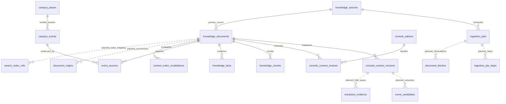

# S3-0｜统一数据模型、协议与状态契约

> 2026-10-17 D-047最终收尾：时间严格诊断10/10，有界人工导入/许可/出处/时间证据、匿名元数据门禁与审核按钮反馈已实现；增量0012/0013共55业务表。真实负责人发布闭环和最新测试/部署状态见[最终准入清单](S3_B_FINAL_ADMISSION.md)，下方旧阶段数字保持历史。

> 当前检索裁决（2026-10-17，D-045）：自研 KnowledgeRetriever + D1KeywordRetriever；Dify 路线正式废弃。原冻结中已由S3-B实现的结构以0007–0011和实际DAO为准；本次不新增迁移。S3-D计划见 [验收目标](S3_D_RETRIEVAL_PLAN.md)。

版本：`s3-freeze-2026-10-17.1`。基线：`7d0f9eb`。**本文件是设计冻结，不是已执行DDL；没有新增migration、API或表。** 实际45表/列/PK/FK见[只读Schema证据](verification/s3-0/repository-audit.json)，产品与阶段见[总体基线](S3_0_ARCHITECTURE_BASELINE.md)。

## 1. 现有权威实体：复用而非另建一套

| 现有实体                        | 主键与实际关系                                                                                        | S3用法 / 不能误解之处                                                                         |
| ------------------------------- | ----------------------------------------------------------------------------------------------------- | --------------------------------------------------------------------------------------------- |
| knowledge_sources               | id PK；网站/公众号等由channel_type区分                                                                | 保留220稳定ID和出处；source_type粗分类兼容保留，不与GIS的source_records混为同一权限域         |
| knowledge_documents             | id PK；source_id→knowledge_sources；owner_user_id→users；superseded_by→自身；UNIQUE(url,content_hash) | 原始文章/文档的稳定业务实体，主来源唯一；原文URL/内容指纹/时间/公开域是事实，不以标题作为身份 |
| console_content_versions        | PK(document_id,version)；document_id→documents，created_by→console_admins                             | 现有版本/恢复的唯一历史库；后续提取和出处引用这个不可变快照，不再建平行文章版本系统           |
| console_content_reviews         | id PK；document_id→documents；admin_id→console_admins；version标被审版本                              | 复用实际运营审核；不得改用要求学生users身份的旧content_reviews假建管理员                      |
| console_commands / audit_logs   | 命令id PK；关联admin、session、source；原子触发审计                                                   | 扩展固定业务动作时沿用真实权限/幂等/乐观版本，不提供通用SQL或模型写入接口                     |
| ingestion_jobs                  | id PK；source_id→sources；status仅queued/running/completed/failed                                     | 没有现成可恢复执行器；后续扩展检查点与租约，不假称已有Cron/队列                               |
| knowledge_chunks                | id PK；document_id→documents ON DELETE CASCADE；vector_key UNIQUE                                     | 复用片段实体，补版本/内容修订引用后才可索引；D1已有表不代表已生成Embedding                    |
| knowledge_facts                 | id PK；document_id→documents；evidence_chunk_id→chunks                                                | 复用事实/证据概念，扩展字段名、证据、核验；claim不是“绝对事实”                                |
| campus_events                   | id PK；place_id→campus_places；review_status和事件阶段status                                          | 复用已批准的规范事件，不把原文整篇当事件；category目前自由文本，尚无固定7分类约束             |
| event_sources                   | PK(event_id,document_id)；分别FK→events/documents                                                     | 一个事件多原文、一个原文多事件；补证据版本/内容修订，不删除原始出处                           |
| content_index_invalidations     | id PK；document_id→documents；version/reason/state                                                    | 复用文档中心outbox，状态变化即时D1拒绝，再异步同步索引；不是已接向量库                        |
| console_admins/sessions/limits  | 独立运营身份、会话、限流                                                                              | 继续HTTPS密钥/CSRF/撤销/角色，不能授予学生私人数据访问                                        |
| user_favorites / user_schedules | 收藏PK(user_id,target_type,target_id)；日程user_id/place_id FK                                        | 保留为个人服务表；S3公共日历不依赖它们，也不冒充学生登录/确认写入已实现                       |

`source_records`、`campus_zones/places`是GIS许可与地理引用域，`knowledge_sources`是信息来源治理域；两类来源不同，不能为省表而混合“文章可信”与“地图素材授权”。

## 2. 统一实体图（实线含既有实体；虚线为后续拟补关系）



事件候选、文章版本、知识片段、审核和采集结果分别有实体边界，不把所有属性塞进extracted_fields_json。图中拟新增表的名称作为下一阶段迁移评审入口，不能据图直接对preview执行建表。

## 3. 需要兼容补齐的字段与关系

### 3.1 三种时间、两种版本

| 字段                                          | 语义                                                                                   |
| --------------------------------------------- | -------------------------------------------------------------------------------------- |
| published_at                                  | 原文发布时间，有来源证据才写；未知NULL，绝不以采集日补齐                               |
| fetched_at                                    | 实际获取内容/人工导入的时间；仅304或编辑文字不应伪装一次新抓取                         |
| source_updated_at                             | 源站明确提供的内容更新时间；HTTP Last-Modified可能是页面资源时间，不能无证据当文章改期 |
| updated_at                                    | CampusOS本记录的系统修改时间，与前两者分开                                             |
| last_checked_at / document_fetches.checked_at | 最近条件检查/尝试，304、失败也可记录，不改变published_at                               |
| version（现有）                               | 业务CAS/审核/发布/outbox版本，每次受控修改可增加                                       |
| content_revision（拟加）                      | 归一化内容输入改变才增加，审核/发布本身不增加                                          |
| input_hash（拟加）                            | 标题、正文、原始发布日期/发布者、规范URL/主来源、有效链接等提取输入的规范哈希          |

关键不变量：提取证据绑定`document_id + snapshot_version + content_revision + input_hash`。snapshot_version FK引用既有console_content_versions，历史快照不随当前文档变更；发布门禁比较当前content_revision/input_hash和审核状态。不能简单要求“提取时version == 发布后version”，否则审核/发布自身递增version会让所有证据立刻失效。索引映射另绑定当前业务version，旧索引命中须D1拒绝。

人工编辑/原文变更使相关内容修订失效并回待审；恢复旧版本也生成新的业务版本，不自动恢复旧批准。可按内容哈希+提取器版本+来源/权利作用域复用计算，但新修订的核验/批准不能继承。旧版本snapshot_json保留兼容恢复；新增过滤/事实/版权/任务字段均类型化，不继续堆入JSON。

### 3.2 拟增量，不重建来源/审核/会话

| 对象                                  | 拟补字段/PK/FK/唯一性                                                                                                                                  | 责任                                                                                                   |
| ------------------------------------- | ------------------------------------------------------------------------------------------------------------------------------------------------------ | ------------------------------------------------------------------------------------------------------ |
| knowledge_documents                   | content_type、updated_at/source_updated_at、content_revision/input_hash、原发布者及raw发布时间、rights_scope；canonical URL规范化                      | 保留现有PK/source_id/公开域约束；旧UNIQUE(url,content_hash)不当永久文章ID，稳定ID由规范URL来源关系维护 |
| console_content_versions              | content_revision/input_hash等类型化版本元数据                                                                                                          | 原复合PK保持；只读旧快照，业务与内容版本含义分清                                                       |
| document_origins（新）                | id PK；document_id/source_id FK；UNIQUE(source_id,canonical_url)；原栏目、原链接、首次/最近发现、源发布日期证据                                        | 同站多栏目/多来源出处；主来源变化需重新审核，不自动借用其他来源许可                                    |
| document_fetches（新）                | id PK；job_id/source_id/doc_id FK；可空复合FK(doc_id,snapshot_version)→console_content_versions；状态码/ETag/Last-Modified/MIME/bytes/时间/结果码/hash | 每次观察与变动版本分开，304不新建文章或提取；失败不清空旧文档                                          |
| document_attachments（新）            | id PK；复合FK到文章版本；URL、名称、MIME/已知大小、rights_status                                                                                       | 仅合规元数据；不默认下载附件/图片，外域重新审核                                                        |
| document_categories（新）             | PK(document_id,content_revision,taxonomy)；document_id FK；category_code FK→分类表(taxonomy,code)                                                      | 同一修订每视图一个主分类；同文可有雷达与知识两个投影                                                   |
| document_tags（新）                   | PK(document_id,content_revision,tag)；document_id FK                                                                                                   | 辅助主题，不储存机构/校区/审核等主维度                                                                 |
| event_candidates（新）                | id PK；复合FK(document_id,snapshot_version)→版本；UNIQUE(document_id,content_revision,extractor_version,ordinal)                                       | 一文多活动，提取候选不是可公开的campus_events；标题/主办/时间/报名/地点等分别类型化                    |
| extraction_evidence（新或事实表扩展） | id PK；candidate_id可空FK；复合版本FK；field_name/raw_span/offsets/confidence/extractor_version/verification_status                                    | 能回看具体版本文字；置信度不是批准权限，未知留NULL，不让模型自填verified=true                          |
| knowledge_facts/chunks                | 补content_revision、snapshot_version、input_hash与用途/核验字段，沿用doc FK                                                                            | 事实与检索片段分离；不把未经批准片段送公共索引                                                         |
| campus_events/event_sources           | event version/publication/lifecycle、报名要求/链接/状态、deadline_date/semantics；关系补证据快照/内容修订                                              | 保留既有事件状态CHECK和真实地点FK；对外报名徽标是派生，不将现有status硬塞新枚举                        |
| console_content_reviews               | 兼容扩展target_type/可空event_candidate_id/event_id，仍保留document_id和admin FK                                                                       | 事件审核指定主证据文档/版本，复用批准/退回/拒绝/撤回与审计，不另建第二套审核权限                       |
| search_index_refs（后续按实现评审）   | 本地doc/版本/chunk FK、索引命名空间、indexed_version/status/attempts；主键随自研索引实现确定，不预建外部Dataset映射                                  | 自研关键词/分段索引只保可重建映射；未来获批向量需另评审，索引ID/score不授予可见性                       |

分类常量可先由同一服务端JSON契约维护，需SQL约束时再建taxonomy_categories；不要同时维护多份互不校验的UI/SQL枚举。JSON数组可用于有界连接器规则或历史快照，不能替代可检索的主维度和实体关系。

去重：同一来源/规范URL重复只更新观察信息；hash相同不重复提取/发布；hash变化保留原快照并回待审。同标题不同年份/学院不合并。跨URL同指纹先做可追溯重复关联，不能自动继承另一来源的审核/版权。一个事件多文通过event_sources关联；文章相似不等于同一事件，同一活动改期也不能误生第二个已确认事件。

### 3.3 地点FK与地图版本

现有campus_events.place_id是到D1 campus_places的真实FK，但运行中的GIS权威是固定JSON，云端该表目前0行。冻结处理：提取候选先存raw_place_name与有版本的候选ID，不强行写事件place_id；S3-C/S3-E真正发布地图事件前，仅将所需、已核验的大学城地点做有限D1引用投影，连同既有source_records/campus_zones的许可/地理证据及mapVersion检查，保持原ID不变。

投影不是新的地图数据源；前端仍读原JSON/MapLibre，不复制路网、不重新定位、不生成新坐标。无法证明引用投影许可、版本或FK时place_id保持NULL，可显示全校/白云山/线上纯文本卡片，但不能落大学城地图。原文“图书馆”多校区歧义不能随意选大学城馆。

## 4. 状态与统一公开门禁

1. 来源：核验/官方主体/采集许可/启用分别判断；robots和权利范围属于许可证据，不由年份或优先级自动批准。
2. 文档：review_status为pending/approved/rejected；既有workflow_status的returned映射pending，其他值保持一致。publication_status与lifecycle_status独立；批准不自动发布。
3. 事件：候选审批与原文审批均需有效；必须有仍可引用的已批准来源版本支撑关键字段。event_status徽标由事件阶段与registration_state派生；不代表本人已报名。
4. 索引：未入队/排队/构建中/ready/失败/已撤销属于派生索引状态，不能改变文档审核/发布状态。
5. 公开读链：当前来源/权利→当前文档审批+发布+生命周期→当前内容修订/证据→事件事实门禁（如适用）→字段白名单。后台能读草稿不代表游客或Agent可读。

旧公开视图/`filterPublicContent`继续作为状态门禁基础，后续增加权利/内容修订/事件证据检查。暂停来源、撤回/拒绝/过期、文档更新必须立即使公开读取失效，同一事务写outbox。远端索引尚未删除时也拒绝旧命中。事件取消/改期同步增加事件版本，并为event_sources关联文档发出既有文档outbox或重新核验索引映射，不能只清理前端缓存。

没有全文许可时，公共页面只给必要元数据、自有简短摘要/合规引用与原文链接；RAG也不能以“片段”名义无界回传全文。外部索引上传范围单独审批；source.permission_status=approved不能直接等于拥有全文再分发权。

## 5. Connector协议冻结（设计接口，未实现）

```ts
interface SourceConnector {
  readonly sourceId: string;
  readonly ruleVersion: string;
  discover(
    ctx: ApprovedSourceContext,
    cursor: Checkpoint,
  ): Promise<DiscoveryBatch>;
  fetch(
    ctx: ApprovedSourceContext,
    target: ApprovedUrl,
    validators?: HttpValidators,
  ): Promise<FetchObservation>;
  parse(page: BoundedHtml, observation: FetchObservation): ParsedArticle;
  normalize(article: ParsedArticle): NormalizedArticle;
  validate(
    article: NormalizedArticle,
    policy: ApprovedPolicy,
  ): ValidatedCandidate;
  checkpoint(step: CommittedStep): Checkpoint;
  report(stats: ActualCounters): ConnectorReport;
}
```

ApprovedSourceContext由可信执行层构建，含来源/政策/规则版本、精确host与栏目路径、权利范围、剩余请求/字节预算、取消signal和持久租约；模型/客户端不能任意构造。每站规则独立，ETag/Last-Modified条件请求由FetchObservation记录，304或同hash不得重复提取。

Checkpoint只保存有界cursor/阶段/已提交目标和hash、next_run_after；不是任意脚本或数据库指令。建议起步HTML≤512KiB、正文沿用现有≤50000字符、每步1 URL；超限明确too_large，不静默截断后声称完整。附件只取许可允许的元数据；字节/链接/重定向/解压后大小都要限制。解析失败不能覆盖既有可用正文。

## 6. 可恢复任务与幂等

沿用ingestion_jobs.id/source_id；拟补phase、checkpoint、control_state、lease_owner/lease_until、lease_fence、next_run_after、policy_version、rule_version、byte/request counters、时间和去重run_key。阶段明细可用ingestion_job_steps，FK到同一任务，不另起权威任务库。

兼容既有4种status：queued/running/completed/failed；新增control_state表达active/paused/cancel_requested/cancelled，不直接写旧CHECK不允许的值。queued但paused不能被领取；取消可映射failed+CANCELLED错误码，UI显示取消而非假装成功。running暂停/取消在下一个受控提交点生效，先撤销/检查租约，拒绝迟到结果。

流程：enqueue→CAS claim/fence→一个受限阶段→原子写入结果+版本/审计+checkpoint→release/next；崩溃后只从最后已提交位置继续。每次写入复验来源已启用/当前许可、政策版本、管理员会话或已批准的job-scoped短票据与fence。网络等待期间不持长SQL事务。

幂等键：任务`(source_id,rule_version,window,manual_request_id)`；获取`(job_id,canonical_url,stage,attempt)`；文章规范URL与内容输入hash；提取`(doc_id,content_revision,extractor_version,input_hash)`；索引`(backend,doc_id,business_version)`。重试/重启不能重复扣模型预算、重复发布或重复批准；`ingestion_job_steps`只有实际完成才累计成功数。

S3-A命令触发器有固定动作/角色/版本约束，S3-B扩展任务动作需同步评审Schema和SQLguard；不能通过另一个不鉴权通道绕过原guard。长处理默认管理员受控本地runner；管理HTTP只接受有限、经过验证的结果/状态提交，不接通用SQL。

## 7. 共享的公开结果与Agent接口

`PublicContentCard`：documentId/currentVersion/contentType、当前视图category、tags、title、允许公开的summary、来源机构/载体/原文URL、publishedAt、campusScope、权利与生命周期的必要业务标志。未知字段显式NULL/unknown，不能把fetchedAt冒充publishedAt。

`PublicEventCard`：eventId/version、title/organizer、startsAt/endsAt、date-only或exact-time截止语义、registrationRequirement/state/url、eventStatus、campusScope、原始地点文本、有条件的真实placeId/mapVersion，以及当前可公开的documentId/version证据列表。

`KnowledgeHit`：documentId/currentVersion/contentRevision、chunkId、允许用途内片段/evidence offsets、来源URL/原发布日期、适用学年/时效、官方与非官方标识、backend/score（只排序）。所有命中回D1重新验证当前审核/发布、版本、来源许可与生命周期；索引状态和片段绑定内容修订。KnowledgeRetriever保持平台无关的自研接口，D1KeywordRetriever为正式后端路线；无证据或召回不足返回不足，不猜测规定。当前两者未实现，详见S3-D计划。

后续只读Skills沿用现有knowledge/events逻辑域和16项规划位置；每项仍严格Schema/权限/超时/错误/来源引用。RAG返回文字不能直接触发地图；需要经现有control_map与客户端真实回执。个人收藏/日程写操作继续关闭，直至S4真实身份和服务端确认台账可用，不能以模型confirmedActionId或运营密钥代替本人确认。

## 8. 迁移与验收约束

本轮仅设计。S3-B先做本地空库/有数据升级，保留原ID、FK、审核、配额、会话和回滚兼容；原始来源与审批状态不能被新导入覆盖。新增列/表/索引尽量增量，CHECK扩展或表重建有数据丢失风险时先暂停确认，不清空preview。S3-A目前0正文并非以后迁移可以假设永远空库。

每个未来迁移要列明旧/新字段映射、默认NULL/unknown的语义、业务version与content_revision迁移、外键关系、唯一性冲突处理和公开视图更新；失败保留原数据。除明确获批的预览兼容迁移外，不能创建生产资源、改正式DNS或消费新模型预算。
