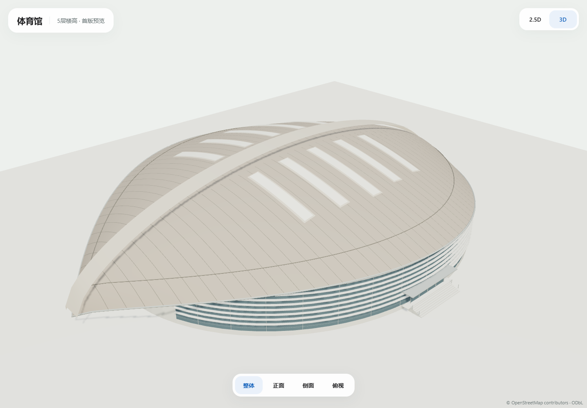

# 体育馆 · 首版2.5D / 3D

2026-10-25，负责人提供三张立面/鸟瞰图、一张俯视图，确认5层楼高。本稿按外部体量尺度制作，不推断体育馆内部有五层楼板。当前独立视觉评审，未接入正式地图。

## 查看与编辑

[打开可旋转预览](http://127.0.0.1:3023)，支持两模式、整体/正面/侧面/俯视；拖动旋转、滚轮缩放、Home复位。

```powershell
node scripts/build-gymnasium-model.mjs
node scripts/serve-gymnasium-preview.mjs
```

| 模型 | 字节 | 三角面 | 模型调用 | 材质 / 图片纹理 |
| --- | ---: | ---: | ---: | --- |
| [2.5D GLB](gymnasium-2.5d.glb) | 76332 | 1464 | 3 | 2 / 0 |
| [3D GLB](gymnasium-3d.glb) | 313932 | 14838 | 11 | 7 / 0 |

参数/四图SHA见[design.json](design.json)，坐标/原轮廓/资产SHA见[manifest.json](manifest.json)，显示最大包络见[GeoJSON](gymnasium-2.5d.geojson)。自有程序几何使用索引曲面、共享材质和实例化；无照片纹理，运行时无几何生成或空闲动画循环。GLB使用EXT_mesh_gpu_instancing，本预览已由Three.js GLTFLoader实际加载。

## 轮廓与外观

绑定现行固定地图s1-2026-10-14.2中的[OSM way1389756844](https://www.openstreetmap.org/way/1389756844)，名称沿用源体育馆（羽毛球场）。原80点椭圆外环完整保留于底座/清单，面积6361.3053平方米；原点为WGS84 [113.39123445,23.072108749999998]，局部east/up/south米制坐标。

2.5D白模保留弧形双翼屋面、东西拱带、十条采光条及入口台阶。3D增加屋面有限接缝、内侧弧线/檐口滚边、弧形玻璃墙、白色横向遮阳板、细窗格及简化门厅。采光条在南北两个屋面各五条，均为曲面上的独立几何。屋面主网格和屋檐使用索引几何，重复遮阳板/门框实例化。

两尖端悬挑屋面按照片单独构建，显示长约122米/宽89米，不能替代原地面椭圆或作为新增导航障碍。GeoJSON屋面height是最大显示包络，真正曲面和不同位置的外墙顶高见GLB/生成器。

## 尺寸与范围

5层楼高来自负责人；屋面最高24.4米、拱带顶25.55米、尖端2.6米、檐边中段12.9米、外墙顶约10.00–14.08米、台基1.2米、屋面悬挑及入口尺寸均为视觉估算。体育馆大空间没有据此生成五层室内平面。前景高杆/拉索归属和锚点未核验，首稿未固化这些遮挡物。没有改正式GIS/标签/路网或新增真实入口。

四张图片留在文档包，Downloads/体育馆俯视.png原像素副本存assets/model_references/gymnasium-v1。文件名数字无建筑参数/时序意义；原URL/年份/公开复用许可仍待补，仅内部观察，不放入public、预览图片端点或GLB纹理。自有模型保留OSM署名。本轮无外网影像/瓦片/供应商模型采集。

## 实际检查

[资产回执](asset-checks.json)：原椭圆/底座/SHA保持，四图/俯视副本核对，两模式各十个采光条射线命中、六处屋面曲线采样和拱带顶25.55米通过；顶点有限、非负高度、无图片；其他十组模型及历史A—D V1共41个GLB SHA保持，B钟楼修正未变。

[质量回执](quality-checks.json)：本轮三个JS文件ESLint、typecheck、生产构建及已有三文件9项模型单元通过。全仓lint仍因原备份inspect.mjs未使用导入和旧test_mp_tools_browsing_ui.cjs三处require失败，未修改这些文件。

[Edge回执](screenshots/edge-review.json)：Edge149，桌面1440×1000、手机视口390×844、短窗口950×540，两模式/四视角/旋转/缩放/调窗通过，十张正式截图，无页面错误，静止350ms无额外帧。手机视口使用桌面GPU，未验收手机实机FPS、热机或正式地图整页性能。



[正面](screenshots/desktop-3d-front.png) · [侧面](screenshots/desktop-3d-side.png) · [俯视](screenshots/desktop-3d-roof.png) · [2.5D](screenshots/desktop-2.5d-overall.png)
