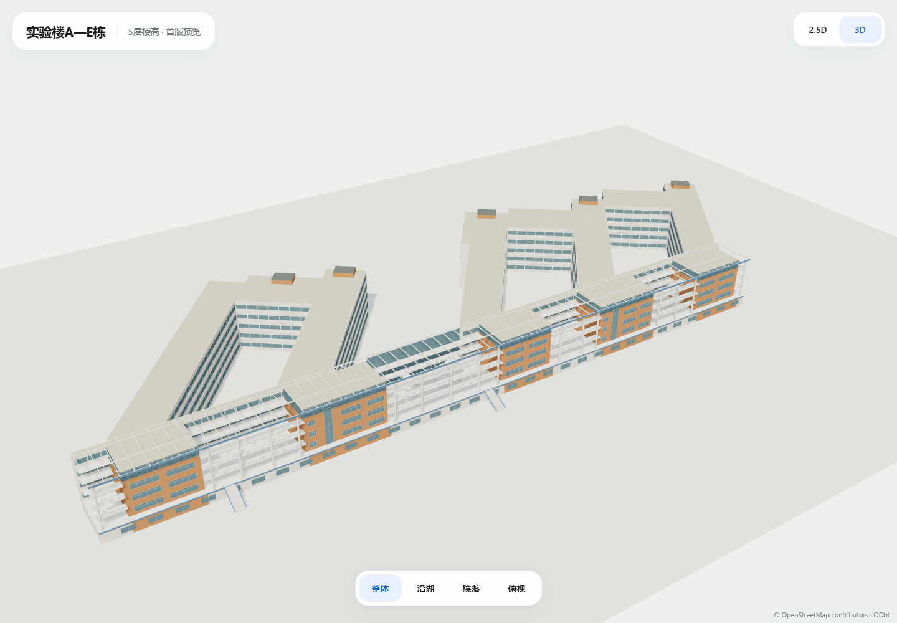

# 实验楼A—E栋建筑群 · 首版2.5D / 3D

2026-10-25，负责人授权制作整组建筑并确认5层楼高。当前为独立视觉评审，未接入正式地图。

## 查看与编辑

在项目根目录运行：

```powershell
node scripts/build-laboratory-a-e-model.mjs
node scripts/serve-laboratory-a-e-preview.mjs
```

打开[本机预览](http://127.0.0.1:3020)，可切换2.5D/3D与整体、沿湖、院落、俯视视角；拖动旋转、滚轮缩放、Home复位。

| 文件 | 字节 | 三角面 | 模型调用 | 材质 / 图片纹理 |
| --- | ---: | ---: | ---: | --- |
| [2.5D GLB](laboratory-a-e-2.5d.glb) | 98176 | 2320 | 5 | 2 / 0 |
| [3D GLB](laboratory-a-e-3d.glb) | 273224 | 15900 | 15 | 7 / 0 |

参数见[design.json](design.json)，资产SHA/坐标框架见[manifest.json](manifest.json)，显示分部见[GeoJSON](laboratory-a-e-2.5d.geojson)。GLB使用共享材质与实例化，运行时只加载资产，无几何生成循环或空闲渲染循环。GLB使用EXT_mesh_gpu_instancing，需支持此扩展的查看器；本预览Three.js GLTFLoader已实际加载。

## 体量与来源

- 现行固定地图s1-2026-10-14.2中的[OSM relation4105911](https://www.openstreetmap.org/relation/4105911)为唯一父轮廓，WGS84原点为[113.39405769999999,23.067542600000003]。原外环和三个真实内环完整保留于底座与清单。
- A/B/C/D/E五个源标签及父关系原样记录labelBindings；没有独立精确分栋轮廓，不把整组复制成五栋。五个橙色前部房间体块是立面显示分部，不能据此认定为A—E精确边界。
- 保留沿湖连续白框/蓝边、五层外部体量、橙色房间及非对称竖玻璃带、白色圆柱、开放连廊/栏杆、两处折返楼梯和外侧台阶、镂空屋架、后方三院落及屋顶简化服务房。
- 负责人提供的七张立面/鸟瞰图留在原文档细节目录；Downloads俯视图原像素复制到文档包assets/model_references/laboratory-a-e-v1。八图路径/大小/SHA记录design；文件名数字不作参数。原图仅内部参考，不放入public、预览端点或GLB纹理。自有程序几何保留OSM署名。

## 高度与适用范围

5层楼高为负责人描述；3.7/7.3/10.9/14.5/18.1米构件基准、屋架顶部18.45米、简化屋顶房最高20米均是视觉估算。未核验室内楼层布局，不将屋顶房认定为额外楼层。源轮廓未写回高度、分栋边界、入口或路线；连廊和楼梯仅作外观，不作为导航通行证据。

当前不制作室内、逐台设备、湖桥/植被/车辆。视觉验收、米制尺寸和真实手机性能仍需后续核对。正式src/public、GIS/标签/路网及既有七组模型保持。

## 实际检查

[资产回执](asset-checks.json)：八图SHA、源四环/底座一致、五标签原样、两模式的三个院落向下射线均无顶盖、屋架开孔射线到低楼板、显式坐标框架、零图片及既有17个资产SHA通过。

[质量回执](quality-checks.json)：三个本轮JS文件ESLint、typecheck、生产构建与既有三文件9项模型单元通过。全仓lint仍失败于此前备份inspect.mjs未使用导入和test_mp_tools_browsing_ui.cjs的三处require；未修改这些文件。

[Edge浏览器回执](screenshots/edge-review.json)：Edge149.0.4022.80，桌面1440×1000、手机视口390×844、短窗口950×540，模式/视角/旋转/缩放/调窗无页面错误，静止350ms无额外帧；共10张正式截图。手机视口使用桌面GPU，不等同手机实机FPS。



[沿湖](screenshots/desktop-3d-front.png) · [院落](screenshots/desktop-3d-side.png) · [俯视](screenshots/desktop-3d-roof.png) · [2.5D](screenshots/desktop-2.5d-overall.png) · [手机视口](screenshots/mobile-3d-overall.png)
