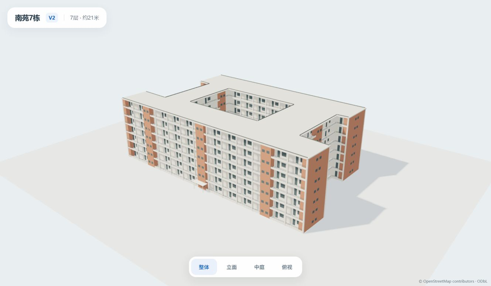
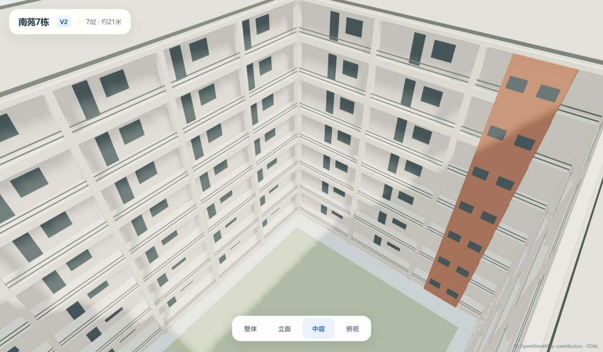

# 南苑7栋第二版 · 独立轻量预览

2026-10-14。负责人要求先设计第二版，不放入地图。本目录是独立评审草稿，地图中的第一版、地点、路网和公共模型清单保持原状。

2026-10-15更新：负责人已批准第二版3D接图、第一版2.5D保留。上文及本目录design/manifest是原评审快照；当前运行资产为public/models/nanyuan7/nanyuan7-v2-54cc55342ae5.glb，二进制与本目录GLB相同。当前地图清单在src/features/campus-map/data/nanyuan7-model.json，第一版原清单另存docs/model-previews/nanyuan7-v1/manifest.json。独立预览仍可用于查看模型，接图记录见docs/S1_NANYUAN7_V2_INTEGRATION_ACCEPTANCE.md。

[打开可旋转预览](http://127.0.0.1:3012/) · [模型文件](nanyuan7-v2.glb)

## 外观调整

根据本轮五张参考图保留浅色柱梁框架、砖红色竖向墙体、凹进阳台、开放中庭走廊、水平栏杆和挑檐。走廊通过主体内缩1.35米与独立楼板形成真实几何层次，七层楼板使用实例绘制；门窗用少量平面表达，栏杆用双面横条表达，材质按颜色合并。没有衣物、人、空调机、管线、逐砖几何或照片纹理。

“宿舍3.png”可见南苑七栋标识；“宿舍7.jpg”可见北苑6，作为同类宿舍的样式参考。原图保留在文档包 `assets/model_references/nanyuan7-v2`，不通过预览服务器发布。立面朝向、楼梯墙位置、开间、雨棚和中庭尺寸仍是简化设计，未作为实测资料、房号或导航入口登记。

## 轻量指标

| 指标         | 第二版              | 第一版桌面资产 |
| ------------ | ------------------- | -------------- |
| GLB文件      | 80384字节（约80KB） | 124024字节     |
| 三角面       | 4748                | 7040           |
| 模型绘制调用 | 7                   | 7              |
| 材质         | 5                   | 7              |
| 图片纹理     | 0                   | 0              |
| 高度/楼层    | 7层、约21米         | 7层、约21米    |

相对第一版桌面资产，文件减少约35%、三角面减少约33%；不能把这个比较用于第一版手机LOD。独立预览含地面、草坪和阴影的当前绘制调用为14，不是地图总成本。相机交互/600ms视角切换才触发绘制，静止后停止渲染，像素密度上限1.5；手机真实帧率和未来地图集成成本未验证。

外轮廓沿用原OSM way312536955，米制位置基于同版WGS84锚点；仅显示模型去掉误差小于4厘米的近共线冗余点，原GIS未修改。楼高保持负责人给定的约21米，仍是owner_approximation。中庭沿用第一版的视觉比例，预览草坪属于展示环境，不写入模型或GIS事实。

## 效果

### 整体



### 中庭



## 可编辑源与运行

设计参数：`design.json`。生成器：`scripts/build-nanyuan7-v2.mjs`。资产SHA、预算和边界：`manifest.json`。独立浏览器页：`index.html / preview.js`。

```powershell
node scripts/build-nanyuan7-v2.mjs
node scripts/serve-nanyuan7-v2.mjs
```

服务器仅监听127.0.0.1:3012，只提供预览文件与锁定Three.js0.186.1模块，不提供参考照片、地图页面、账号/API或任意项目文件。此草稿URL使用no-store，准确内容SHA在manifest中；后续正式接入仍需单独审核和版本绑定。

## 验证

- 48单元/9文件、类型检查、Lint及Next生产构建通过；新增单元验证隔离状态、原轮廓SHA、模型预算/无图片、七层实例楼板和21米总高。
- 独立预览Chrome4通过、Edge4通过，分别覆盖桌面1440×900与手机视口390×844/DPR3：四个视角、完整模型范围、600ms镜头、静止停止绘制、GLB失败诚实状态。截图与证据JSON在screenshots目录；手机视口不等于手机实机。
- Edge当前配置实际显示的整体/中庭JPEG另存，未编辑像素。应用src/public/package清单与e975a87比较无变更，第一版资产URL仍为原完整/低细节GLB；本轮未部署或注册第二版到地图。

```powershell
$env:E2E_BASE_URL='http://127.0.0.1:3012'
$env:MODEL_V2_PREVIEW_URL='http://127.0.0.1:3012'
$env:PLAYWRIGHT_CHANNEL='chrome'
npx playwright test tests/e2e/model-v2-preview.spec.ts --workers=1 --reporter=list --output=test-results/nanyuan7-v2-chrome
# Edge对应msedge及独立输出目录nanyuan7-v2-edge。
```

来源：OSM轮廓©OpenStreetMap contributors，ODbL-1.0；楼高为负责人近似值；本轮原图只内部观察。模型是自有简化几何和纯色材质，不包含第三方图片像素、纹理或模型。详细来源见工程记录SRC-045。
