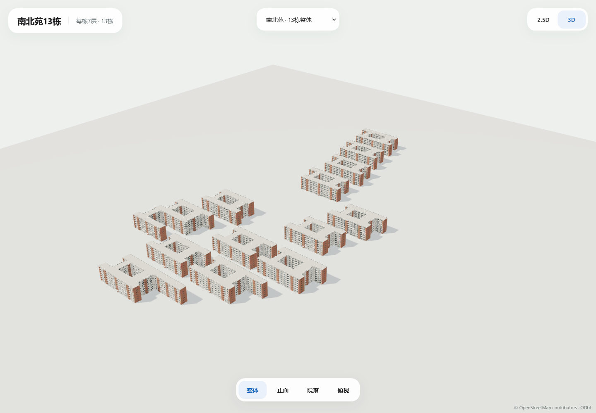

# 南北苑13栋宿舍 · 2.5D / 3D首版批量评审

2026-11-01，负责人明确授权北苑1—6栋、南苑7—13栋，共13栋，确认每栋7层，南北苑建筑风格一致、占地不同。本批范围限这13栋。当前为独立视觉评审，尚未接入正式地图。

## 查看与下载

**[打开预览](http://127.0.0.1:3025)**，下拉框可选择单栋、北苑、南苑或13栋整体；模型按需加载，可切换2.5D/3D与整体/正面/院落/俯视，拖动旋转、滚轮缩放、Home复位。默认整体2.5D；[整体3D](http://127.0.0.1:3025/?building=all&mode=3d)可直接查看全部。

**[下载模型包](dormitories-13-models.zip)**：26个单栋GLB＋6个组合GLB，附清单/参数/显示GeoJSON、质量记录及本模型截图，无源照片。

```powershell
node scripts/build-north-south-dormitories.mjs
node scripts/serve-north-south-dormitories-preview.mjs
```

## 逐栋资产

| 楼栋 | 2.5D | 3D | 3D字节 | 3D三角面 | 体量差异 |
| --- | --- | --- | ---: | ---: | --- |
| 北苑1栋 | [2.5D](models/n1-2.5d.glb) | [3D](models/n1-3d.glb) | 81392 | 4824 | 封闭内院 |
| 北苑2栋 | [2.5D](models/n2-2.5d.glb) | [3D](models/n2-3d.glb) | 81400 | 4824 | 封闭内院 |
| 北苑3栋 | [2.5D](models/n3-2.5d.glb) | [3D](models/n3-3d.glb) | 81408 | 4824 | 封闭内院 |
| 北苑4栋 | [2.5D](models/n4-2.5d.glb) | [3D](models/n4-3d.glb) | 81408 | 4824 | 封闭内院 |
| 北苑5栋 | [2.5D](models/n5-2.5d.glb) | [3D](models/n5-3d.glb) | 82252 | 4796 | 封闭内院 |
| 北苑6栋 | [2.5D](models/n6-2.5d.glb) | [3D](models/n6-3d.glb) | 82248 | 4796 | 封闭内院 |
| 南苑7栋 | [2.5D](models/s7-2.5d.glb) | [3D](models/s7-3d.glb) | 80384 | 4748 | 封闭内院 |
| 南苑8栋 | [2.5D](models/s8-2.5d.glb) | [3D](models/s8-3d.glb) | 110584 | 6902 | 一处封闭内院＋开放凹院 |
| 南苑9栋 | [2.5D](models/s9-2.5d.glb) | [3D](models/s9-3d.glb) | 81400 | 4812 | 封闭内院 |
| 南苑10栋 | [2.5D](models/s10-2.5d.glb) | [3D](models/s10-3d.glb) | 81400 | 4812 | 封闭内院 |
| 南苑11栋 | [2.5D](models/s11-2.5d.glb) | [3D](models/s11-3d.glb) | 81396 | 4812 | 封闭内院 |
| 南苑12栋 | [2.5D](models/s12-2.5d.glb) | [3D](models/s12-3d.glb) | 84508 | 5048 | 内院＋延伸翼楼 |
| 南苑13栋 | [2.5D](models/s13-2.5d.glb) | [3D](models/s13-3d.glb) | 89952 | 5420 | 内院＋延伸翼楼 |

每个单栋3D均为7模型调用/5材质/0图片纹理，约80—111KB。南苑7栋3D直接复制原已验收V2文件，SHA为54cc55342ae54c2f38743341490fe943de8a877f8a968bc7c46d7a6f2c14b79a，与原文档包及public运行文件逐字节相同。其2.5D GLB为既有原生挤出几何的离线展示转换，正式原生2.5D保持。

## 组合资产与性能口径

| 组合 | 模式 | 字节 | 三角面 | 模型调用 |
| --- | --- | ---: | ---: | ---: |
| [南北苑13栋](models/all-2.5d.glb) | 2.5d | 170388 | 1744 | 2 |
| [南北苑13栋](models/all-3d.glb) | 3d | 965156 | 65442 | 19 |
| [北苑1—6栋](models/north-2.5d.glb) | 2.5d | 76556 | 768 | 2 |
| [北苑1—6栋](models/north-3d.glb) | 3d | 434360 | 28888 | 12 |
| [南苑7—13栋](models/south-2.5d.glb) | 2.5d | 96536 | 976 | 2 |
| [南苑7—13栋](models/south-3d.glb) | 3d | 542628 | 36554 | 13 |

组合按真实坐标摆放：静态房间/屋顶面按材质离线合并，相同柱梁/窗面共享实例；不同足迹的楼板各自保留。13栋3D为65442三角面/19模型调用，分别加载13个单栋会有91个模型调用。调用不含地面和阴影，不作为整页FPS或手机实机性能结论。

整体3D几何量高于既有普通手机30k建议目标；本页提供单栋、分区与整体2.5D评审，默认低细节整体。真实手机/热机/弱网及正式地图整页性能尚未验收，现有南苑7栋正式设计与地图模式保持。

## 模板、轮廓与尺寸依据

- 外观复用[scripts/build-nanyuan7-v2.mjs](../../../scripts/build-nanyuan7-v2.mjs)与原nanyuan7-v2参数中的五色材质、七层楼板、开间、砖红竖墙、浅色柱梁、凹进阳台/廊道、栏杆及平屋顶挑檐。每栋独立读取源轮廓并计算边长/法向/开间数量，整栋没有简单比例拉伸。
- 北1—6、南7—13各自稳定ID、原始WGS84外环/坐标/SHA写入[manifest.json](manifest.json)，版本固定s1-2026-10-14.2。原外环和源地点保持；3D沿用模板的近共线点显示简化，不改GIS。
- 原OSM未提供这13栋的真实中庭内环。南苑7沿用既有已验收显示内环；其余按各栋连接段与模板房间深度推定内院，结合参考图表现。院落精确尺寸尚未测量；这些显示内环不写回GIS或导航。南苑8的开放凹院来自原外环凹口，保持开放；南苑12/13翼楼延伸不扩大基本中庭。
- 7层为负责人本轮明确确认；南苑7约21米沿用既有负责人近似依据，其余12栋采用21米模板显示高度，未实测。楼梯墙/入口挑棚/屋顶与开间细部也是模板近似，无室内布局或真实入口核验。

[design.json](design.json)记录授权、12图SHA和预算；[dormitories-2.5d.geojson](dormitories-2.5d.geojson)仅为显示评审稿。场景/材质采用EXT_mesh_gpu_instancing，外部查看器需支持该扩展，本页GLTFLoader已实际加载。

## 坐标使用

单栋GLB各以自身地点坐标为原点，组合GLB统一以南苑7栋坐标[113.390146,23.0615765]为原点。manifest每个资产明确origin。组合含真实位置和经纬尺度修正，单体与组合分别使用；导入组合后可按组合原点定位，单体按各自原点定位。共享实例内保留源placeId的owner范围，正式地图拾取/高亮等接入仍需后续验收。

## 来源与检查

本轮12张照片/卫星图/粗略图按用户实际附件路径读取，保留原文档包；泛称细节目录不覆盖附件中的真实路径。粗略n.jpg仅核对名称/相对关系，不当GIS来源。文件名附加数字无尺寸/层数/时序意义，7层依据来自负责人文字确认。原图片URL/年份/公开复用许可待补，仅内部参考，无图片纹理/图片端点/public图片复制。OSM源轮廓保留ODbL署名。

[资产回执](asset-checks.json)：13个源ID/名称/坐标/外环、原南苑7正式文件保持；每栋3D七层楼板、78个单体及组合院落射线、南8开放凹院、组合真实位置/三角面之和通过。既有45个模型文件SHA保持。

[浏览器回执](screenshots/browser-review.json)：Playwright CLI驱动Edge 149.0.4022.80，桌面1440×1000、手机视口390×844与950×540短窗口，实际加载32资产、查看26单栋模式状态及组合/俯视/旋转/缩放/调窗，40张截图，0页面错误/失败请求，静止350ms无额外帧；未测试真实手机GPU。

[质量回执](quality-checks.json)：本轮三个JS文件ESLint、typecheck、生产构建及已有三文件9项模型单元通过。全仓lint因已有.map-tools/.tmp生成文件和项目旧告警等失败，共69错误/2292告警，未改无关文件或忽略规则。



[北苑4栋](screenshots/desktop-n4-3d.png) · [南苑8栋开放凹院](screenshots/desktop-s8-roof.png) · [南苑13栋延伸翼](screenshots/desktop-s13-3d.png) · [整体2.5D](screenshots/desktop-all-2.5d.png)
