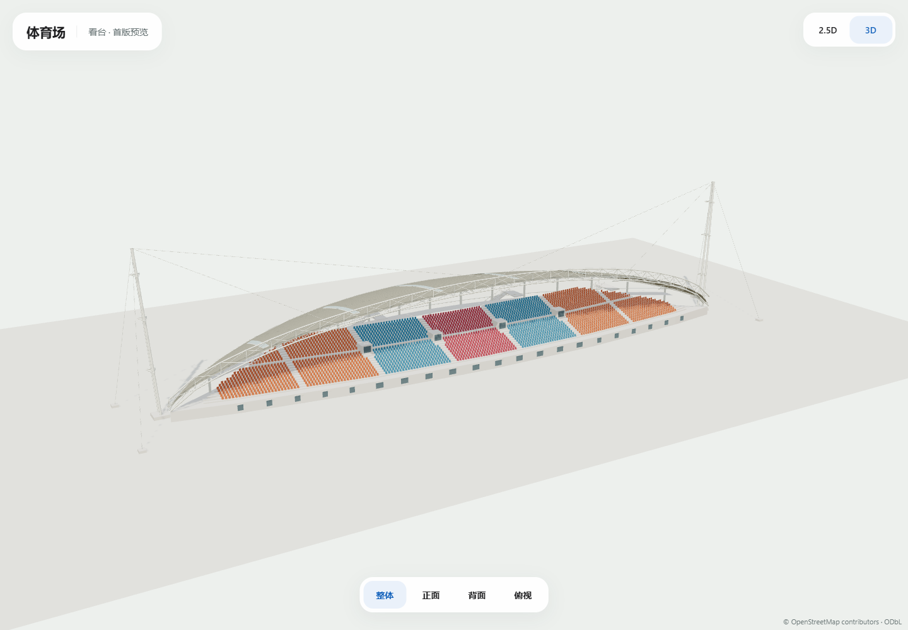

# 体育场带顶看台 · 首版2.5D / 3D

2026-10-27，负责人提供七张正面/背面/侧面/鸟瞰图及一张俯视图，授权体育场建模。本轮建模主体是这些照片中的带顶看台；原球场和跑道继续沿用既有地图数据。当前为独立视觉评审，未接图。

## 查看与编辑

[打开本机预览](http://127.0.0.1:3024)，支持2.5D/3D、整体/正面/背面/俯视；拖动旋转、滚轮缩放、Home复位。

```powershell
node scripts/build-stadium-model.mjs
node scripts/serve-stadium-preview.mjs
```

| 模型 | 字节 | 三角面 | 模型调用 | 材质 / 图片纹理 |
| --- | ---: | ---: | ---: | --- |
| [2.5D GLB](stadium-2.5d.glb) | 146500 | 3994 | 4 | 2 / 0 |
| [3D GLB](stadium-3d.glb) | 403208 | 28366 | 9 | 8 / 0 |

[design.json](design.json)为可编辑参数和八图SHA，[manifest.json](manifest.json)记录坐标/来源映射/资产SHA，[GeoJSON](stadium-2.5d.geojson)为显示包络。纯几何、共享材质与实例化，无照片纹理；GLB使用EXT_mesh_gpu_instancing，本预览通过Three.js GLTFLoader实际加载。运行时没有几何生成或空闲动画循环。

## 来源映射与朝向

| 实体 | 稳定ID | 处理 |
| --- | --- | --- |
| 体育场地点/真草场 | [osm-way-1389756837](https://www.openstreetmap.org/way/1389756837) | 原地点坐标与场地轮廓保持，作为资产关联地点 |
| 带顶看台建筑 | [osm-way-1389756836](https://www.openstreetmap.org/way/1389756836) | 原22顶点外环作为模型来源轮廓 |
| 跑道 | [osm-relation-19176025](https://www.openstreetmap.org/relation/19176025) | 原数据保持，只作方向/关联核对 |

来源取固定地图s1-2026-10-14.2当前文件/maps/campus-15060d099418.geojson，先核对完整SHA；源看台面积约3086.5449平方米、两端间距约145.40米。看台原轮廓不替代球场轮廓，不新增虚构看台POI。GLB原点为原体育场地点WGS84 [113.3926224,23.071347799999998]，局部east/up/south米制坐标；文件中的看台相对位置已编码。

施工坐标以南端为锚点、+x指向北端、+z指向球场，alignedToLocal记录到上述原点的转换。球场中心在看台坐标中为[74.04,56.225]，座席背板实际法向已核对朝向该场地一侧。预览只为观看而转正/居中，未改变地理位置。

## 外观与估算项

2.5D保留弧形雨棚、简化拱带/高杆、阶梯看台、背部柱廊和外梯。3D增加白色三弦桁架/横向腹杆、两端双肢高杆与拉索、橙/蓝/红分区座椅、中央步道/通道口、前排门窗、背部通风方孔/栏杆与四组外梯。雨棚按六条采光带做了真实开口与双面采光面，从上方和看台下方都能看到。

本轮未给定层数或米制高度；雨棚前缘最高约20米、桁架顶约22米、高杆约35.5米、座席前沿2.5米及排距/阶梯/后侧约6米平台/拉索锚点均为照片比例估算。不能沿用体育馆五层的描述，也没有核验室内结构或导航入口。

程序设置22排的最大视觉布局，3D实际放置3003个简化座席实例；这是合成显示排布，**不是体育场真实座位数或容量数据**。台阶和杆索锚点在原看台轮廓外有近似显示构件，不写回GIS或路网。

## 来源与实际检查

七张原图保留文档包assets/source_maps/广外地图/细节；Downloads/体育场俯视.png原像素副本保留assets/model_references/stadium-v1。文件名数字无建筑参数或时序意义，八图路径/字节/SHA记录design。原URL/年份/公开复用许可待补，仅内部观察，不在public、图片端点或GLB纹理中分发；自有程序模型保留OSM署名，本轮无外网素材/瓦片或供应商模型采集。

[资产回执](asset-checks.json)：当前底图SHA、看台/球场/跑道轮廓不变，八图SHA/俯视副本一致，座席实例法向朝场地，两模式的六个采光条从上下双向射线可见；有限顶点/非负高度/零图片通过；其他十一组及历史A—D V1共43个GLB SHA保持，B钟楼修正保持。

[质量回执](quality-checks.json)：本轮三个JS ESLint、typecheck、生产构建和已有三文件9项模型单元通过。全仓lint仍因原备份inspect.mjs未使用导入和test_mp_tools_browsing_ui.cjs三处require失败，未修改无关文件。

[Edge回执](screenshots/edge-review.json)：Edge149，桌面1440×1000、手机视口390×844、短窗口950×540，两模式/四视角/旋转/缩放/调窗通过，十张正式截图，无页面错误、静止350ms无额外帧。手机实机FPS/热机和正式地图整页性能未验收。



[正面](screenshots/desktop-3d-front.png) · [背面](screenshots/desktop-3d-side.png) · [俯视](screenshots/desktop-3d-roof.png) · [2.5D](screenshots/desktop-2.5d-overall.png)
