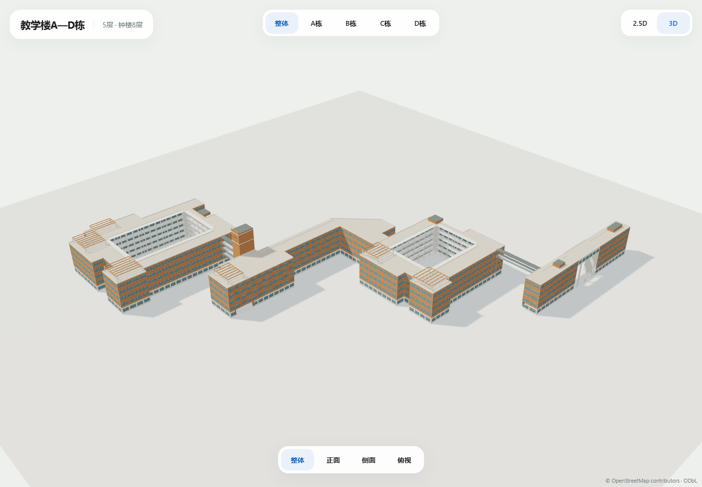

# 教学楼A—D栋建筑群 · 首版2.5D / 3D

2026-10-25，负责人提供13张立面/鸟瞰/俯视参考，明确主体5层楼高、C栋钟楼8层楼高。当前为独立视觉评审，未接入正式地图。

## 查看与编辑

在项目根目录执行：

```powershell
node scripts/build-teaching-a-d-model.mjs
node scripts/serve-teaching-a-d-preview.mjs
```

[本机预览](http://127.0.0.1:3021)可切换整体/A/B/C/D与2.5D/3D，单体按需加载。拖动旋转、滚轮缩放、Home复位；C栋整体视角面向钟楼玻璃侧。

| 文件 | 字节 | 三角面 | 模型调用 | 材质 / 图片纹理 |
| --- | ---: | ---: | ---: | --- |
| [整体 2.5d](teaching-a-d-2.5d.glb) | 179236 | 4472 | 4 | 2 / 0 |
| [整体 3d](teaching-a-d-3d.glb) | 562900 | 27570 | 13 | 7 / 0 |
| [A栋 2.5d](teaching-A-2.5d.glb) | 30708 | 600 | 3 | 2 / 0 |
| [A栋 3d](teaching-A-3d.glb) | 87748 | 3620 | 10 | 6 / 0 |
| [B栋 2.5d](teaching-B-2.5d.glb) | 60180 | 1392 | 4 | 2 / 0 |
| [B栋 3d](teaching-B-3d.glb) | 180708 | 8490 | 11 | 6 / 0 |
| [C栋 2.5d](teaching-C-2.5d.glb) | 44560 | 788 | 4 | 2 / 0 |
| [C栋 3d](teaching-C-3d.glb) | 144516 | 5494 | 12 | 7 / 0 |
| [D栋 2.5d](teaching-D-2.5d.glb) | 64308 | 1620 | 4 | 2 / 0 |
| [D栋 3d](teaching-D-3d.glb) | 202696 | 9798 | 11 | 6 / 0 |

参数在[design.json](design.json)，SHA/坐标框架/源环在[manifest.json](manifest.json)，显示体量见[GeoJSON](teaching-a-d-2.5d.geojson)。共享几何/材质并实例化，GLB使用EXT_mesh_gpu_instancing；本预览Three.js GLTFLoader已实际加载，其他查看器需支持该扩展。静态模型按交互/调窗渲染，空闲无额外渲染循环。

## 平面与坐标

四栋沿用固定地图s1-2026-10-14.2的稳定源ID：

| 对象 | 源ID | 原内环 |
| --- | --- | ---: |
| A | [osm-way-1410412694](https://www.openstreetmap.org/way/1410412694) | 0 |
| B | [osm-relation-19299171](https://www.openstreetmap.org/relation/19299171) | 1 |
| C | [osm-way-1410412691](https://www.openstreetmap.org/way/1410412691) | 0 |
| D | [osm-relation-19299170](https://www.openstreetmap.org/relation/19299170) | 1 |

原外环及B/D两个内环保留于底座、清单与GeoJSON。C栋北侧原凸出处保留全部五个顶点，按照片匹配为钟楼，和余下主体分别挤出；两部分面积之和与源C一致，钟楼不会叠在完整5层体块上重复绘制。钟楼匹配仍是显示近似，不新增独立OSM ID或实测钟楼坐标。

**十个GLB统一使用C栋WGS84原点[113.3917075,23.0663962]，east/up/south米制坐标。单体相对位置已经编码，不能再按各栋标签原点二次平移。** 整体包括两处楼间显示连廊，单体不包含这些跨栋连接段，避免四个单体叠放时重复绘制。后续如按组件接图，需要依清单共享原点和单独处理连接，不以标签自动重置原点。

## 外观和高度

2.5D保留四栋相对体量、源院落、C钟楼、A架空门洞及屋顶构架。3D增加橙白窗墙、白色开放廊道/栏杆、A三柱入口、C架空局部/竖玻璃带、钟楼双面几何刻度/固定指针、平屋顶女儿墙、橙色镂空构架和简化屋顶房。钟面指针固定展示，不代表实时校钟时间。

主体5层、钟楼8层楼高来自负责人；3.7/7.3/10.9/14.5/18.1米构件基准、主体女儿墙约18.55米、屋架21.4米、钟楼顶31.2米/侧鳍最高32.05米均为视觉估算，未核验室内分层。钟楼原凸出轮廓的照片匹配、门洞/廊道退让、窗格/屋顶分部与楼间连接尺寸也是显示近似，不回写GIS、入口、路网或通行事实。

整体3D562900字节/27570三角面/13模型调用，为四栋合计；单体按需加载。当前为首稿评审，未完成真实手机FPS/热机或正式地图整页性能验收。正式地图仍保留既有模型范围。

## 来源与检查

十一张文档包细节目录照片留在原路径；Downloads两张俯视图原像素复制至文档包assets/model_references/teaching-a-d-v1。13图路径/字节/SHA见design。文件名数字不作尺寸/层数或时序，整体照片仅作上下文，不额外建模E/F/G。原发布URL/拍摄年份/公开复用许可待补；原图不放入public、预览图片端点或GLB纹理，自有程序几何保留OSM署名。

[资产回执](asset-checks.json)：四个源轮廓/坐标及底座保持，13图与两俯视副本SHA核对，C主体/钟楼分部面积一致，十资产共用C原点/零图片；B/D院落竖直射线无封顶、A/C入口水平射线通透，钟楼中心高度与8层外观参数一致；既有八组19资产SHA保持。

[质量回执](quality-checks.json)：三个本轮JS文件ESLint、typecheck、生产构建和已有三文件9项模型单元通过。全仓lint仍失败于之前备份inspect.mjs未使用导入、旧test_mp_tools_browsing_ui.cjs三处require，未改无关文件。

[Edge回执](screenshots/edge-review.json)：Edge149.0.4022.80，桌面1440×1000、手机视口390×844、短窗口950×540；十资产/对象/模式/视角、旋转/缩放/调窗无页面错误，静止350ms无额外帧，共23张正式截图。手机视口运行在桌面GPU，不等同手机实机。



[钟楼](screenshots/desktop-C-3d-overall.png) · [A栋入口](screenshots/desktop-A-3d-front.png) · [整体俯视](screenshots/desktop-complex-3d-roof.png) · [2.5D](screenshots/desktop-complex-2.5d-overall.png) · [手机C栋](screenshots/mobile-C-3d.png)
