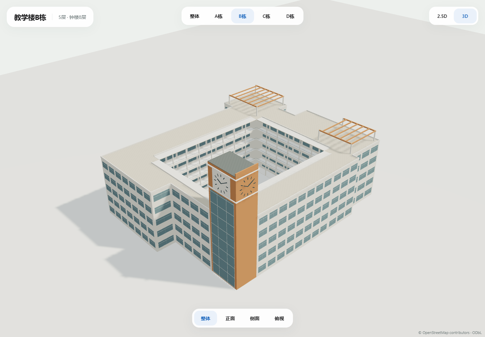

# 教学楼A—D V2 · B栋钟楼位置与朝向修正

2026-10-25，负责人明确指出V1误将钟楼放在C栋，并提供B栋红框位置和朝外箭头。当前V2已取代V1，正式地图尚未接入。

## 本轮修正

- 钟楼归属改为B栋osm-relation-19299171，放在红框所指外侧转角；从B栋五层主体切出单独八层塔体，原B轮廓面积分部保持。
- 主钟面和下方玻璃面朝负责人箭头所指楼外方向；本地east/up/south框架的平面法向为[0.9999382815936566,0.011110040662618169]。第二钟面朝另一外侧，默认俯视已与负责人标注图一致，主钟面向图中下方。
- C栋原高塔移除，原凸出处恢复五层体量；C栋不含钟楼实体或八层元数据。
- A、D两种模式GLB的几何BIN数据与V1逐字节相同；四源轮廓/院落、原GIS/标签/路网不变。

## 查看与编辑

[打开修订预览](http://127.0.0.1:3021/?v=2-b-clock)，原3021地址已切换V2；已有标签页刷新即可。支持整体和A/B/C/D，B栋正面视角直接查看朝外主钟面。

```powershell
node scripts/build-teaching-a-d-model.mjs
node scripts/serve-teaching-a-d-preview.mjs
```

[design.json](design.json)为参数/来源，[manifest.json](manifest.json)为坐标/实体归属/SHA，[GeoJSON](teaching-a-d-2.5d.geojson)为独立显示稿。

| 模型 | 字节 | 三角面 | 模型调用 |
| --- | ---: | ---: | ---: |
| [整体 2.5d](teaching-a-d-2.5d.glb) | 182024 | 4500 | 4 |
| [整体 3d](teaching-a-d-3d.glb) | 562936 | 27490 | 13 |
| [A栋 2.5d](teaching-A-2.5d.glb) | 30788 | 600 | 3 |
| [A栋 3d](teaching-A-3d.glb) | 87828 | 3620 | 10 |
| [B栋 2.5d](teaching-B-2.5d.glb) | 62876 | 1452 | 4 |
| [B栋 3d](teaching-B-3d.glb) | 189464 | 8426 | 12 |
| [C栋 2.5d](teaching-C-2.5d.glb) | 44832 | 756 | 4 |
| [C栋 3d](teaching-C-3d.glb) | 134272 | 5478 | 9 |
| [D栋 2.5d](teaching-D-2.5d.glb) | 64388 | 1620 | 4 |
| [D栋 3d](teaching-D-3d.glb) | 202776 | 9798 | 11 |

十GLB保持既有C栋WGS84共享原点[113.3917075,23.0663962]；钟楼实体placeId已明确归B。组件相对位置已编码，加载时不按各标签重复平移。纯几何/实例化/零照片纹理，需支持EXT_mesh_gpu_instancing的查看器，本预览实际通过GLTFLoader加载。

## 来源与尺寸边界

本轮五图：钟楼2.jpg、钟楼1.jpg、b栋钟楼.png、b栋钟楼位置.png、b栋钟楼俯视.png，从Downloads原像素复制至文档包assets/model_references/teaching-a-d-v2；连同原13图共18条SHA记录在design。用户消息附加箭头作为主钟面朝向依据。旧文件名中C栋字样不用于判断钟楼归属，最新负责人修正优先。原图仅内部研究，不作为public资源、图片服务或纹理；公开许可/年份/原URL仍待补。

主体5层、钟楼8层楼高保持负责人依据。塔宽6.4米/深9米、顶31.2米/侧鳍32.05米、其他米制尺寸继续为视觉估算，红框用于该转角匹配，不是现场测量坐标或室内平面。正式GIS/导航不回写任何几何或高度。B内庭边缘廊道在塔体接口处退让，保持原院落空洞。

## 检查

[资产回执](asset-checks.json)：18图SHA、四原轮廓/内环、B塔体分部面积、C旧位置降至五层、钟楼唯一归属B、实际玻璃面射线法向朝外、两模式/十资产零图片、A/D几何BIN相同；原其他模型及历史V1共29个GLB SHA保持。

[质量回执](quality-checks.json)：本轮JS及V1归档生成器ESLint、typecheck、生产构建、已有三文件9项模型单元通过。全仓lint仍因原备份inspect.mjs未使用导入及test_mp_tools_browsing_ui.cjs三处require失败，未修改无关文件。

[浏览器回执](screenshots/edge-review.json)：Edge149，1440×1000、390×844手机视口、950×540短窗口，十资产/模式/视角/旋转/缩放/调窗通过，无页面错误，静止350ms无额外帧，共26张正式截图。手机实机性能未测。



[朝外主钟面](screenshots/desktop-B-3d-front.png) · [对照红框的整体俯视](screenshots/desktop-complex-3d-roof.png) · [B栋2.5D](screenshots/desktop-B-2.5d-overall.png) · [C栋移除旧塔](screenshots/desktop-C-3d-overall.png)
