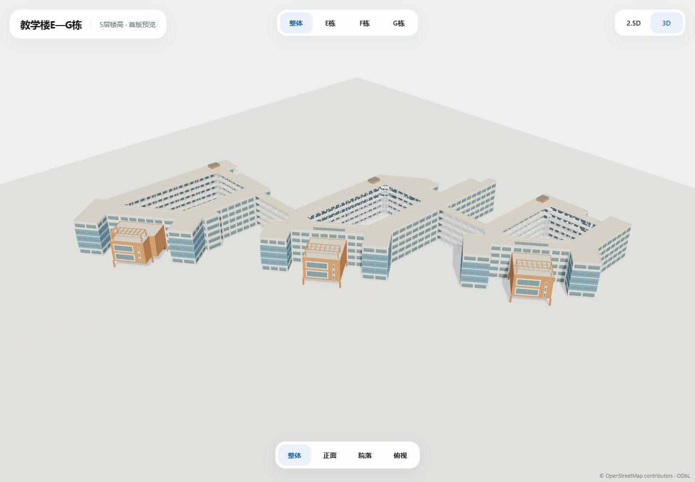

# 教学楼E—G建筑群 · 首版2.5D / 3D

2026-10-25，负责人提供七张立面/鸟瞰图、一张俯视图，确认5层楼高。当前为独立视觉评审，未接入正式地图。

## 查看与编辑

[打开本机预览](http://127.0.0.1:3022)，支持整体、E/F/G近景观察、两种模式与正面/院落/俯视；拖动旋转、滚轮缩放、Home复位。E/F/G按钮只调整相机，同一个整组模型始终显示，邻近体量可在近景边缘出现。

```powershell
node scripts/build-teaching-e-f-g-model.mjs
node scripts/serve-teaching-e-f-g-preview.mjs
```

| 模型 | 字节 | 三角面 | 模型调用 | 材质 / 图片纹理 |
| --- | ---: | ---: | ---: | --- |
| [整体2.5D](teaching-e-f-g-2.5d.glb) | 175672 | 3184 | 3 | 2 / 0 |
| [整体3D](teaching-e-f-g-3d.glb) | 610988 | 25002 | 14 | 7 / 0 |

参数/八图SHA见[design.json](design.json)，坐标/源环/标签/资产SHA见[manifest.json](manifest.json)，显示包络见[GeoJSON](teaching-e-f-g-2.5d.geojson)。GLB为自有程序几何、共享材质和实例化，无照片纹理；需支持EXT_mesh_gpu_instancing的查看器，本预览已通过Three.js GLTFLoader加载。运行时只加载文件，无几何生成或空闲动画循环。

## 地理依据与分部

唯一父轮廓为[OSM relation4105730](https://www.openstreetmap.org/relation/4105730)，固定地图s1-2026-10-14.2。原75个外环顶点、三个真实内环及标签绑定保留。E/F/G分别沿用osm-node-3125704419、osm-node-3125704391、osm-node-3125704356，均绑定此父楼；没有独立精确分栋GIS边界。

三个主院落体量、三个前方投影体块、两连接段只为构建显示外观而分部，分部净面积之和与原父轮廓净面积8327.5097平方米一致；不将这些内部线写回GIS或导出三份重复父模型。两GLB统一以父楼WGS84坐标[113.3929848,23.066674550000002]为原点，east/up/south米制框架。

## 外观与尺寸边界

2.5D保留三处院落、主楼/前部体量高低、架空体块与开放连接段。3D增加橙白窗墙、蓝色窗带、院落内退的白色廊道/栏杆、两段开放楼层连廊、前部橙色支柱和大窗、三组屋顶构架/短采光带、G侧边简化折返梯和F入口凹进。

主楼5层楼高来自负责人；层间基准0.1/3.7/7.3/10.9/14.5/18.1米、女儿墙约18.52米、前方橙色体块露台14.5米/构架18.6米、小屋面最高约19.63米为视觉估算。较低前部体量按照片分开表现，不推断其室内层数。门洞/楼梯/廊道/构架尺寸均为显示近似，不生成室内或新增导航通行事实。整体照片中的B栋钟楼仅作上下文；本组无钟楼，已修正A—D资产保持。

3D约611KB/25002三角面为整组总量，2.5D约176KB。手机视口运行于桌面GPU，未做手机实机FPS、热机或正式地图整页性能验收。

## 来源与实际检查

七张原图保留文档包assets/source_maps/广外地图/细节；Downloads/教学楼EFG栋俯视.png原像素副本存文档包assets/model_references/teaching-e-f-g-v1。文件名数字无参数/时序意义，八图路径/大小/SHA在design。原发布URL、年份及照片公开复用许可仍待补，只内部观察，不放入public、预览图片端点或GLB纹理；本轮无外网影像/瓦片或供应商模型采集。自有几何保留OSM署名。

[资产回执](asset-checks.json)：原父四环/三标签保持，八图SHA/俯视副本一致，分部及GeoJSON面积一致；两模式三院落向下射线无顶盖、三投影体块下方/两连接段地面射线通透、F入口凹进开放；其他九组模型及历史A—D V1共39个GLB SHA保持，修正后的B钟楼归属未变。

[质量回执](quality-checks.json)：本轮三个JS文件ESLint、typecheck、生产构建与已有三文件9项模型单元通过。全仓lint仍因既有备份inspect.mjs未使用导入和test_mp_tools_browsing_ui.cjs三处require失败，未改无关文件。

[Edge回执](screenshots/edge-review.json)：Edge149，桌面1440×1000、手机视口390×844、短窗口950×540，两模式/观察目标/视角/旋转/缩放/调窗通过；无页面错误，静止350ms无额外帧，整组两个GLB各请求一次，共20张正式截图。



[E近景](screenshots/desktop-E-3d-overall.png) · [F院落侧](screenshots/desktop-F-3d-side.png) · [G院落侧](screenshots/desktop-G-3d-side.png) · [俯视](screenshots/desktop-complex-3d-roof.png) · [2.5D](screenshots/desktop-complex-2.5d-overall.png)
