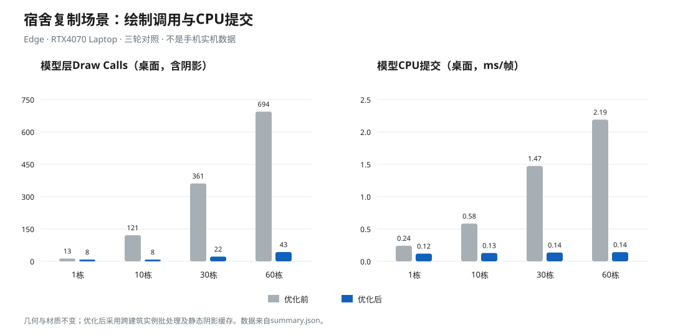
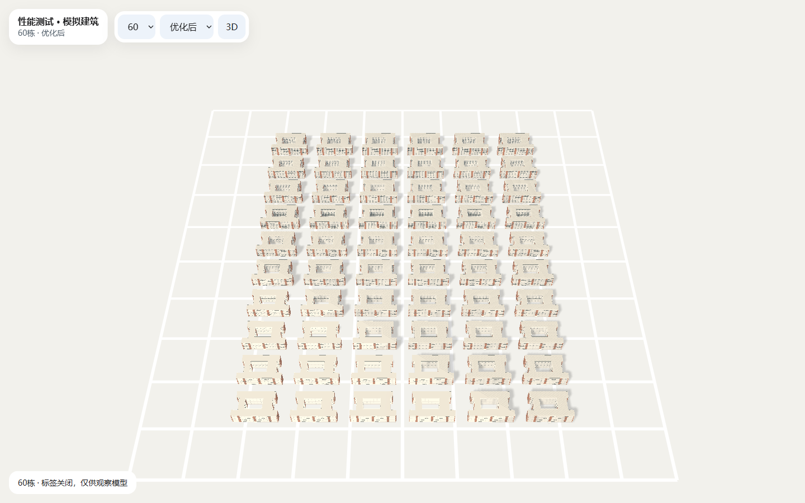
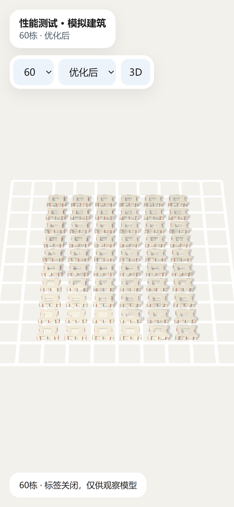
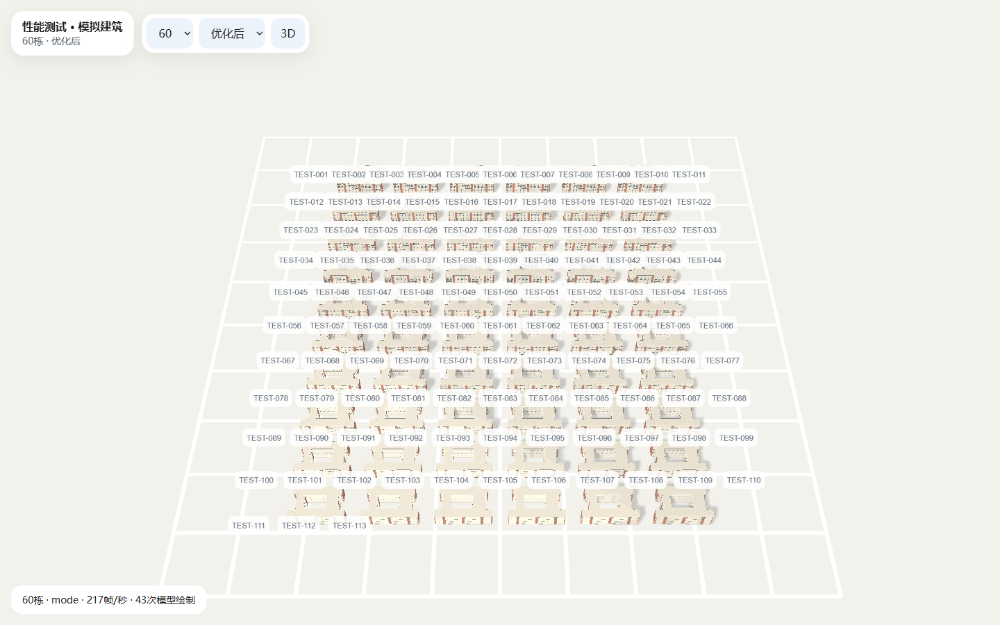
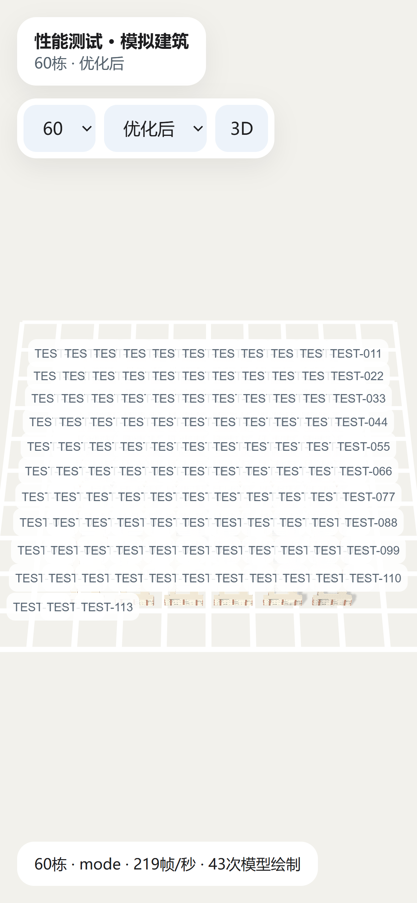

# CampusOS 宿舍多建筑性能对比报告

2026-10-15。南苑7栋的2.5D/3D已由负责人视觉验收，采用其构件与规则作为南苑、北苑、师苑、友苑的标准模板。正式地图目前仍只有南苑7栋立体模型。本轮没有制作或登记其他真实宿舍模型。

## 结论

本机Edge的1/10/30/60栋隔离复制场景完成优化前后三轮对比，60栋持续绘制可运行；这不是全校真实建筑或普通手机的容量认证。建议下一批先做3栋资料完整的宿舍差异验证，初期同时显示高细节模型上限建议10栋，进一步扩展以手机实机和真实差异模型复验为门槛。

优化采用跨建筑InstancedMesh、共享原几何/材质与静态阴影缓存。60栋全景模型绘制调用约694→43，桌面模型CPU提交约2.19→0.14ms；单栋正式地图的含阴影绘制调用13→8。南苑7栋GLB与2.5D参数没有改变，照明参数、材质、外观和轮廓均保留。

模式按钮已按反馈改为直接循环2D→2.5D→3D→2D，默认2D，浏览和导航文字都为#1d1d1f，不再弹出菜单。3D加载失败时保留原2.5D，下一次点击可回2D，再循环重试；弱设备跳过不可用模式。

## 测试环境与隔离

- Windows本机：AMD Ryzen 7 7745HX（8核16线程），约15.18GiB物理内存，RTX4070 Laptop GPU；Edge 149.0.4022.80，ANGLE/D3D11硬件渲染。系统显示刷新率查询为239Hz，结果受显示和浏览器调度上限影响。
- 桌面1440×900/DPR1；手机视口390×844/DPR3，仍使用同一台电脑的CPU/GPU，actualPhone=false。未进行手机实机、热机或弱GPU验收。
- 模型内容SHA256：54cc55342ae54c2f38743341490fe943de8a877f8a968bc7c46d7a6f2c14b79a。每个场景只下载一次80384字节模板；1/10/30/60复制数不等于1/10/30/60个独立GLB的下载成本。
- 主对照48轮：2视口×4数量×2方案×3重复；交换方案执行顺序，串行采集避免互相竞争。另有14项单因素/策略探查、8项近景探查、16项真实鼠标拖动检查，正式地图优化前后各18种模式/标签/AI条件诊断。
- 所有复制场景位于tests/performance/dormitory-stress，loopback3013测试页；模型和模拟道路坐标在虚拟[0,0]网格，标签仅TEST编号。没有真实校园地点ID或导航能力，没有覆盖正式地点。正式地图/POI/路由和public模型文件均未扩增。
- 测试保留113个模拟DOM标签作为同场景对照，并非真实校园底图。正式4521地物/113地点的开销单独在3000实际地图诊断，不能把网格FPS直接当成完整校园地图FPS。

## 测量口径

FPS为MapLibre render事件在采集窗口内的频率，帧时间为这些事件的间隔；它不等同于屏幕最终呈现帧率。平移/缩放/旋转使用固定时长镜头运动，另以Playwright真实鼠标动作覆盖全部数量；idle为人为持续重绘压力阶段，正常静止页面没有额外渲染循环。各表使用三轮中位FPS及汇总P95帧间隔。

模型Draw Calls/提交三角面来自Three.renderer.info，包含阴影和测试地面；全场GL调用由实际draw函数计数，包括MapLibre测试网格。固有模型三角面是4748×数量，提交三角面可能因阴影重复和视野剔除而不同。模型CPU耗时仅含CPU提交，不是GPU执行耗时。

内存为CDP页面JSHeapUsedSize；就绪样本先GC。动作后变化包含采样数组、临时对象和缓存，不据此推断模型GPU内存或泄漏。MapLibre Worker、浏览器进程完整RAM、GPU VRAM、最终呈现FPS和整页GPU帧耗时无法可靠归因，本报告未给出这些指标的虚构值。模式阶段的模型CPU字段不用于归因，因为非3D阶段的旧样本曾保留最近3D提交值。

## 主对照：平移场景

### 桌面

| 数量 | 方案 | 提交FPS | 帧间隔P95 ms | 模型调用 | 全场GL调用 | 固有三角面 | 提交三角面 | CPU提交ms |
| ---- | ---- | ------- | ------------ | -------- | ---------- | ---------- | ---------- | --------- |
| 1    | 前   | 230.6   | 5.80         | 13       | 72         | 4748       | 7402       | 0.241     |
| 1    | 后   | 231.4   | 5.30         | 8        | 67         | 4748       | 4750       | 0.119     |
| 10   | 前   | 230.5   | 6.30         | 121      | 180        | 47480      | 74002      | 0.583     |
| 10   | 后   | 230.9   | 6.00         | 8        | 67         | 47480      | 47482      | 0.129     |
| 30   | 前   | 223.9   | 6.60         | 361      | 420        | 142440     | 222002     | 1.473     |
| 30   | 后   | 231.8   | 5.60         | 22       | 81         | 142440     | 142442     | 0.136     |
| 60   | 前   | 231.1   | 6.80         | 694      | 753        | 284880     | 433814     | 2.190     |
| 60   | 后   | 231.6   | 4.70         | 43       | 102        | 284880     | 284882     | 0.141     |

### 手机视口（电脑模拟）

| 数量 | 方案 | 提交FPS | 帧间隔P95 ms | 模型调用 | 全场GL调用 | 固有三角面 | 提交三角面 | CPU提交ms |
| ---- | ---- | ------- | ------------ | -------- | ---------- | ---------- | ---------- | --------- |
| 1    | 前   | 231.8   | 4.80         | 13       | 50         | 4748       | 7402       | 0.147     |
| 1    | 后   | 231.9   | 4.70         | 8        | 45         | 4748       | 4750       | 0.091     |
| 10   | 前   | 231.9   | 4.80         | 121      | 158        | 47480      | 74002      | 0.516     |
| 10   | 后   | 232.0   | 4.70         | 8        | 45         | 47480      | 47482      | 0.088     |
| 30   | 前   | 232.7   | 4.90         | 361      | 398        | 142440     | 222002     | 1.231     |
| 30   | 后   | 232.3   | 4.70         | 22       | 59         | 142440     | 142442     | 0.124     |
| 60   | 前   | 225.0   | 5.70         | 694      | 731        | 284880     | 433681     | 2.396     |
| 60   | 后   | 232.0   | 4.70         | 43       | 80         | 284880     | 284882     | 0.141     |

## 加载和页面JS内存

批处理降低稳态调用，但矩阵整合/包络计算增加首次构建成本；60栋优化后约32–38ms构建，不能忽略加载中的主线程峰值。资源相同使下载/解析几乎不随复制数增长，真实不同屋顶/材质的多文件加载需另测。

| 视口    | 数量 | 方案      | 就绪ms | 解析ms | 构建ms | 就绪JS MiB | 动作后ΔJS MiB | 几何对象/纹理 |
| ------- | ---- | --------- | ------ | ------ | ------ | ---------- | ------------- | ------------- |
| desktop | 1    | baseline  | 151.9  | 6.2    | 0.5    | 7.75       | 17.42         | 8/3           |
| desktop | 1    | optimized | 130.0  | 5.1    | 2.9    | 7.46       | 26.32         | 8/3           |
| desktop | 10   | baseline  | 158.9  | 7.0    | 1.9    | 8.20       | 15.48         | 8/3           |
| desktop | 10   | optimized | 149.9  | 5.2    | 12.5   | 7.66       | 20.48         | 8/3           |
| desktop | 30   | baseline  | 174.0  | 4.9    | 3.3    | 8.36       | 11.69         | 8/3           |
| desktop | 30   | optimized | 178.2  | 5.3    | 22.7   | 7.87       | 22.73         | 8/3           |
| desktop | 60   | baseline  | 156.9  | 4.3    | 5.3    | 9.37       | 17.81         | 8/3           |
| desktop | 60   | optimized | 162.1  | 4.8    | 31.6   | 7.88       | 4.43          | 8/3           |
| mobile  | 1    | baseline  | 116.9  | 4.5    | 0.3    | 7.67       | 9.39          | 8/3           |
| mobile  | 1    | optimized | 126.1  | 4.5    | 3.4    | 7.62       | 10.50         | 8/3           |
| mobile  | 10   | baseline  | 142.6  | 5.2    | 1.5    | 7.77       | 11.67         | 8/3           |
| mobile  | 10   | optimized | 127.1  | 5.6    | 10.5   | 7.66       | 8.81          | 8/3           |
| mobile  | 30   | baseline  | 153.6  | 5.6    | 3.5    | 8.38       | 6.17          | 8/3           |
| mobile  | 30   | optimized | 149.7  | 5.5    | 20.9   | 7.50       | 11.06         | 8/3           |
| mobile  | 60   | baseline  | 166.5  | 5.5    | 6.5    | 9.00       | 20.70         | 8/3           |
| mobile  | 60   | optimized | 165.9  | 6.5    | 37.6   | 7.59       | 10.35         | 8/3           |

## 缩放、旋转和模式切换

| 视口    | 数量 | 方案      | 缩放FPS/P95ms | 旋转FPS/P95ms | 模式FPS/P95ms |
| ------- | ---- | --------- | ------------- | ------------- | ------------- |
| desktop | 1    | baseline  | 232.4/5.60    | 231.3/5.60    | 217.0/5.40    |
| desktop | 1    | optimized | 230.9/5.50    | 231.4/5.30    | 218.1/5.20    |
| desktop | 10   | baseline  | 230.6/6.20    | 228.1/6.20    | 217.8/5.70    |
| desktop | 10   | optimized | 231.6/5.90    | 230.6/6.00    | 216.2/5.90    |
| desktop | 30   | baseline  | 222.2/6.80    | 221.9/6.70    | 217.1/5.40    |
| desktop | 30   | optimized | 231.8/5.60    | 231.9/5.70    | 217.7/5.60    |
| desktop | 60   | baseline  | 230.7/5.50    | 229.3/6.70    | 215.9/5.20    |
| desktop | 60   | optimized | 231.9/4.80    | 232.3/4.70    | 217.5/4.60    |
| mobile  | 1    | baseline  | 232.6/4.70    | 232.0/4.80    | 217.8/4.70    |
| mobile  | 1    | optimized | 232.3/4.70    | 232.5/4.70    | 217.6/4.60    |
| mobile  | 10   | baseline  | 231.1/4.80    | 231.2/4.80    | 217.7/4.70    |
| mobile  | 10   | optimized | 232.0/4.70    | 231.8/4.70    | 217.9/4.70    |
| mobile  | 30   | baseline  | 232.0/4.90    | 231.4/4.90    | 217.7/4.70    |
| mobile  | 30   | optimized | 231.9/4.70    | 232.7/4.70    | 218.0/4.70    |
| mobile  | 60   | baseline  | 223.8/5.50    | 224.3/5.50    | 218.0/4.90    |
| mobile  | 60   | optimized | 232.2/4.70    | 232.1/4.70    | 218.8/4.70    |

## 真实鼠标拖动

所有数量均通过实际鼠标按下/移动/松开。单次诊断的输入频率、惯性和停止绘制影响FPS，不能用于容量上限结论；它补充主表匀速镜头运动的覆盖。

| 视口    | 数量 | 方案      | 绘制事件FPS | 平均模型调用 |
| ------- | ---- | --------- | ----------- | ------------ |
| desktop | 1    | baseline  | 200.9       | 13           |
| desktop | 1    | optimized | 185.7       | 8            |
| desktop | 10   | baseline  | 112.7       | 121          |
| desktop | 10   | optimized | 4.1         | 8            |
| desktop | 30   | baseline  | 106.3       | 361          |
| desktop | 30   | optimized | 1.7         | 22           |
| desktop | 60   | baseline  | 40.2        | 694          |
| desktop | 60   | optimized | 1.7         | 43           |
| mobile  | 1    | baseline  | 211.2       | 13           |
| mobile  | 1    | optimized | 212.2       | 8            |
| mobile  | 10   | baseline  | 208.7       | 121          |
| mobile  | 10   | optimized | 219.0       | 8            |
| mobile  | 30   | baseline  | 204.6       | 361          |
| mobile  | 30   | optimized | 216.6       | 22           |
| mobile  | 60   | baseline  | 188.9       | 694          |
| mobile  | 60   | optimized | 215.3       | 43           |

## 策略探查：60栋

以下为单次探查，不与主对照三轮数据混算。cached-shadow只缓存阴影；batch-only只实例整合；spatial按地面格网细分；adaptive远景使用原2.5D体块；staged每帧构建一组；labels-off/shadows-off用于开销归因。

| 视口    | 策略          | 平移FPS | 模型调用 | 就绪ms | 构建ms | 缩放提交三角面 |
| ------- | ------------- | ------- | -------- | ------ | ------ | -------------- |
| desktop | cached-shadow | 238.0   | 421      | 398.6  | 12.4   | 280395         |
| desktop | batch-only    | 240.0   | 73       | 183.7  | 29.5   | 444002         |
| desktop | spatial       | 231.1   | 169      | 157.0  | 28.1   | 282866         |
| desktop | adaptive      | 240.8   | 0        | 124.4  | 27.4   | 211595         |
| desktop | staged        | 240.8   | 43       | 149.1  | 28.7   | 284882         |
| desktop | labels-off    | 239.1   | 694      | 141.7  | 5.2    | 429493         |
| desktop | shadows-off   | 235.5   | 421      | 199.5  | 5.2    | 280543         |
| mobile  | cached-shadow | 172.4   | 420      | 181.5  | 6.0    | 284336         |
| mobile  | batch-only    | 234.3   | 73       | 177.0  | 36.3   | 444002         |
| mobile  | spatial       | 239.1   | 169      | 168.9  | 34.6   | 284490         |
| mobile  | adaptive      | 240.5   | 0        | 130.8  | 32.4   | 216367         |
| mobile  | staged        | 240.6   | 43       | 260.7  | 57.7   | 284882         |
| mobile  | labels-off    | 240.2   | 693      | 162.5  | 6.2    | 433278         |
| mobile  | shadows-off   | 240.0   | 420      | 159.8  | 7.4    | 284366         |

近景+3级缩放补充：

| 视口    | 策略      | 平均调用 | 平均提交三角面 | P95ms |
| ------- | --------- | -------- | -------------- | ----- |
| desktop | baseline  | 574.4    | 358943         | 5.30  |
| desktop | optimized | 43.0     | 284882         | 4.80  |
| desktop | spatial   | 128.1    | 239080         | 5.10  |
| desktop | adaptive  | 39.8     | 263617         | 4.80  |
| mobile  | baseline  | 554.0    | 345187         | 5.70  |
| mobile  | optimized | 43.0     | 284882         | 4.80  |
| mobile  | spatial   | 117.4    | 227665         | 5.00  |
| mobile  | adaptive  | 39.6     | 262495         | 4.70  |

## 瓶颈与采用范围

1. **Three.js CPU提交与阴影重复**：前方案已经共享几何/材质，但每栋仍有多个绘制对象和重复阴影通道。跨建筑实例整合与静态阴影缓存减少调用和提交CPU，FPS在高刷新强GPU上已接近上限，不能用FPS变化否定调用成本的下降。
2. **首次构建**：InstancedMesh的矩阵/包络预计算比简单clone更费时。staged可摊开构建，但手机视口探查就绪261ms，较常规优化165.9ms更长；本轮不把分批加载强行用于单栋。未来不同GLB按视野/优先级加载，先预备10栋以内，再增量补充。
3. **视野剔除**：Three默认包络剔除已生效。细分spatial在全景169次调用，比10栋一组43次更多；近景提交三角面降到约239080/227665，代价是约128/117次调用。建议依据设备GPU压力选择组尺度，避免追求最细分组。
4. **LOD**：adaptive在远景不提交细节模型，近景恢复原模型；数据支持远景体块策略，但切换阈值和视觉连续性仍须验收。只在测试页验证，没有改南苑7栋当前3D表现。
5. **MapLibre和标签/AI**：真实底图约2.56MB，正式地图启动约0.68–1.39秒，高于简单网格。现有标签由MapLibre DOM Marker更新，业务避让在moveend执行，没有每帧React状态更新。实际标签关闭后部分GL调用变化取决于当前视野；AI浮层有合成/模糊成本，但诊断样本不足以证明它是当前主瓶颈，本轮保持UI设计。

正式地图诊断中的绘制间隔会包含约1000ms静止空档，且鼠标输入、边界限制和惯性不同；不把这些间隔解释为掉帧或用来宣称优化后的整页FPS提升。可靠的正式变化是同一3D层的稳态调用13→8，实际当前截图及CDP记录保留用于复核。

已实施：静态阴影缓存（首次加载、通行透明度变更、GL恢复时更新），同模板跨建筑共享批处理模块及明确资源所有权，默认2D/直接循环按钮。已验收资产、灯光参数、原生2.5D和导航/地点事实不变。未对正式地图启用测试副本或未验收LOD。

## 正式地图实际对照

| 阶段 | 视口    | 3D条件     | 模型层稳态调用 | 页面启动ms |
| ---- | ------- | ---------- | -------------- | ---------- |
| 前   | desktop | normal     | 13             | 1050       |
| 前   | desktop | labels-off | 13             | 1050       |
| 前   | desktop | ai-open    | 13             | 1050       |
| 前   | mobile  | normal     | 13             | 840        |
| 前   | mobile  | labels-off | 13             | 840        |
| 前   | mobile  | ai-open    | 13             | 840        |
| 后   | desktop | normal     | 8              | 1389       |
| 后   | desktop | labels-off | 8              | 1389       |
| 后   | desktop | ai-open    | 8              | 1389       |
| 后   | mobile  | normal     | 8              | 677        |
| 后   | mobile  | labels-off | 8              | 677        |
| 后   | mobile  | ai-open    | 8              | 677        |

## 下一批建议与门槛

- 先选南苑8栋、南苑9栋、北苑1栋共3栋，复核已登记轮廓、楼层/高度、屋顶和外立面差异；北苑1栋还验证水电冷充值点的父子选择。资料确认后才生成。随后用一栋师苑/友苑检验不同类型，不能直接整栋拉伸窗格冒充准确新立面。
- 共用浅色框架/砖红竖墙/走廊/栏杆构件与材质；每栋的足迹、中庭、楼层、尺寸、朝向和资料状态独立，21米只属于南苑7栋。
- 首批同时显示细节模型建议≤10栋，累计加载更多时采用视野剔除/体块LOD。新楼型/材质会拆分批次，60个同模板结果不自动覆盖60个不同模型。
- 后续扩展需真实批次重复交互、手机实机热机/弱GPU测量、加载峰值/内存与导航/AI回归；目标桌面60FPS、普通手机30FPS，但本轮只证明当前电脑隔离场景可运行。全校批量建模尚未开始。

## 实际截图与数据

以下为关闭模拟标签后的补充观察截图，不替代113标签主对照：

[原始压缩采样](raw.json.gz) · [汇总JSON](summary.json) · [逐动作CSV](metrics.csv)。截图目录包含1/10/30/60栋前后两视口16张；probes、closeup、pointer及real-map-before/after保留额外数据和截图。试验页[60栋](http://127.0.0.1:3013/?count=60&variant=optimized)，显著标为模拟场景。模型轮廓©OpenStreetMap contributors，ODbL；无照片纹理。

## 复验与交付检查

运行scripts/serve-dormitory-stress.mjs，再运行run-dormitory-stress.mjs；默认三轮、两视口、四数量、两方案。STRESS_VARIANTS/COUNTS/REPEATS/DURATION/OUTPUT/ACTIONS可复验探查；同一时间串行运行一个性能采集器，关闭其他高负载程序。summarize-dormitory-stress.mjs生成压缩原始数据/JSON/CSV，write-dormitory-report.mjs生成本报告。功能检查与生产构建结果见docs/PROGRESS.md，不以截图代替运行功能。
