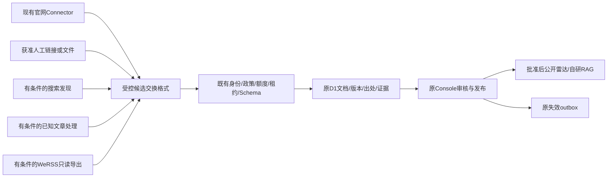

# CampusOS｜公众号与校园信息流水线建议

> 续接完成稿：基于206e01d、四仓库静态审计及本轮隔离PoC。D-045继续生效，Dify不参与选型。只形成实施决策，不启动正式爬虫、校园雷达或公网变更；上轮断点与本轮完成范围见 [研究索引](s3-wechat/README.md)。

日期：2026-10-17（Asia/Shanghai）。研究基线 `206e01d`，开始时工作区干净；本轮没有应用集成、迁移、发布、采集任务启动或模型调用。推荐不等于已经获得正式实施授权。

配套：[四项目证据与矩阵](S3_WECHAT_OPEN_SOURCE_COMPARISON.md)、[PoC门槛](S3_WECHAT_POC_PLAN.md)、[thu-push适配](S3_THU_PUSH_ADAPTATION.md)。

## 1. 恢复现场与数据证据时间

[已有只读云端快照](../verification/s3-wechat/campus-baseline.json)的时间为2026-10-17 06:49:31 UTC：来源220、启用3、核验3、文档3且全部待审、公开0、任务4、历史重复1、错误0；53业务表、0001–0011、外键错误0，彼时Worker为 `21a72753-f951-4b91-9549-1390a2c7e49f`。**本轮未重新查询云端，不能将这些数字冒充新的实时统计**。3个既有政策为metadata_only且有到期时间；不续期、不启用新源，也不重新导入220条。

两份原草稿和`tests/research/audit-campus-baseline.mjs`均在206e01d中已提交；草稿现补齐为完成稿。审计脚本是显式`--remote-preview`的只读入口，但固定输出会覆盖旧快照，本轮只审读而未执行；未来复查应先扩展独立输出参数并保留原证据，不用历史脚本重写原报告。原代理未落盘的结果不引用，本轮重新生成离线结果。

复核 `wrangler.jsonc`、OpenNext配置、Console认证/DAO、`src/domain/console/ingestion.ts`、`src/lib/ingestion/{profiles,connector,safe-fetch}.ts` 与迁移。静态页面外壳、私有API no-store、服务端身份/CSRF、D1原子命令、120秒租约/fence、检查点、全站20网络预留/UTC日与10任务/日继续沿用。四个本地项目包只读，不复制到public或Worker。

S3-0中“拟新增”与S3-B实际差异按D-044解释：文档时间/内容修订、origins/fetches、事件候选/证据、辅助主题现已落库；不是再建这些表。事件精度扩展、公开雷达、有限地点投影及检索消费仍待后续阶段。旧Dify UI仅为历史证据，路线已废弃。旧的cron/Queues/向量方案不视为已开通。

## 2. 三方案比较与实施排序

| 维度                | A 官网+搜索发现+人工已知链接                        | B 官网+授权WeRSS订阅                                 | C 混合职责适配                                 |
| ------------------- | --------------------------------------------------- | ---------------------------------------------------- | ---------------------------------------------- |
| 当前可用性          | 官网既有链路可用；人工入口已有；搜索仍关闭          | 官网可用，WeRSS七层实机未测、故障未解除              | 官网/人工先行，其余分支均条件启用              |
| 实测程度            | 官网历史真实3篇；Search本轮仅离线                   | WeRSS5项上游纯函数/1文档映射，20自有网关草案；无实时 | 四项目静态/离线完成，不等于多源生产已接        |
| 正文/发布日期准确率 | 微信无在线分母，N/A；人工按原文核验，缺许可仅元数据 | 同为N/A，不因REST结构或订阅成功推算                  | 同为N/A；Blog/thu的已知误填必须拒绝            |
| 维护难度            | 较低，人工审核成本可控；Search模板/真链变更需维护   | 高，会话/浏览器/调度/正文改版/只读网关               | 中高，接口清晰但分支越多运维越多               |
| 服务器需求          | 无新增服务器，受控本地runner；不承诺全天候          | 需独立常驻载体，未获批准                             | 初期无新增；订阅阶段另评载体                   |
| Workers Free        | 只提交有限候选与查询；重处理在本地                  | 不直接嵌Python/Docker/SQLite，Worker仍只处理有界交换 | 同一受控D1/Console，不能在HTTP组合四工具批跑   |
| 平台/源码许可       | Search许可声明缺独立LICENSE；平台访问门禁未过       | MIT软件不授账号/文章/关注权限                        | 另有Blog附加许可及公开服务用途未明，按来源隔离 |
| 模型/基础设施成本   | 初版规则+人工不需额外模型或服务器；运营有人力成本   | 模型非必需，但常驻/浏览器维护成本未知，不能称零成本  | 初期同A；后续组件费用逐项审批                  |
| 比赛前完成判断      | **最高**，先关闭Search实现官网+人工子集             | 低且受授权/平台可用性制约，不给成功承诺              | 仅核心子集可行，全接风险高                     |
| 推荐顺序            | **近期第1：受限A**                                  | 第3，长期订阅候选                                    | 第2：作为可扩展结构，不同时落地所有分支        |

相对上轮草稿“C优先”，本轮实测后收敛为：**近期实施受限A，保留C的可替换接口；B及其他微信分支在门禁通过前关闭**。不能用空数组宣称没有通知，或用服务能启动宣称增量已恢复。名称不证明认证主体，搜索不保证历史覆盖或原文链接永久有效。

## 3. 适配边界：只设计，未增加运行依赖



| 建议适配器                   | discover / fetch / parse                                                    | normalize / validate                                                              | checkpoint / report                                                                |
| ---------------------------- | --------------------------------------------------------------------------- | --------------------------------------------------------------------------------- | ---------------------------------------------------------------------------------- |
| WeixinSearchDiscoveryAdapter | 已批准关键词+分页得到线索；只接真实微信URL，未解真链单列失败；不自动取全文  | 搜索发布者、日期均待核；绝不从结果自动认证或批准来源                              | 页游标、已提交线索、规则/政策版本；blocked与真正空结果分开                         |
| KnownArticleImportAdapter    | 管理员提交有许可URL/公开合集；合集逐项记录来源；不推断全账号历史            | 拒绝模板正文、today回填和失效页；提取完整性单独判定；许可不足仅元数据             | 有界文件/URL批次与单项hash，失败不覆盖旧正文                                       |
| WeRSSSubscriptionAdapter     | 只读取经批准账号的有界API/导出；严格路由白名单，禁调用同步/订阅写入/任务run | 校验publisher映射、schema、时间、正文状态；不相信上游approved、official或权限字段 | 以更新时间+稳定ID复合游标及重叠窗口去重，不只max日期；区分无新增/抓取失败/凭据过期 |
| ManualArticleImportAdapter   | 复用现有Console原文链接/手动内容入口；人工提供内容仍需用途授权              | 明确人工输入来源；未知时间/微信号NULL，不补造URL；同一审批链                      | 既有commandId/版本/CAS与审计；没有新增通用抓取API                                  |

这些职责对齐冻结SourceConnector七方法。当前正式实现只支持5个官网profile，不能把新增微信URL直接塞进其allowlist；后续应增加独立profile/交换验证、保留现有官网安全检查，而不是放宽它。

### 3.1 交换格式草案（仅研究，不是已上线API）

```ts
type ArticleExchangeV1 = {
  schemaVersion: "campusos-article-exchange/1";
  batchId: string;
  itemId: string;
  adapterVersion: string;
  sourceId: string; // 必须与可信任务scope一致
  identityEvidenceRef: string; // 服务端已核验映射的引用，不是上游认证声明
  canonicalUrl: string;
  originalUrl: string;
  discoveryUrl: string | null;
  upstreamArticleId: string | null;
  upstreamPublisherId: string | null;
  title: string;
  publisher: string | null;
  publishedAt: string | null;
  publishedRaw: string | null;
  sourceUpdatedAt: string | null;
  observedAt: string;
  text: string | null;
  textStatus: "not_requested" | "complete" | "partial" | "unavailable";
  hash: string | null;
  rightsEvidenceRef: string;
  outcome:
    | "ok"
    | "no_new"
    | "blocked"
    | "auth_required"
    | "parse_error"
    | "unavailable";
};
```

这是外部候选数据，不能直接写D1。所有字段严格Schema、长度/批量上限、URL及日期验证，服务端另行构建ApprovedSourceContext，剥离未知/权限字段；哈希由可信归一化过程重算。上游不提供CampusOS的adminId、approved、timeVerified、SQL或MapAction。上传时间不当原发布时间；observedAt仅线索观察，实际fetched_at由可信接收流程按真正获取语义处理。无正文不使用合成默认正文作为完整提取证据。

当前CommitStepSchema只接受ok/not_modified/parse_error/too_large/blocked/network_error，并非上面的新交换格式。未来AUTH_REQUIRED/平台限制需由可信接收层映射为现有blocked暂停或经过评审的受控错误扩展，不能直接透传未知枚举；来源版本、政策/身份、fence/取消、容量和额度检查仍逐次执行。新字段/适配器与必要增量迁移均未实施。

### 3.2 稳定身份、去重、权利与失效

1. **账号映射**：现有source_id不变，channel_type分订阅号/服务号。名称/微信号/__biz/fakeid仅不同类型标识，保存带namespace的证据映射；不凭名称或可逆编码认定认证主体。广外图书馆原目录属于服务号线索，微信号未知时不编造。跨工具同账号须管理员核验归属再关联，不重导目录或自动合并不同载体。
2. **文章身份**：验证后的`__biz + mid + idx`等完整元组可作微信文章候选稳定键；sn保留原文链接用途，不作为删除其他身份字段的理由。短链缺元组时保留完整经审核规范URL/原跳转证据，不能去掉所有query导致文章合并；未解析真链不进正式正文库。当前`document_origins UNIQUE(source_id,canonical_url)`继续使用，未来增加标识映射需评审增量迁移，不隐含已经实现。
3. **同文异源**：同URL/hash无新修订；输入变更生成content_revision/input_hash与原console_content_versions快照并回待审。document_origins现按source+canonical URL唯一，不能一行保存所有发现器/栏目；document_fetches保存获取观察，亦不能假定已有全量发现事件。交换批次需保留有界discovery provenance，后续评审扩展既有出处观察关系；不造新sourceId绕唯一约束，不另建文章权威库。跨URL同hash只标可疑重复，不跨来源继承版权/批准，不按标题合并跨年活动。
4. **四时间**：published_at原文证据；fetched_at实际获取；source_updated_at原文明确改动证据；updated_at系统记录修改。ETag/Last-Modified只作条件观察，不自动生成文章更新时间。上游字段名publish_time/create_time/update_time先按固定版本代码语义核对。
5. **版权与公开**：源码许可证不等于微信平台自动化许可或文章版权许可。rights_scope来自现有政策/证据，缺全文许可不存全文/图片、不送外部RAG；元数据/自有短摘要也要当前审核。上游摘要不能直接标为CampusOS已核验。
6. **撤回与取消**：停止来源/原文撤回/正文变动必须经既有命令、版本、审核和content_index_invalidations；公共读取用当前D1 gate重新检查。上游删除消息本身需核验，不无条件删除本地其他来源版本。未来事件取消/改期更新关联事件及日历版本，不只隐藏卡片。
7. **幂等与故障**：复用任务run_key、commandId+真实actor+payload指纹、lease/fence与步统计；重复导入不新发布或扣模型额度。BLOCKED/AUTH_REQUIRED/PARSE_ERROR不能转换为no_new；检查点只在原子成功提交后推进。403/429/验证码/登录或明确限制即暂停，不通过换Cookie、账号池、代理出口绕行。

### 3.3 不共享上游写库

WeRSS本地SQLite只能在其运维允许下使用只读快照/经审计GET接口导出有限公开文章。GET名称不保证无副作用，`message_tasks/{id}/run`触发同步，必须禁止。禁止挂载原库到Worker、复制其users/session表、共用管理员Cookie或让Python直接写D1。传输仅HTTPS/受控本地文件，不开放预览网到内网任意URL抓取；外部常驻服务若未来需要，另行提出认证/网络/成本方案。

## 4. 按价值与风险的实施清单（待批准）

| 顺序 | 阶段       | 最小任务                                                      | 验收门槛                                                          |
| ---- | ---------- | ------------------------------------------------------------- | ----------------------------------------------------------------- |
| 1    | S3-B小补充 | 现有人工导入说明、元数据交换校验、来源身份/权利证据、错误分型 | 不新增来源库；重复导入无重复，权限/许可不继承；无微信访问也可运行 |
| 2    | S3-C       | 7类真实已发布内容流、原文跳转、来源/校区筛选和时间排序        | 当前0发布先真实审核；拒绝/撤回即时不再公开；无内容真实空态        |
| 3    | S3-C       | 精度/证据明确的时间DTO与审核表单；匿名ICS                     | 绝对/相对/缺年/未知及注入测试，禁止截止当开始；有时间核验才导出   |
| 4    | S3-C       | 即将举办/截止排序及简单显式学科/来源偏好                      | 可回到全量时间排序；重要公告可见；不需模型或私人画像              |
| 5    | S3-D/E     | D1受控检索、现有Agent只读引用，outbox与当前版本复验           | 不因外部命中或原文指令扩权；自研D1检索，Dify已废弃                |
| 6    | 独立研究   | Search修复与许可、BlogDistiller作者书面授权、WeRSS七层试验    | 当前暂停，不以未合并PR/上游历史报告当验收                         |
| 7    | S4/S5      | 本人收藏/日程确认写入、可撤销偏好/反馈、限权个人化            | 真实学生身份、隐私和写入确认；运营身份不读学生聊天/GPS            |
| 8    | 比赛后     | 常驻订阅载体、SMTP推送、复杂推荐、多账号规模化                | 新预算、平台/账号授权、退订反滥用、运维与长期增量证据             |

雷达分类严格为讲座、文体活动、竞赛、升学就业、学术科研、奖助机会、校园公告；知识分类仍6类，映射读取[固定契约](../contracts/s3-taxonomy.v1.json)，thu上游标签不直接成为正式枚举。

## 5. 费用、CPU与十二项明确选择

本轮只在本地内存SQLite测试，不查询或写公网D1；0模型调用、0SMTP、0新服务/套餐/服务器、无部署。没有新增付费操作，不据此推断整个账户账单。官网解析/微信Python/Docker/模型批处理继续本地，不把cron/waitUntil当CPU豁免。旧平台规格和S3-B混合负载CPU P95 16.752ms只是历史证据，不是本轮重新测试或容量解除结论；后续新增API要独立测CPU、Wall、D1行和子请求，不能省鉴权/校验提速。

1. **各自解决什么**：Search发现线索，Blog处理已知URL/合集，WeRSS候选订阅增量，thu辅助导入及下游信息处理；四者职责不可互相替代。
2. **实际证据**：本轮18项Search/Blog缺陷/格式探针、WeRSS/helper26检查（其中20为自有网关草案）、thu81指定测试+17探针；CampusOS10诊断8通过2失败。真实文章0，README/上游作者自报与这些结果分列，详见比较和PoC报告。
3. **发现器**：Search职责最合适，但仅候选；真链/阻断/日期及许可证据未过，不建议直接接Agent或定时任务。
4. **持续监测**：WeRSS最合适作为长期候选，需七层实机及账号/平台授权、受控运行载体；当前不作为依赖。
5. **安全导入**：管理员提供合法原文/许可与身份凭据引用→严格有界交换→原任务/DAO→文章修订/证据→Console待审；不自动跟踪任意URL，不镜像无许可全文，不继承采集器的approved/official字段。
6. **thu TS候选**：中文词法、严格时间候选、可解释确定性排序、去重关系及规范ICS；重写截止/精度/锚点/多活动/取消/版本，保留许可，不照搬CDP/邮件/私人SQLite台账。
7. **许可/访问风险**：Search独立LICENSE缺失与平台规则，Blog附加许可/公开用途不明，WeRSS/thu的MIT不授账号权限或文章版权；无合法在线条件则继续关闭。
8. **无需新服务器**：手动本地runner+人工资料+现有D1/Console，审核后做公共页面/自研D1检索及ICS；不能承诺全天候微信订阅更新。
9. **S3-B最小剩余**：交换格式/身份和权利证据、有界发现出处/错误分型、无空格时间漏提修复及独立精度契约；不重做Console或批量启用220源。
10. **S3-C优先**：真实已批准分类流、P0时间/截止证据、规范事件去重/最新状态、匿名ICS；P1确定性即将举办/截止排序和解释，地图仅已核验大学城引用。
11. **延期**：P2长期兴趣/反馈、个性化订阅依赖S4/S5身份/隐私；邮件/主动推送/常驻引擎与规模化延至比赛后、授权和预算另批。
12. **微信全失败仍可运行**：官网及获准人工链接/内容使用同一审核链；真实批准后展示元数据/自有短摘要及原文，无合法正文不做全文RAG。没有已发布数据就真实空态，不拿测试通知或3待审冒充公开演示成果。

## 6. 最小工作包、人日估算与验收

估算为**1名熟悉现有代码的工程人员，1人日约6小时专注工作**，含自动化测试/文档，非工期承诺；不含平台授权等待、人工语料核验或不确定的微信修复。可复用S3-A/B，应用代码保持当前版本直到负责人启动实施。

| 优先级/包                      | 边界及预估                                                                  | 验收条件                                                                                        |
| ------------------------------ | --------------------------------------------------------------------------- | ----------------------------------------------------------------------------------------------- |
| B-P0 有界人工/已知链接交换     | 1–2人日；复用管理身份、任务和文章DAO，明确链接仅登记/获准内容导入           | 严格Schema/URL/容量/权限/许可；不同身份拒绝；幂等重放不重复、不自动启用采集                     |
| B-P0 出处和错误契约            | 1–2人日；按需增量扩展出处观察，不建立第二文章库                             | 同URL多发现器保留出处；同标题不同年份不合并；blocked/auth/parse失败区别no_new并暂停，无重试风暴 |
| B-P0 时间入口修补及精度设计    | 0.5–1人日；修现有无空格时间漏提，定义与C共用字段                            | R01/R02原严格断言通过，回归非法日期/缺年/仅日期；解析仍pending，不把日期补午夜                  |
| C-P0 真实内容流与审核/失效投影 | 2–3人日；7类、来源/校区筛选、真实空态，不重做后台                           | 无未审/撤回/过期/旧修订；匿名可浏览；手机/桌面原文跳转正常                                      |
| C-P0 时间证据和事件身份        | 3–4人日；date/exact/period、字段偏移、多活动/多来源、取消改期及必要增量迁移 | 十边界均有严格测试，文档/事件/证据修订一致；旧数据升级/空库/FK门禁通过，不丢历史                |
| C-P0 匿名ICS                   | 1.5–2人日；只读导出，不写个人日程                                           | 当前已核验时间、稳定UID/SEQUENCE、时区/全日/取消/CRLF/UTF8折行；浏览器格式通过，真机另列        |
| C-P1 确定性排序/理由           | 1–2人日                                                                     | 即将举办/截止有时间证据；提供全部/按时间排序；重要公告不被隐藏，不调用额外模型                  |
| 微信条件试点                   | **不作当前交付工期承诺**；许可与访问门槛通过后再估                          | 每工具/目标≤10公开样本，准确率分母、七层及两轮新增证据齐备；失败即停                            |

近期B合计约2.5–5人日，C的P0约6.5–9人日、加P1约7.5–11人日，部分设计可共用；真实内容许可/批准是独立前置，不能用估算保证比赛前一定完成。先批准受限A工作包，再启动C。D1自研RAG仍按独立S3-D计划推进，Dify不作为选项或阻塞。

本轮完成即停，四适配器和公开雷达/ICS均为设计，未对预览网站增加功能。
