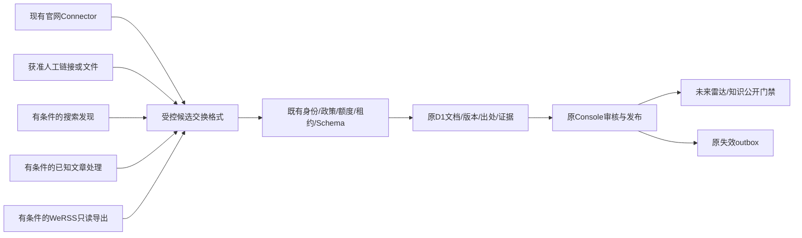

# CampusOS｜公众号与校园信息流水线建议

> 上轮中断草稿，未完成联合研究验收；本轮仅保留工作成果。D-045已废弃Dify路线，所有旧可选接入描述失效。现场与缺项见 [中断清单](s3-wechat/README.md)。

日期：2026-10-17（Asia/Shanghai）。研究基线 `e30a939`；本轮没有应用集成、迁移、发布、采集任务启动或模型调用。推荐不等于已经获得实施授权。

配套：四项目证据与矩阵（尚未交付）、[PoC门槛](S3_WECHAT_POC_PLAN.md)、thu-push适配报告（尚未交付）。

## 1. 当前现场，重新核对而非沿用历史数字

[只读云端快照](../verification/s3-wechat/campus-baseline.json)确认：来源220、启用3、核验3、文档3且全部待审、公开0、任务4、历史重复1、错误0；53业务表，0001–0011已应用，外键错误0。当前Worker版本仍为 `21a72753-f951-4b91-9549-1390a2c7e49f`。3个既有政策为metadata_only且有到期时间；**本轮不续期、不启用新源，也不重新导入220条**。

复核 `wrangler.jsonc`、OpenNext配置、Console认证/DAO、`src/domain/console/ingestion.ts`、`src/lib/ingestion/{profiles,connector,safe-fetch}.ts` 与迁移。静态页面外壳、私有API no-store、服务端身份/CSRF、D1原子命令、120秒租约/fence、检查点、全站20网络预留/UTC日与10任务/日继续沿用。四个本地项目包只读，不复制到public或Worker。

S3-0中“拟新增”与S3-B实际差异按D-044解释：文档时间/内容修订、origins/fetches、事件候选/证据、辅助主题现已落库；不是再建这些表。事件精度扩展、公开雷达、有限地点投影及检索消费仍待后续阶段。旧Dify UI仅为历史证据，路线已废弃。旧的cron/Queues/向量方案不视为已开通。

## 2. 三方案排序

| 方案 | 可靠性与合规前提 | 维护/成本 | 扩展及演示价值 | 排序 |
| --- | --- | --- | --- | --- |
| C 混合、官网主干 | 官网已有3篇真实元数据链路；微信按渠道许可和可用性独立开关；任一工具失败不阻断主干 | 初期官网手动runner+人工链接，不新增服务器/模型；各微信分支后续单独预算 | 当前最能展示真实来源→审核→未来雷达；扩展无需换底座 | 1 |
| A 搜索优先 | 搜索结果只是线索，不能证明指定账号完整历史或认证主体；PR9未合并且robots门槛未解除 | 无常驻服务也可研究，但真链/日期/阻断需修复和实测；不能无人值守定期跑 | 仅作补漏，不足以承诺稳定增量 | 2，条件候选 |
| B WeRSS订阅优先 | 授权/当前登录正文故障/真实新增未验证；辅助导入有触发同步副作用 | 需独立持续运行载体、凭据维护、任务监控；免费软件不等于免费运维 | 权限和七层实测通过后才有长期订阅价值 | 3，暂不正式集成 |

“C优先”当前仅启动其**官网+获准人工资料**部分，不代表四项目全接。不能用搜索页面空数组宣称没有通知，或用WeRSS服务能启动宣称增量已恢复。相同名称不作为账号认证过滤器；链接长期性需定期复验，不保证永久有效。

## 3. 适配边界：只设计，未增加运行依赖



| 建议适配器 | discover / fetch / parse | normalize / validate | checkpoint / report |
| --- | --- | --- | --- |
| WeixinSearchDiscoveryAdapter | 已批准关键词+分页得到线索；只接真实微信URL，未解真链单列失败；不自动取全文 | 搜索发布者、日期均待核；绝不从结果自动认证或批准来源 | 页游标、已提交线索、规则/政策版本；blocked与真正空结果分开 |
| KnownArticleImportAdapter | 管理员提交有许可URL/公开合集；合集逐项记录来源；不推断全账号历史 | 拒绝模板正文、today回填和失效页；提取完整性单独判定；许可不足仅元数据 | 有界文件/URL批次与单项hash，失败不覆盖旧正文 |
| WeRSSSubscriptionAdapter | 只读取经批准账号的有界API/导出；严格路由白名单，禁调用同步/订阅写入/任务run | 校验publisher映射、schema、时间、正文状态；不相信上游approved、official或权限字段 | 以更新时间+稳定ID复合游标及重叠窗口去重，不只max日期；区分无新增/抓取失败/凭据过期 |
| ManualArticleImportAdapter | 复用现有Console原文链接/手动内容入口；人工提供内容仍需用途授权 | 明确人工输入来源；未知时间/微信号NULL，不补造URL；同一审批链 | 既有commandId/版本/CAS与审计；没有新增通用抓取API |

这些职责对齐冻结SourceConnector七方法。当前正式实现只支持5个官网profile，不能把新增微信URL直接塞进其allowlist；后续应增加独立profile/交换验证、保留现有官网安全检查，而不是放宽它。

### 3.1 交换格式草案（仅研究，不是已上线API）

```ts
type ArticleExchangeV1 = {
  schemaVersion: "campusos-article-exchange/1";
  batchId: string; itemId: string; adapterVersion: string;
  sourceId: string; // 必须与可信任务scope一致
  identityEvidenceRef: string; // 服务端已核验映射的引用，不是上游认证声明
  canonicalUrl: string;
  originalUrl: string; discoveryUrl: string | null;
  upstreamArticleId: string | null; upstreamPublisherId: string | null;
  title: string; publisher: string | null;
  publishedAt: string | null; publishedRaw: string | null;
  sourceUpdatedAt: string | null; observedAt: string;
  text: string | null; textStatus: "not_requested" | "complete" | "partial" | "unavailable";
  hash: string | null;
  rightsEvidenceRef: string;
  outcome: "ok" | "no_new" | "blocked" | "auth_required" | "parse_error" | "unavailable";
};
```

这是外部候选数据，不能直接写D1。所有字段严格Schema、长度/批量上限、URL及日期验证，服务端另行构建ApprovedSourceContext，剥离未知/权限字段；哈希由可信归一化过程重算。上游不提供CampusOS的adminId、approved、timeVerified、SQL或MapAction。上传时间不当原发布时间；observedAt仅线索观察，实际fetched_at由可信接收流程按真正获取语义处理。无正文不使用合成默认正文作为完整提取证据。

### 3.2 稳定身份、去重、权利与失效

1. **账号映射**：现有source_id不变，channel_type分订阅号/服务号。名称/微信号/__biz/fakeid仅不同类型标识，保存带namespace的证据映射；不凭名称或可逆编码认定认证主体。广外图书馆原目录属于服务号线索，微信号未知时不编造。跨工具同账号须管理员核验归属再关联，不重导目录或自动合并不同载体。
2. **文章身份**：验证后的`__biz + mid + idx`等完整元组可作微信文章候选稳定键；sn保留原文链接用途，不作为删除其他身份字段的理由。短链缺元组时保留完整经审核规范URL/原跳转证据，不能去掉所有query导致文章合并；未解析真链不进正式正文库。当前`document_origins UNIQUE(source_id,canonical_url)`继续使用，未来增加标识映射需评审增量迁移，不隐含已经实现。
3. **同文异源**：同URL/hash无新修订；内容输入变更生成content_revision/input_hash与原console_content_versions快照并回待审。多搜索结果/栏目作为document_origins，获取观察进document_fetches；跨URL同hash仅可疑重复关联，不跨来源继承版权/批准。不按标题合并跨年活动。
4. **四时间**：published_at原文证据；fetched_at实际获取；source_updated_at原文明确改动证据；updated_at系统记录修改。ETag/Last-Modified只作条件观察，不自动生成文章更新时间。上游字段名publish_time/create_time/update_time先按固定版本代码语义核对。
5. **版权与公开**：源码许可证不等于微信平台自动化许可或文章版权许可。rights_scope来自现有政策/证据，缺全文许可不存全文/图片、不送外部RAG；元数据/自有短摘要也要当前审核。上游摘要不能直接标为CampusOS已核验。
6. **撤回与取消**：停止来源/原文撤回/正文变动必须经既有命令、版本、审核和content_index_invalidations；公共读取用当前D1 gate重新检查。上游删除消息本身需核验，不无条件删除本地其他来源版本。未来事件取消/改期更新关联事件及日历版本，不只隐藏卡片。
7. **幂等与故障**：复用任务run_key、commandId+真实actor+payload指纹、lease/fence与步统计；重复导入不新发布或扣模型额度。BLOCKED/AUTH_REQUIRED/PARSE_ERROR不能转换为no_new；检查点只在原子成功提交后推进。403/429/验证码/登录或明确限制即暂停，不通过换Cookie、账号池、代理出口绕行。

### 3.3 不共享上游写库

WeRSS本地SQLite只能在其运维允许下使用只读快照/经审计GET接口导出有限公开文章。GET名称不保证无副作用，`message_tasks/{id}/run`触发同步，必须禁止。禁止挂载原库到Worker、复制其users/session表、共用管理员Cookie或让Python直接写D1。传输仅HTTPS/受控本地文件，不开放预览网到内网任意URL抓取；外部常驻服务若未来需要，另行提出认证/网络/成本方案。

## 4. 按价值与风险的实施清单（待批准）

| 顺序 | 阶段 | 最小任务 | 验收门槛 |
| --- | --- | --- | --- |
| 1 | S3-B小补充 | 现有人工导入说明、元数据交换校验、来源身份/权利证据、错误分型 | 不新增来源库；重复导入无重复，权限/许可不继承；无微信访问也可运行 |
| 2 | S3-C | 7类真实已发布内容流、原文跳转、来源/校区筛选和时间排序 | 当前0发布先真实审核；拒绝/撤回即时不再公开；无内容真实空态 |
| 3 | S3-C | 精度/证据明确的时间DTO与审核表单；匿名ICS | 绝对/相对/缺年/未知及注入测试，禁止截止当开始；有时间核验才导出 |
| 4 | S3-C | 即将举办/截止排序及简单显式学科/来源偏好 | 可回到全量时间排序；重要公告可见；不需模型或私人画像 |
| 5 | S3-D/E | D1受控检索、现有Agent只读引用，outbox与当前版本复验 | 不因外部命中或原文指令扩权；自研D1检索，Dify已废弃 |
| 6 | 独立研究 | Search修复与许可、BlogDistiller作者书面授权、WeRSS七层试验 | 当前暂停，不以未合并PR/上游历史报告当验收 |
| 7 | S4/S5 | 本人收藏/日程确认写入、可撤销偏好/反馈、限权个人化 | 真实学生身份、隐私和写入确认；运营身份不读学生聊天/GPS |
| 8 | 比赛后 | 常驻订阅载体、SMTP推送、复杂推荐、多账号规模化 | 新预算、平台/账号授权、退订反滥用、运维与长期增量证据 |

雷达分类严格为讲座、文体活动、竞赛、升学就业、学术科研、奖助机会、校园公告；知识分类仍6类，映射读取[固定契约](../contracts/s3-taxonomy.v1.json)，thu上游标签不直接成为正式枚举。

## 5. 费用、CPU及十项明确选择

本轮只读D1查询消耗现有少量免费读额度；0模型调用、0SMTP、0新服务/套餐/服务器、无部署。无新增模型或基础设施费用操作；不是整个账户账单为0的证明。官网解析/微信Python/Docker/模型批处理继续在受控本地，不能把cron、waitUntil当CPU豁免。官方当前[Workers限制](https://developers.cloudflare.com/workers/platform/limits/)与[D1价格](https://developers.cloudflare.com/d1/platform/pricing/)不能代替本项目真实容量测量；既有S3-B混合负载CPU P95 16.752ms历史风险未解除，本轮不重开专项或声称优化。

1. 足够试点证据：**现有官网、人工获准资料**；thu的有界排序/去重思想可作为后续独立TS实现候选，四个上游整体均未获正式集成结论。
2. 仅本地研究：Search MCP、WeRSS、thu的授权导入工具链；研究不使用原包静态Cookie。
3. 暂缓：BlogDistiller公开服务用途许可与模板回填问题；Search真链/错误/时间；WeRSS登录/正文及真实增量。
4. 保留WeRSS长期候选，但不设为当前必需依赖，需另行通过七层验证及授权。
5. thu值得移植：证据明确的时间抽取思路（需重写语义）、有界可解释排序/重复抑制、规范ICS（需重写安全与更新）；不照搬邮件、CDP、默认时间推断。
6. 无新服务器可以完成初版：手动本地runner+现有D1/Console+静态公共界面/有限查询；不能宣称全天候公众号增量。
7. 微信全部失败时，官网+人工导入仍能支撑**真实审核后的**比赛演示；当前3待审不能假装已公开，也不填模拟文章。
8. S3-B仅补有限导入/错误契约与许可核验，不再扩多源批采。
9. S3-C优先真实分类流、证据时间、日历与简单排序，地图只使用已核验大学城引用；不改地图/Agent架构。
10. 个人反馈/日程放S4/S5；常驻采集、邮件和规模化放比赛后。开始这些实施前等待负责人确认。

本轮完成即停，四适配器和公开雷达/ICS均为设计，未对预览网站增加功能。
